# Operational Scope & Boundary Definition

## Document Metadata
- **Document ID**: `SRK-DOC-01-003`
- **Version**: `1.0.0`
- **Status**: `VERIFIED`
- **Owner**: `SURAKSHA Product & Engineering Team`
- **Created Date**: `2026-11-21`
- **Last Updated**: `2026-11-21`
- **Last Verified Against Commit**: `HEAD`
- **Applicable Module**: `SURAKSHA-MOD-01-FLOOD`
- **Related Documents**: `[Project Charter](project-charter.md)`, `[System Master Spec](/docs/04_SYSTEM_ARCHITECTURE/system-master-specification.md)`

---

## 1. Single Source of Operational Truth
The authoritative operational scope of the SURAKSHA repository is **SURAKSHA-MOD-01-FLOOD**, specifically anchored on the **Ganges River Basin at Patna (Digha – Gandhi Ghat – Danapur corridor, Bihar, India)**.

```mermaid
flowchart LR
    subgraph IN_SCOPE ["Active Production Scope (Module 01)"]
        direction TB
        S1["Ganges at Patna Corridor<br/>(Gandhi Ghat: 023-MDGANG)"]
        S2["Riverine & Urban Inundation Forecasting"]
        S3["Sentinel-1 SAR C-Band Radar Extent"]
        S4["Himalayan Headwater Cryosphere Ingestion<br/>(Gangotri, Kedarnath, Alaknanda, Kosi)"]
        S5["Patna Ward Infrastructure Exposure<br/>(Roads, Hospitals, Substations)"]
    end

    subgraph FUTURE_SCOPE ["Planned Future Extensions (Post-v1.0)"]
        direction TB
        F1["Brahmaputra Basin (Guwahati)"]
        F2["Mahanadi Basin (Cuttack)"]
        F3["Godavari & Krishna Basins"]
        F4["Cyclone Module (MOD-02)"]
        F5["Earthquake Module (MOD-03)"]
    end

    IN_SCOPE -.->|Modular Expansion| FUTURE_SCOPE
```

---

## 2. Operational Lifecycle Demarcation

| Disaster Lifecycle Stage | In-Scope Operational Capabilities | Excluded Out-of-Scope Capabilities |
| :--- | :--- | :--- |
| **Pre-Event (Preparedness)** | • Telemetry QA & regime classification • 24h–72h multi-horizon stage forecasts • Cryosphere snowline and meltwater tracking • Early evacuation corridor planning | • Long-range seasonal monsoon forecasting (>14 days) • Climate change decadal projection models |
| **During-Event (Response)** | • Live Sentinel-1 SAR flood extent extraction • Jev committee spread adjudication • Critical infrastructure breach analysis • Automated OASIS CAP v1.2 draft XML generation | • Automated drone fleet control / robotics • Direct citizen 911 dispatch telephony |
| **Post-Event (Recovery)** | • Submerged road and hospital isolation reporting • Displaced population estimation • Commander SITREP decision briefings | • Long-term economic reconstruction insurance settlements • Structural post-earthquake masonry inspection |

---

## 3. Explicitly Excluded Hazard Domains
To maintain rigorous scientific focus and prevent architecture dilution, the following hazard domains are **strictly excluded** from the current implementation:
* Standalone Tsunami modeling (marine seismology).
* Standalone Tropical Cyclone landfall/wind-field forecasting (MOD-02 Cyclone remains an isolated future module).
* Earthquake geotechnical liquefaction modeling (MOD-03 Earthquake remains an isolated future module).
* Wildfire / Forest Fire tracking.

---

## 4. Geographic & Hydrological Boundary Coordinates
* **Primary Corridor**: Patna Urban Agglomeration & Riparian Floodplain, Bihar, India.
* **Bounding Box**: $[85.10^\circ\text{E}, 25.58^\circ\text{N}, 85.25^\circ\text{E}, 25.68^\circ\text{N}]$
* **Key Station**: Gandhi Ghat, Patna (`CWC Station: 023-MDGANG`)
  * Warning Level: $47.60\text{ m}$ MSL
  * Danger Level: $48.60\text{ m}$ MSL
  * Highest Flood Level (HFL): $50.52\text{ m}$ MSL (Recorded: 2016)

