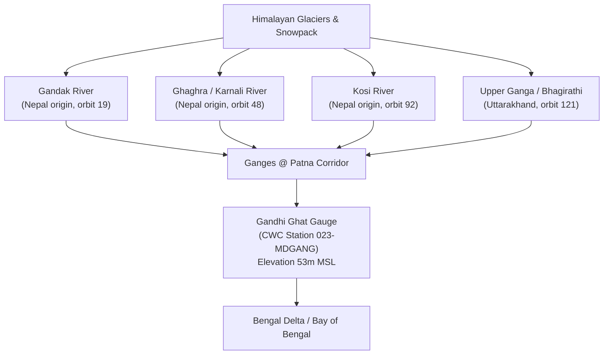
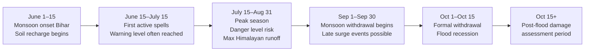
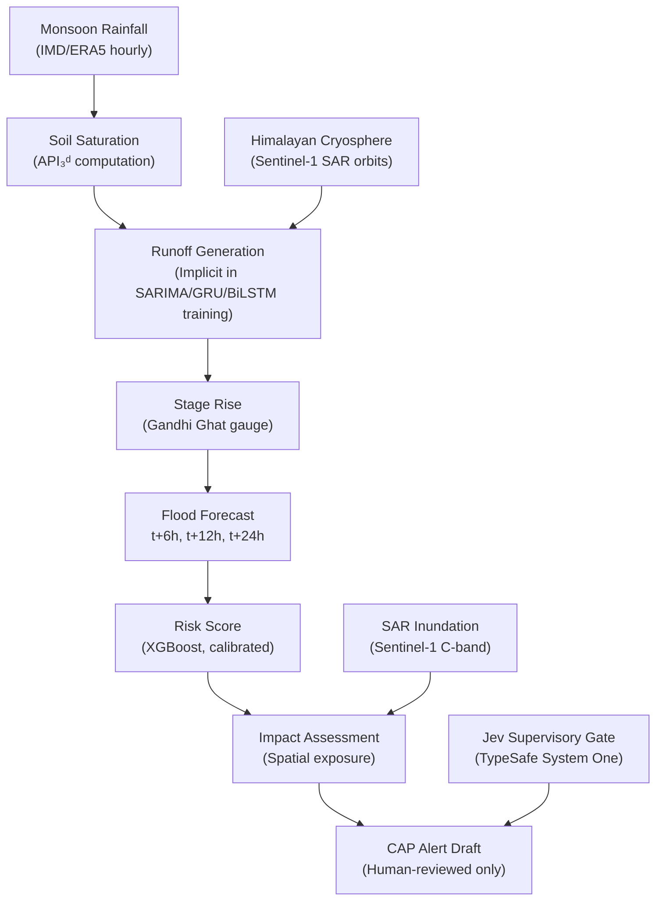

# Flood Science Overview: Monsoon, Rivers, and Bihar's Vulnerability

**Document ID:** DOC-03-001  
**Category:** 03 — Domain and Flood Knowledge  
**Status:** VERIFIED  
**Last Updated:** 2026-11-21  
**Maintainer:** SURAKSHA Science Team

---

## Table of Contents

1. [The Indian Monsoon System](#1-the-indian-monsoon-system)
2. [From Rainfall to Runoff: The Hydrological Cycle](#2-from-rainfall-to-runoff-the-hydrological-cycle)
3. [How Rivers Fill and Overflow](#3-how-rivers-fill-and-overflow)
4. [Riverine vs. Urban Flooding](#4-riverine-vs-urban-flooding)
5. [Bihar and Patna: Structural Vulnerability](#5-bihar-and-patna-structural-vulnerability)
6. [The Annual Flood Season: June–October](#6-the-annual-flood-season-juneoctober)
7. [Gandhi Ghat and the Ganges Corridor](#7-gandhi-ghat-and-the-ganges-corridor)
8. [Embankment Failure Dynamics](#8-embankment-failure-dynamics)
9. [Compound Events and Cascading Hazards](#9-compound-events-and-cascading-hazards)
10. [How SURAKSHA Uses This Science](#10-how-suraksha-uses-this-science)

---

## 1. The Indian Monsoon System

### 1.1 Origin and Mechanics

The South Asian Monsoon — formally the Indian Summer Monsoon (ISM) — is a planetary-scale atmospheric circulation reversal driven by the differential heating of the Asian landmass relative to the Indian Ocean. Beginning in late May/early June, the low pressure zone over the Thar Desert and the Indo-Gangetic Plain draws in moisture-laden winds from the Bay of Bengal and the Arabian Sea.

The Bay of Bengal Branch is the primary driver of Bihar's flood season. It tracks northward along the east coast of India, entering the Gangetic Delta by mid-June, and reaching the Bihar plains by the third week of June in a typical year.

**Key monsoon parameters monitored by SURAKSHA:**

| Parameter | Source | Update Frequency |
|-----------|--------|------------------|
| Gridded Rainfall (0.25° × 0.25°) | IMD ERA5-Land | Hourly |
| 24-hour Cumulative Precipitation (mm) | `rainfall_24h_mm` field | Per pipeline cycle |
| Antecedent Precipitation Index (API₃ᵈ) | Computed in Data Agent | Per pipeline cycle |
| Soil Moisture (0–7 cm) | ERA5-Land | Hourly |

### 1.2 Interannual Variability

Monsoon intensity varies significantly year-to-year, driven by:

- **El Niño / La Niña (ENSO):** El Niño phases suppress ISM rainfall; La Niña phases amplify it. The 2024 season that generated SURAKSHA's training dataset was a La Niña–neutral transition year.
- **Indian Ocean Dipole (IOD):** Positive IOD phases (warm western Indian Ocean) tend to increase Bihar rainfall.
- **Madden-Julian Oscillation (MJO):** 30–60 day intraseasonal pulses modulate active/break cycles within the monsoon season.

### 1.3 Active and Break Periods

The monsoon is not a continuous rain event. It alternates between:

- **Active spells** (5–10 days): Widespread, sustained heavy rainfall. These are the primary flood-generating events in Bihar.
- **Break periods** (5–15 days): Diminished rainfall over the plains; heating resumes.

SURAKSHA's RAPID_RISE regime is typically triggered during active spell transitions when antecedent soil saturation from prior spells leaves no infiltration capacity.

---

## 2. From Rainfall to Runoff: The Hydrological Cycle

### 2.1 Rainfall Partitioning

When monsoon rain falls on the Bihar watershed, precipitation P (mm) is partitioned into four components:

```
P = ET + ΔS + I + Q_surface
```

Where:
- **ET** = Evapotranspiration (minimal during active monsoon)
- **ΔS** = Change in soil moisture storage
- **I** = Infiltration to groundwater (severely limited when soil is saturated)
- **Q_surface** = Surface runoff → enters rivers

### 2.2 Soil Saturation and the Runoff Coefficient

The runoff coefficient C determines what fraction of rainfall becomes runoff:

```
Q_surface = C × P × A
```

Where A is catchment area (km²). C varies dramatically with antecedent soil moisture:

| Soil Condition | Runoff Coefficient (C) | Typical API₃ᵈ |
|---------------|------------------------|---------------|
| Dry (early monsoon) | 0.10–0.30 | < 20 mm |
| Moist (mid-monsoon) | 0.40–0.65 | 20–60 mm |
| Saturated (late monsoon) | 0.70–0.90 | > 60 mm |
| Fully saturated + rainfall > intensity | 0.95–1.00 | > 100 mm |

**SURAKSHA computes the 3-day Antecedent Precipitation Index** (API₃ᵈ) in the Data Agent as:

```
API₃ᵈ = Σₜ₌₀³ (0.85ᵗ × Rₜ)
```

Where Rₜ is rainfall at t days prior (mm) and 0.85 is the daily soil moisture recession factor. This index is a leading predictor of flood risk in SURAKSHA's XGBoost risk model.

### 2.3 Hortonian vs. Saturation Excess Runoff

Two runoff mechanisms are relevant to Bihar flooding:

**Hortonian (Infiltration Excess):** Rainfall intensity exceeds soil infiltration rate. Common in impervious urban surfaces (Patna city center). Relatively rare in Gangetic alluvium.

**Saturation Excess:** Soil moisture reaches field capacity; subsequent rainfall cannot infiltrate and entirely converts to runoff. This is the dominant mechanism in Bihar agricultural plains during the monsoon active phase. SURAKSHA's `soil_saturation` field (0–1 scale) tracks proximity to field capacity.

---

## 3. How Rivers Fill and Overflow

### 3.1 The Drainage Basin Hierarchy

Bihar sits at the lower end of the Ganges basin — one of the world's largest river systems. The key subcatchments that drain into the Bihar plains segment of the Ganges:



### 3.2 Stage–Discharge Relationship

River stage h(t) (water surface elevation in metres MSL at the gauge) is related to discharge Q(t) (m³/s) through the **rating curve**:

```
Q = a × (h - h₀)^b
```

Where:
- h = current stage (m MSL)
- h₀ = zero-flow stage (gauge datum intercept)
- a = coefficient (site-specific, calibrated by CWC)
- b = exponent (typically 1.5–2.5 for Gangetic rivers)

At **Gandhi Ghat**, CWC official CWC thresholds define the operational regime:
- Warning Level: **47.60 m MSL**
- Danger Level: **48.60 m MSL**
- Highest Flood Level (HFL): **50.52 m MSL** (recorded 2016)

### 3.3 Flood Wave Propagation

A rainfall event in the upper catchment generates a flood wave that propagates downstream at the kinematic wave speed (1.0–1.5 × mean flow velocity). For the Ganges system:

- Himalayan snowmelt signal (Gangotri area) → Patna arrival: **72–96 hours**
- Gandak tributary surge (Nepal) → Patna confluence: **24–48 hours**
- Kosi surge (Nepal) → Patna effect: **36–60 hours**

This propagation delay is what allows SURAKSHA to generate 24-hour advance forecasts at Gandhi Ghat from upstream signals detected by Sentinel-1 SAR in the Himalayan orbit corridors.

### 3.4 Channel Geometry and Floodplain Activation

The Ganges near Patna has a compound channel cross-section:
- **Low-flow channel:** ~300–500m wide, deeply incised
- **Main channel:** ~1–2km wide at bankfull discharge
- **Floodplain:** 10–30km wide alluvial plain; activated when stage exceeds bankfull (~47.5m MSL)

As stage rises from 47.60m (Warning) toward 48.60m (Danger), water progressively inundates the floodplain. Above 48.60m, low-lying areas of Patna — including Rajendra Nagar (elevation ~52m), Kankarbagh, and Gulabi Bagh colonies — are threatened.

---

## 4. Riverine vs. Urban Flooding

### 4.1 Riverine Flooding (Primary SURAKSHA Focus)

**Definition:** Fluvial overflow where river discharge exceeds channel capacity, causing lateral inundation of adjacent floodplains.

**Drivers:**
- Excessive upstream runoff from monsoon rainfall
- Himalayan glacial melt (spring/early monsoon amplifier)
- Backwater effects from tributary confluences
- Embankment overtopping or breach

**SURAKSHA coverage:** Full — Gandhi Ghat stage monitoring, multi-model forecasting, SAR inundation extraction, risk and impact assessment.

**Spatial scale:** 10s to 100s of km² of inundated area over days to weeks.

### 4.2 Urban (Pluvial) Flooding

**Definition:** Flooding caused by stormwater drainage systems being overwhelmed by intense local rainfall, independent of river levels.

**Drivers:**
- Short-duration, high-intensity rainfall (> 50mm/hr)
- Inadequate drainage infrastructure
- Impervious surface coverage (asphalt, concrete)
- Blocked drains and solid waste accumulation

**SURAKSHA coverage:** Partial — Patna's urban drainage failure during extreme rainfall is tracked via the EXTREME_RAINFALL data regime. No explicit urban drainage hydraulic model is currently implemented.

**Key distinction:** Urban flooding can occur even when Gandhi Ghat stage is **below** Warning Level, if localized convective rainfall overwhelms the city's stormwater network. This is a known limitation of SURAKSHA's current scope.

### 4.3 Interaction Effects

The most dangerous scenarios involve **compound flooding**: simultaneous riverine stage rise + extreme local rainfall + saturated soils. This traps stormwater with nowhere to drain and raises groundwater tables to the surface. SURAKSHA's `COMPOUND_SURGE` data regime captures these conditions.

---

## 5. Bihar and Patna: Structural Vulnerability

### 5.1 Geographic Setting

Patna occupies a peninsula formed by the confluence of four rivers:
- **Ganges** (north/west) — major Himalayan perennial river
- **Son** (southwest) — peninsular tributary, red-soil watershed
- **Punpun** (south) — Bihar plains river, flashier regime
- **Gandak** confluence (northwest, ~60km)

**Elevation:** Patna city center lies at approximately 53m MSL — only 4.4m above the 2016 Highest Flood Level. Many periurban colonies are at 51–52m MSL.

**Population:** ~2.5 million in Patna Metropolitan Area. The floodplain settlements targeted by SURAKSHA impact models include an estimated 800,000+ in direct flood risk zones.

### 5.2 Embankment Geography

Bihar's rivers are extensively embanked — earthen levees constructed to contain monsoon flows. These embankments were largely built 1950s–1970s and have several structural vulnerabilities:

- **Piping:** Subsurface seepage creates internal erosion channels
- **Overtopping:** Extreme events exceeding embankment design capacity
- **Rodent damage:** Agricultural pest activity weakens embankment bases
- **Inadequate maintenance:** Underfunded Bihar Water Resources Department

The embankment system has a paradoxical effect: by constraining the river to its channel, it increases peak stage heights and velocities (less lateral dissipation), and when failure occurs, the breach releases water catastrophically rather than gradually.

### 5.3 Geological Amplifiers

**Alluvial geology:** The Bihar plains consist of deep Holocene alluvial deposits with high liquefaction potential. During severe floods, water-saturated alluvium loses structural integrity.

**Subsidence:** Parts of Patna are experiencing slow subsidence (1–3mm/year) due to groundwater extraction, gradually reducing freeboard above flood thresholds.

**Channel avulsion history:** The Kosi River has historically migrated up to 120km westward over centuries, reshaping the Bihar landscape. While not an acute risk in the SURAKSHA monitoring window, it represents the geological context of Bihar's flood vulnerability.

### 5.4 Infrastructure Exposure (SURAKSHA Impact Model)

SURAKSHA tracks the following infrastructure categories within flood polygons:

| Asset Type | SURAKSHA Field | Data Source |
|-----------|---------------|-------------|
| Hospitals | `hospitals_exposed` | OpenStreetMap |
| Power Substations | `substations_exposed` | OpenStreetMap |
| Schools/Shelters | `schools_exposed` | OpenStreetMap |
| Road Segments | Flood polygon overlay | OpenStreetMap |
| Designated Shelters | `designated_shelters` | NDMA/IndoFloods |

---

## 6. The Annual Flood Season: June–October

### 6.1 Seasonal Timeline



### 6.2 Driver Timeline by Month

| Month | Primary Driver | Secondary Driver | Typical Patna Stage |
|-------|---------------|-----------------|---------------------|
| June | Onset rainfall | Himalayan snowmelt | 44–47 m MSL |
| July | Heavy monsoon | Glacial melt peak | 46–49 m MSL |
| August | Active spells | Nepal watershed runoff | 47–50+ m MSL |
| September | Lingering monsoon | Receding Himalayan input | 46–48 m MSL |
| October | Withdrawal | Recession flow | 44–46 m MSL |

### 6.3 Return Periods

Historical analysis of Gandhi Ghat flood records:

| Stage Threshold | Return Period (years) | CWC Category |
|----------------|----------------------|--------------|
| 47.60 m MSL | ~1–2 years | Warning |
| 48.60 m MSL | ~5–8 years | Danger |
| 49.50 m MSL | ~15–20 years | Severe |
| 50.52 m MSL (HFL) | ~50+ years (2016) | Catastrophic |

> [!IMPORTANT]
> These return periods are based on historical observation records and do not account for non-stationary climate change effects. SURAKSHA's models are trained on 2024 ERA5+GloFAS data and require periodic recalibration as the climate baseline shifts.

---

## 7. Gandhi Ghat and the Ganges Corridor

### 7.1 Gauge Station

Gandhi Ghat (Mahatma Gandhi Setu area, Patna) hosts the Central Water Commission (CWC) monitoring station:

- **Station Code:** 023-MDGANG
- **River:** Ganges (Ganga)
- **Location:** 25.6177°N, 85.1476°E
- **Elevation datum:** Mean Sea Level (MSL), Kolkata Port Trust datum
- **Measurement:** Staff gauge + ultrasonic level sensor
- **Reporting:** Hourly, transmitted to CWC NWDP portal

### 7.2 SURAKSHA Integration

SURAKSHA ingests Gandhi Ghat stage data via the NWDP CSV ingestor. The `NWDP_LEVEL_DATUM=MSL` environment variable confirms that readings are already in MSL units — no datum offset conversion required. The `water_level_m` field in `FloodState.current_condition` stores the gauge reading.

### 7.3 Stage-to-Danger Ratio

SURAKSHA computes a normalized stage-to-danger ratio for alert classification:

```
stage_to_danger_ratio = (current_stage - warning_level) / (danger_level - warning_level)
```

Where:
- `warning_level` = 47.60 m MSL
- `danger_level` = 48.60 m MSL (1.0 m band)

| Ratio Range | Interpretation | SURAKSHA Severity |
|------------|---------------|-------------------|
| < 0.0 | Below warning | NORMAL |
| 0.0–0.5 | Warning zone (lower) | ELEVATED |
| 0.5–1.0 | Warning zone (upper) | HIGH |
| 1.0–1.5 | Danger zone | SEVERE |
| > 1.5 | Above HFL zone | EXTREME |

---

## 8. Embankment Failure Dynamics

### 8.1 Breach Mechanics

Embankment breaches follow a progressive failure sequence:

1. **Seepage initiation:** Rising river head drives water through embankment body
2. **Piping:** Seepage channels enlarge as fine sediments are transported
3. **Heave/blowout:** Downstream-side boils indicate severe internal erosion
4. **Breach initiation:** Embankment crest is compromised at weakest point
5. **Breach enlargement:** Scour rapidly widens the opening (minutes to hours)
6. **Outflow flood:** Uncontrolled discharge into hinterland; often >5× normal overbank flow rate

### 8.2 SURAKSHA's Breach Advisory

> [!WARNING]
> SURAKSHA does **not** implement a mechanistic embankment breach model. The platform's breach risk advisories are probabilistic statements based on stage thresholds, historical breach statistics, and XGBoost risk scores — **not** structural engineering assessments of specific embankment sections.
>
> Model-estimated breach probabilities do NOT constitute officially declared flood emergencies. Only authorized Bihar State Disaster Management Authority (BSDMA) or Central Water Commission officers may declare embankment failure emergencies.

---

## 9. Compound Events and Cascading Hazards

### 9.1 Types of Compound Events

SURAKSHA recognizes three compound event categories:

**Type A: Rainfall + Himalayan Melt (Synchronized)**
- Both rainfall-driven runoff AND glacial melt runoff peak simultaneously
- Historically caused the most severe floods (e.g., 2013 Uttarakhand, 2017 Bihar)
- SURAKSHA regime: `COMPOUND_SURGE`

**Type B: Multiple Tributary Surges (Phased)**
- Gandak, Son, and Kosi tributaries all surge within days of each other
- Backwater effects cause Ganges stage to remain elevated longer
- SURAKSHA regime: `RAPID_RISE` with high API₃ᵈ

**Type C: Rainfall + Embankment Failure (Cascading)**
- Precipitation-driven stage rise triggers embankment failure
- Hinterland flooding adds to total affected population
- Not fully modeled in SURAKSHA v1; planned for future development

### 9.2 GLOF Precursor Events

Glacial Lake Outburst Floods (GLOFs) represent a high-consequence, lower-probability tail risk. SURAKSHA monitors the upstream cryosphere for GLOF precursors:

- Anomalous wet-snow SAR backscatter decrease (Nagler algorithm, >3 dB threshold)
- Sudden discharge spike in Gandak/Ghaghra without commensurate rainfall
- Regional seismic events near proglacial lakes (not currently integrated)

SURAKSHA regime: `GLOF_PRECURSOR` — triggers immediate `ESCALATE_TO_HUMAN` supervisor action.

---

## 10. How SURAKSHA Uses This Science

### 10.1 Scientific Chain of Custody



### 10.2 Scientific Assumptions and Limitations

| Assumption | Consequence if Wrong |
|-----------|---------------------|
| ERA5 reanalysis accurately represents historical Bihar rainfall | Model training is biased; forecasts may underestimate extremes |
| Rating curve is stationary (no channel morphology change) | Stage-discharge conversion errors |
| Embankments remain intact below Danger Level | Actual flooding can occur at lower stages |
| 72–96 hr Himalayan signal travel time | May be shorter during extreme GLOF events |
| Gandhi Ghat gauge is representative of Patna flood exposure | Backwater effects from Son/Punpun confluences may cause local flooding at lower Ganges stages |

---

*This document describes the scientific domain knowledge embedded in SURAKSHA. For mathematical foundations see [hydrological-fundamentals.md](/docs?doc=03-flood-science-and-domain-knowledge--hydrological-fundamentals). For CWC threshold details see [flood-thresholds.md](/docs?doc=03-flood-science-and-domain-knowledge--flood-thresholds). For cryosphere dynamics see [glacial-melt-and-runoff.md](/docs?doc=03-flood-science-and-domain-knowledge--glacial-melt-and-runoff).*
