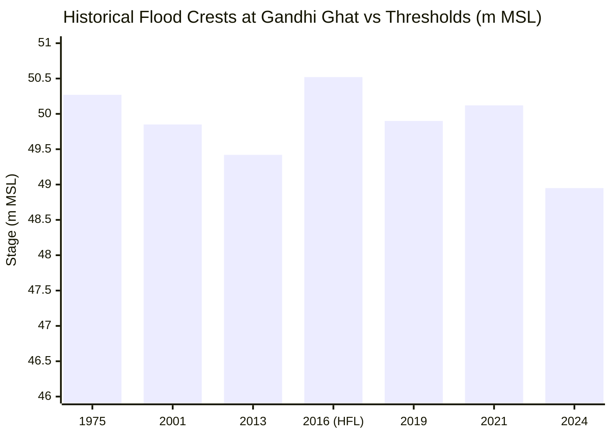

# Hydrological Flood Thresholds & Hydraulic Geometry: Patna

| Field | Value |
|---|---|
| **Document ID** | DOM-03-004 |
| **Version** | 1.0.0 |
| **Status** | VERIFIED |
| **Operational Station** | Gandhi Ghat, Patna (`023-MDGANG`) |

---

## 1. Official CWC Threshold Hierarchy

The Central Water Commission (CWC) establishes three standardized vertical reference stages for the Gandhi Ghat gauge in meters above Mean Sea Level (MSL):

| Threshold Stage | Elevation (m MSL) | Hydraulic Condition | Civil Defense Action Required |
|---|---|---|---|
| **Bed Level** | 42.00 m | Minimum riverbed elevation | Low-flow navigation monitoring |
| **Zero Level (Gauge Datum)** | 40.00 m | Reference survey bench mark | Station calibration baseline |
| **Warning Level (WL)** | **47.60 m** | Bankfull stage; active channel filled | Issue Yellow Advisory; activate round-the-clock gauge watch |
| **Danger Level (DL)** | **48.60 m** | Embankment toe submerged; spill into low-lying diara islands | Issue Orange Warning; mobilize NDRF/SDRF rescue teams |
| **Highest Flood Level (HFL)** | **50.52 m** | Historic record crest (Aug 27, 2016) | Issue Red Emergency; mandatory evacuation of municipal wards |

---

## 2. Historical Major Flood Crests at Gandhi Ghat

### 2.1 The 2016 Benchmark Flood
In August 2016, compound discharge from the Yamuna, Sone, and Gandak tributaries met an already swollen Ganga mainstem, pushing the stage to **50.52m MSL** (+1.92m above Danger Level). More than 3.5 million citizens across Bihar were displaced.
