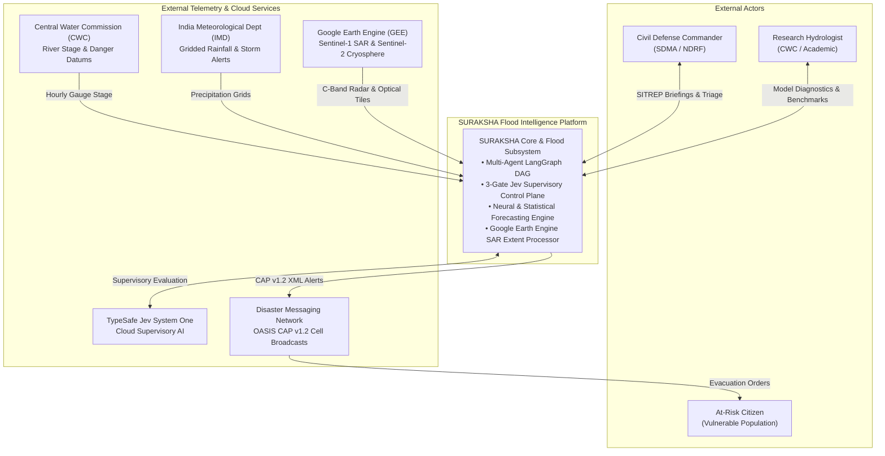
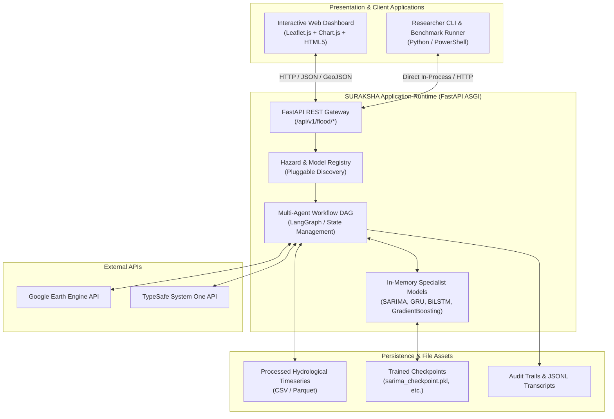
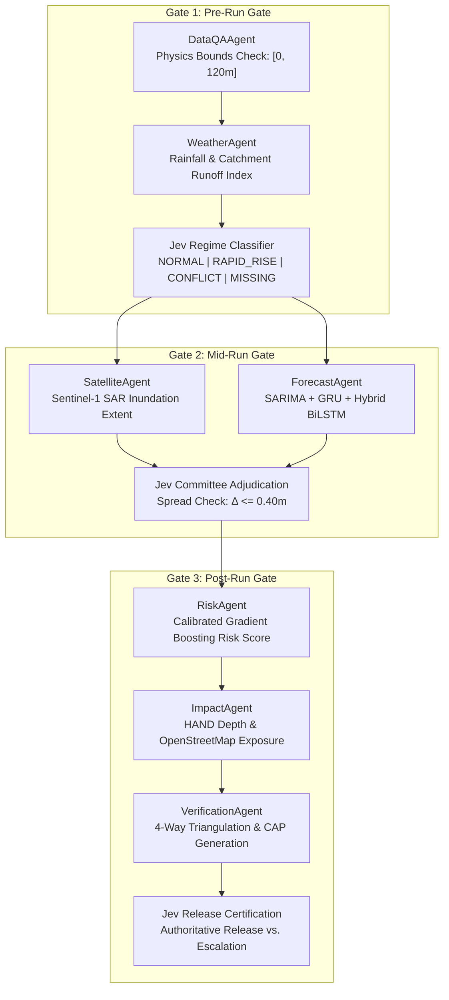

# System Architecture Overview: SURAKSHA Platform

## Document Metadata
- **Document ID**: `SRK-DOC-04-001`
- **Version**: `1.0.0`
- **Status**: `VERIFIED`
- **Owner**: `SURAKSHA Core Architecture Team`
- **Created Date**: `2026-11-21`
- **Last Updated**: `2026-11-21`
- **Last Verified Against Commit**: `HEAD`
- **Applicable Module**: `Platform Core & All Hazard Subsystems`
- **Related Documents**: `[Master Knowledge Map](/docs?doc=01-getting-started--suraksha-knowledge-map)`, `[ADR-001](/docs?doc=04-system-architecture--adr-001-modular-monolith)`, `[ADR-002](/docs?doc=04-system-architecture--adr-002-three-gate-supervisor)`

---

## 1. Architectural Philosophy: The Two-Tier System

SURAKSHA enforces a clean two-tier architectural separation:

```text
src/suraksha/
│
├── core/                                # PLATFORM CORE (Zero disaster-specific logic)
│   ├── contracts/                       # Base schemas: BaseHazardState, SeverityLevel, CoordinatePoint
│   ├── intelligence/                    # TypeSafe Jev System One client, question prompts, and offline mocks
│   ├── geospatial/                      # EarthEngineClient, CRS projections, spatial bounding boxes
│   ├── registry/                        # HazardRegistry (Pluggable subsystem discovery)
│   └── alerting/                        # Common Alerting Protocol (CAP v1.2) XML generators
│
└── disasters/                           # DISASTER SUBSYSTEM PLUGINS
    ├── flood/                           # MODULE 01 (Active Reference Implementation: Patna, Bihar)
    ├── cyclone/                         # MODULE 02 (Planned Future Extension)
    ├── earthquake/                      # MODULE 03 (Planned Future Extension)
    └── ...
```

### Strict Architectural Boundaries
1. **Core Zero-Dependency Rule**: `suraksha.core` must **never** import from `suraksha.disasters.*`. The core provides generic abstractions, shared geospatial clients, alerting engines, and base contracts.
2. **Subsystem Independence**: Disaster plugins never import from each other directly. Shared tools exist exclusively in `suraksha.core`.
3. **Pluggable Registration**: Every disaster plugin registers itself dynamically at import time with `HazardRegistry.register()`.

---

## 2. C4 Architecture Models

### Level 1: System Context Diagram (C1)



---

### Level 2: Container Architecture Diagram (C2)



---

### Level 3: Component Architecture (Flood Subsystem C3)

The 7-Agent DAG execution is organized into three supervisory gates:



---

## 3. The Scientific Value Governance Invariant

1. **Calculations are Specialist-Owned**: Hydrological, meteorological, statistical, and neural models strictly and exclusively own all numerical outputs (predicted stage, river discharge, inundated acreage, damage probabilities).
2. **Supervisory Boundary**: **TypeSafe Jev System One** acts as a supervisory decision layer across explicit lifecycle gates. Jev is strictly **forbidden** from modifying, overriding, interpolating, or fabricating numerical predictions.
3. **Bounded Decision Set**: All supervisory verdicts emitted by Jev deterministically map to one of five actions:
   * `CONTINUE`: Telemetry and claims are verified; proceed along workflow.
   * `HOLD_AND_RETRY`: Transient anomaly detected; retry agent (maximum 1 retry per agent).
   * `RUN_CHALLENGER_MODEL`: Model divergence detected; summon alternative model from whitelist.
   * `USE_APPROVED_FALLBACK`: Corrupt or missing telemetry; switch to approved fallback model.
   * `ESCALATE_TO_HUMAN`: Critical cross-agent contradiction; flag for civil defense officer review.

