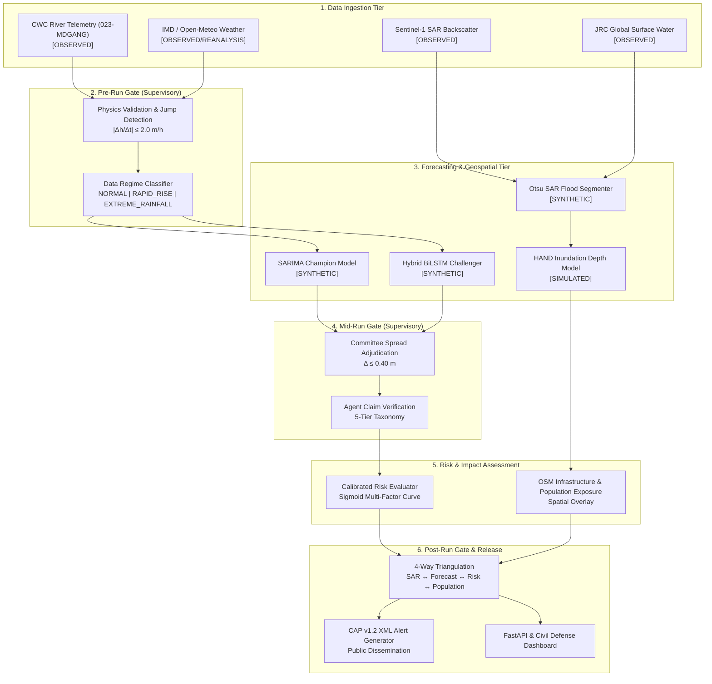

# SURAKSHA Data Lineage & Provenance Architecture

| Field | Value |
|---|---|
| **Document ID** | DLN-05-003 |
| **Version** | 1.0.0 |
| **Status** | VERIFIED |
| **Module** | SURAKSHA-MOD-01-FLOOD |

---

## 1. End-to-End Data Flow

The SURAKSHA data architecture guarantees strict traceability from raw ingestion to public alert dissemination. Every data point is tagged with its provenance classification (`OBSERVED`, `REANALYSIS`, `SYNTHETIC`, or `SIMULATED`).

---

## 2. Provenance Transformation Rules

1. **Raw Telemetry**: Ingested directly from CWC NWDP (`OBSERVED`) or Open-Meteo reanalysis (`REANALYSIS`).
2. **Quality Scrubbing**: Data Agent removes non-physical negative stages ($<0.0$ m) and fills transient gaps ($<3$ hours) using cubic splines, logging imputed points with confidence penalties ($\Delta C = -0.05$).
3. **Forecasting**: Statistical and neural models produce 24-hour forward projections (`SYNTHETIC`). Predictions must be accompanied by 90% confidence intervals.
4. **Geospatial Processing**: Raw SAR backscatter (dB) is converted to water probability raster using Lee filter and Otsu thresholding. Subtraction of JRC permanent water produces net flood extent.
5. **Alert Release**: Alerts are generated only when verified by the Post-Run Gate (`is_authoritative = True`). Unverified alerts are held for human civil defense escalation.
