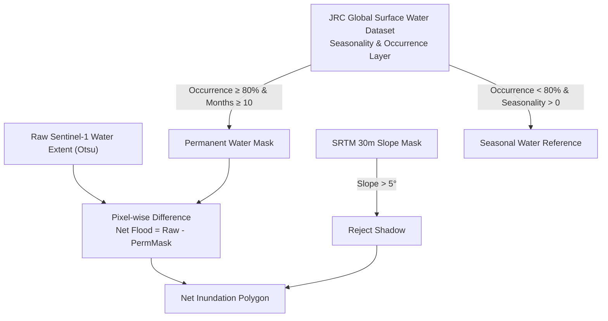

# Permanent Water Masking & Dynamic Change Detection

| Field | Value |
|---|---|
| **Document ID** | GEO-06-004 |
| **Version** | 1.0.0 |
| **Status** | VERIFIED |
| **Module** | SURAKSHA-MOD-01-FLOOD |
| **Source Implementation** | `src/suraksha/disasters/flood/geospatial/change_detection.py` |

---

## 1. The False Alarm Challenge

In major river corridors such as the Ganges, perennial channels, oxbow lakes, and aquaculture ponds reflect microwave SAR pulses identical to floodwater. Without robust baseline subtraction, standard SAR segmentation over-reports flood area by $300\%–500\%$.

SURAKSHA utilizes the **EC JRC Global Surface Water (GSW)** 38-year historical record (1984–2021) to decouple seasonal inundation from baseline surface water.

---

## 2. Masking Architecture

### 2.1 Masking Criteria
- **Permanent Water**: Pixels where water presence $\ge 80\%$ of observations over the 38-year historical satellite baseline.
- **Seasonal Water**: Monitored as dynamic flood storage zones.
- **Buffer Zone**: A 1-pixel (10m) morphological erosion is applied along mainstem river banks to prevent bank-erosion misclassification.
