# Sentinel-1 SAR Flood Inundation Processing

| Field | Value |
|---|---|
| **Document ID** | GEO-06-001 |
| **Version** | 1.0.0 |
| **Status** | VERIFIED |
| **Module** | SURAKSHA-MOD-01-FLOOD |
| **Source Implementation** | `src/suraksha/disasters/flood/geospatial/s1_sar_processor.py` |

---

## 1. Sensor Overview & Physical Principles

Synthetic Aperture Radar (SAR) on board the Copernicus Sentinel-1 constellation operates at C-band (5.405 GHz). Unlike optical sensors (e.g. Sentinel-2, Landsat), SAR microwave pulses penetrate dense monsoon cloud cover and operate independently of solar illumination.

### 1.1 Radar Backscatter Mechanism
Smooth, standing water surfaces act as specular reflectors for incoming radar microwave radiation. The signal bounces away from the sensor, resulting in extremely low radar backscatter:
$$\sigma^0_{\text{water}} \approx -24\text{ dB to }-16\text{ dB}$$
In contrast, rough bare soil, vegetation, and urban infrastructure generate diffuse scattering or double-bounce returns:
$$\sigma^0_{\text{land}} \approx -14\text{ dB to }-6\text{ dB}$$

---

## 2. Processing Pipeline

The SURAKSHA `Sentinel1SARProcessor` implements a 7-step automated processing pipeline:

```mermaid
flowchart LR
    S1[Sentinel-1 GRD<br/>IW / VV Polarization] --> Orbit[Apply Precise<br/>Orbit Vectors]
    Orbit --> Calib[Radiometric<br/>Calibration σ⁰]
    Calib --> Terrain[Terrain Correction<br/>SRTM 30m]
    Terrain --> Lee[Lee Speckle Filter<br/>7x7 Window]
    Lee --> Otsu[Otsu Automated<br/>Thresholding]
    Otsu --> PermMask[Subtract JRC<br/>Permanent Water]
    PermMask --> SlopeMask[Mask Slopes > 5°<br/>SRTM DEM]
    SlopeMask --> NetFlood[Net Flooded<br/>Acreage Polygon]
```

### 2.1 Speckle Noise Reduction (Refined Lee Filter)
Raw SAR images contain multiplicative speckle noise caused by coherent interference. We apply a $7\times 7$ Refined Lee filter:
$$\hat{I} = \bar{I} + W \cdot (I - \bar{I})$$
where the weighting coefficient $W$ is derived from local variance:
$$W = \frac{\sigma^2_I - \bar{I}^2 / N}{\sigma^2_I}$$

### 2.2 Otsu Bimodal Thresholding
The processor dynamically computes the optimal bimodal threshold $\tau^*$ separating water and non-water pixels in the VV backscatter histogram by maximizing inter-class variance:
$$\sigma^2_B(\tau) = \omega_0(\tau)\omega_1(\tau)[\mu_0(\tau) - \mu_1(\tau)]^2$$
Typical thresholds for the Patna Ganga corridor range between $-17.5\text{ dB}$ and $-16.0\text{ dB}$.

### 2.3 Permanent Water Subtraction & Slope Masking
1. **Permanent Water**: Extracted from JRC Global Surface Water (water occurrence $\ge 80\%$).
2. **Terrain Masking**: Inundation cannot stand on steep slopes. Pixels with SRTM slope $> 5^\circ$ are rejected to eliminate radar shadow false positives.

---

## 3. Offline Calibrated Fallback Mode

When Google Earth Engine (GEE) authentication is unavailable or internet connectivity is disrupted:
- The system activates `OfflineFallbackSAR`.
- Utilizes calibrated historical flood polygon benchmarks for Patna (2016, 2019, 2021) stored as local GeoJSON assets.
- Scales the inundation extent linearly based on observed gauge height at Gandhi Ghat:
$$A_{\text{inundated}}(h) = A_{\text{base}} \cdot \max\left(0, \frac{h - h_{\text{warning}}}{h_{\text{HFL}} - h_{\text{warning}}}\right)^{1.35}$$
