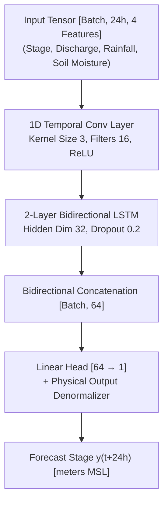

# Model Card: Hybrid BiLSTM + 1D CNN Challenger

| Field | Value |
|---|---|
| **Model ID** | `HYBRID_BILSTM_CNN` |
| **Framework** | PyTorch 2.6.0+ |
| **Version** | 1.1.0 |
| **Status** | PRODUCTION CHALLENGER |
| **Source Implementation** | `src/suraksha/disasters/flood/models/forecasting/neural.py` |

---

## 1. Model Summary

A deep learning sequence-to-sequence model combining 1D Temporal Convolutional Neural Networks (for extracting local hydrometeorological feature interactions) with a 2-layer Bidirectional Long Short-Term Memory network (for long-term upstream catchment memory).

---

## 2. Architecture Specification

---

## 3. Operational Role

In the **Mid-Run Gate**, this model acts as the primary challenger to SARIMA during `RAPID_RISE` regimes:
- If $|y_{\text{SARIMA}} - y_{\text{BiLSTM}}| \le 0.40\text{ m}$, the ensemble confidence is maximized.
- If spread exceeds $0.40\text{ m}$, the supervisor engages TypeSafe Jev System One for committee adjudication.
