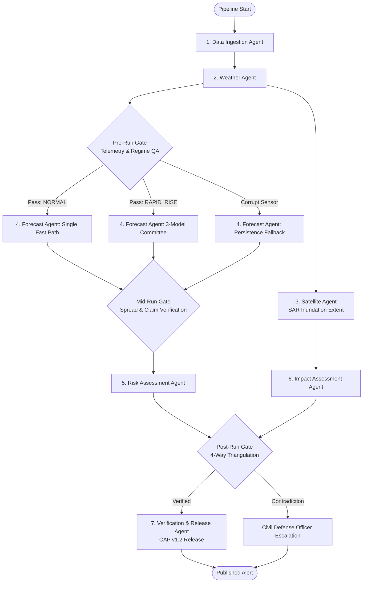

# Agentic Intelligence Architecture: 7-Agent Topology

| Field | Value |
|---|---|
| **Document ID** | AGT-08-001 |
| **Version** | 1.0.0 |
| **Status** | VERIFIED |
| **Module** | SURAKSHA-MOD-01-FLOOD |
| **Orchestration Framework** | LangGraph / StateGraph |

---

## 1. Topological Architecture

SURAKSHA abandons brittle monolithic pipelines in favor of an **Agentic Specialist DAG** supervised by three lifecycle decision gates:

---

## 2. Dual Execution Modes

1. **Supervised Mode (`supervised`)**: The default production execution mode. The 3 gates dynamically evaluate data quality, summon model committees, adjust confidence intervals, and mandate human review upon sensor contradiction.
2. **Static Mode (`static`)**: A non-branching, deterministic baseline that executes all agents sequentially without supervisory intervention. Used for empirical research benchmarks and regression testing.
