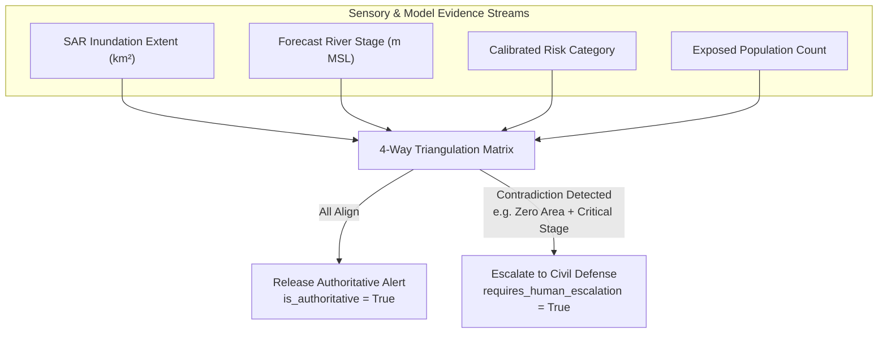

# 5-Tier Claim Verification Taxonomy

| Field | Value |
|---|---|
| **Document ID** | JEV-08-004 |
| **Version** | 1.0.0 |
| **Status** | VERIFIED |
| **Module** | SURAKSHA-MOD-01-FLOOD |
| **Source Implementation** | `src/suraksha/disasters/flood/supervisor/post_run_gate.py` |

---

## 1. The Verification Taxonomy

When intermediate agents generate state claims (e.g. "Forecast indicates danger level exceedance within 18 hours"), the supervisory layer classifies support against sensory evidence using a formal 5-tier taxonomy:

| Tier | Label | Meaning | Pipeline Consequence |
|---|---|---|---|
| 1 | `SUPPORTED` | Claim strictly aligns with physical observations and cross-agent evidence | Release proceeds with 100% confidence |
| 2 | `CONDITIONALLY_SUPPORTED` | Minor evidence gap or telemetry latency; physically plausible | Pipeline proceeds with confidence discount ($\Delta C = -0.10$) |
| 3 | `UNSUPPORTED` | Claim contradicts physical telemetry or exceeds physical rate bounds | Triggers retry or fallback model |
| 4 | `CONFLICTING` | Two or more specialist agents generate mutually exclusive claims | Triggers committee adjudication or human escalation |
| 5 | `INSUFFICIENT_EVIDENCE` | Telemetry missing, satellite obscured, or sensor off-line | Halts automatic warning; requests human verification |

---

## 2. 4-Way Cross-Agent Triangulation Algorithm

In the **Post-Run Gate**, the supervisor executes 4-way triangulation:
$$\text{Consensus} = \text{Triangulate}(\text{Stage}_{\text{forecast}}, \text{Area}_{\text{SAR}}, \text{Risk}_{\text{score}}, \text{Pop}_{\text{impact}})$$

