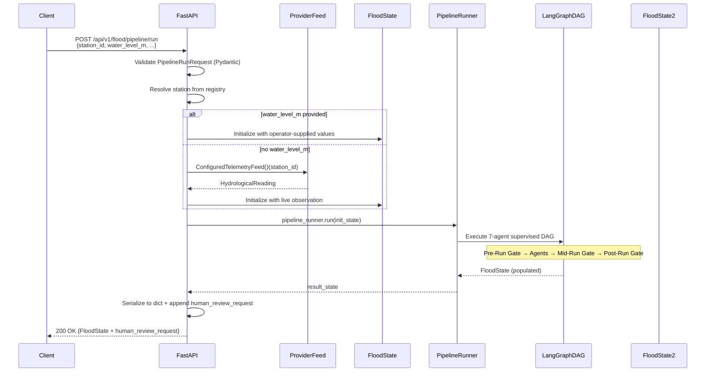
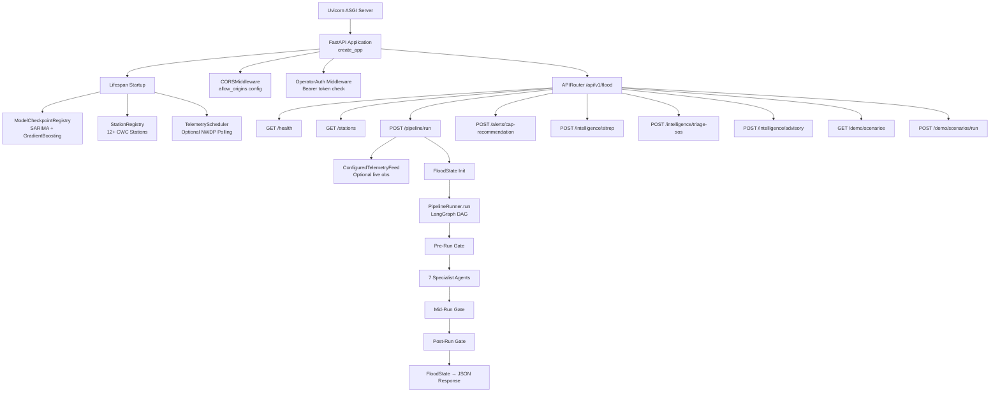

# Backend Architecture — SURAKSHA Flood FastAPI Gateway

> **Status:** VERIFIED — matches [`/src/suraksha/disasters/flood/api/app.py`](https://github.com/shouri123/SURAKSHA/tree/main/src/suraksha/disasters/flood/api/app.py) and [`/src/suraksha/disasters/flood/api/routes.py`](https://github.com/shouri123/SURAKSHA/tree/main/src/suraksha/disasters/flood/api/routes.py)

---

## Table of Contents

1. [Overview](#overview)
2. [Application Entry Point](#application-entry-point)
3. [Lifespan Context Manager](#lifespan-context-manager)
4. [Application Factory Pattern](#application-factory-pattern)
5. [CORS Middleware](#cors-middleware)
6. [Operator Authentication Middleware](#operator-authentication-middleware)
7. [Routing Structure](#routing-structure)
8. [Async vs Sync Endpoints](#async-vs-sync-endpoints)
9. [Error Handling Patterns](#error-handling-patterns)
10. [Pipeline Invocation via REST](#pipeline-invocation-via-rest)
11. [In-Process Testing with Starlette TestClient](#in-process-testing-with-starlette-testclient)
12. [Architecture Diagram](#architecture-diagram)

---

## Overview

SURAKSHA's flood REST service is a **FastAPI ASGI application** that exposes the full 7-agent supervised pipeline over HTTP. The gateway is designed around three principles:

- **Zero runtime fitting** — all ML model checkpoints are pre-loaded at startup
- **Production hardening** — CORS, authentication, and production environment checks are enforced at boot
- **Offline-first** — TypeSafe Jev and external search corroboration both run in deterministic offline mode when network credentials are absent

The application is served by [**Uvicorn**](https://www.uvicorn.org/) (ASGI), enabling async I/O on the server event loop while keeping scientific pipeline execution in synchronous Python.

---

## Application Entry Point

**File:** [`/src/suraksha/disasters/flood/api/app.py`](https://github.com/shouri123/SURAKSHA/tree/main/src/suraksha/disasters/flood/api/app.py)

```python
# Application entry point for Uvicorn
app = create_app()
```

The module-level `app` object is the Uvicorn target:

```bash
# Development
uvicorn suraksha.disasters.flood.api.app:app --reload --host 0.0.0.0 --port 8000

# Production (with gunicorn process manager)
gunicorn suraksha.disasters.flood.api.app:app \
  -w 1 -k uvicorn.workers.UvicornWorker \
  -b 0.0.0.0:8000
```

> [!IMPORTANT]
> Use a single Uvicorn worker (`-w 1`). The model registry singleton and the in-memory demo review store are **not** process-safe across multiple forked workers.

The application auto-loads `.env` via `python-dotenv` on import when available:

```python
try:
    from dotenv import load_dotenv
    load_dotenv()
except ImportError:
    pass
```

Deployed environments should inject configuration through their secret manager rather than a `.env` file.

---

## Lifespan Context Manager

The `lifespan` async context manager executes pre-flight tasks before the first request is accepted:

```python
@asynccontextmanager
async def lifespan(app: FastAPI):
    """Startup & Shutdown lifecycle hook."""
    # 1. Load CWC Station Catalog into memory
    print(f"[*] Pre-loading CWC Station Catalog ({len(default_station_registry.list_stations())} stations)...")

    # 2. Pre-load Production Forecaster (SARIMA or Hybrid BiLSTM)
    forecaster = default_registry.get_production_forecaster()
    print(f"[*] Pre-loaded Production Forecaster: {forecaster.model_name}")

    # 3. Pre-load Calibrated Risk Model (GradientBoosting)
    risk_model = default_registry.get_production_risk_model()
    print(f"[*] Pre-loaded Risk Model: {risk_model.engine_name}")

    # 4. Conditionally start telemetry polling (opt-in)
    if os.getenv("TELEMETRY_POLLING_ENABLED") in {"1", "true", "yes"}:
        # Starts background CWC/IMD polling scheduler
        default_scheduler.start_polling(feed=ConfiguredTelemetryFeed())

    yield  # Application serves requests here

    # Shutdown: stop polling
    if telemetry_enabled:
        default_scheduler.stop_polling()
```

### Pre-loaded Components

| Component | Loaded From | Purpose |
|-----------|------------|---------|
| `default_registry.get_production_forecaster()` | `ModelCheckpointRegistry` | SARIMA or Hybrid BiLSTM — zero-fitting inference |
| `default_registry.get_production_risk_model()` | `ModelCheckpointRegistry` | GradientBoosting risk calibration |
| `default_station_registry` | `StationRegistry` | 12+ CWC gauge stations with datum/thresholds |
| `default_scheduler` | `TelemetryScheduler` | Background polling (opt-in via env) |

The lifespan pattern guarantees that the first `/api/v1/flood/pipeline/run` request will not trigger any model fitting or station catalog I/O.

---

## Application Factory Pattern

SURAKSHA uses the **application factory** pattern (`create_app()`) rather than a module-level global, which enables:

- Testing with `TestClient` using per-test environment overrides
- Production environment validation at boot (raises `RuntimeError` on misconfiguration)
- Swappable middleware stacks per environment

```python
def create_app() -> FastAPI:
    app = FastAPI(
        title="SURAKSHA Flood Subsystem API",
        version="0.1.0",
        description="Operational civil protection & multi-agent early warning API ...",
        lifespan=lifespan
    )
    # ... middleware and routers attached here
    return app

app = create_app()  # module-level singleton for Uvicorn
```

### Production Boot Guards

When `ENVIRONMENT=production`, `create_app()` enforces:

| Guard | Condition | Error |
|-------|-----------|-------|
| CORS origins | Must be explicit; wildcard `*` forbidden | `RuntimeError` |
| Operator API Key | Must be ≥ 32 characters | `RuntimeError` |
| CAP sender identity | `CAP_SENDER` and `CAP_CONTACT` must be set and non-example | `RuntimeError` |

These guards prevent silent misconfiguration in production deployments.

---

## CORS Middleware

SURAKSHA configures `CORSMiddleware` from Starlette for cross-origin access by civil defense dashboards:

```python
app.add_middleware(
    CORSMiddleware,
    allow_origins=configured_origins,  # from CORS_ALLOWED_ORIGINS env var
    allow_credentials=False,
    allow_methods=["*"],
    allow_headers=["*"],
)
```

### Environment Behaviour

| Environment | Origins | Behaviour |
|-------------|---------|-----------|
| `development` (default) | `http://localhost:3000, http://127.0.0.1:3000` | Permissive development defaults |
| `production` | Explicit list from `CORS_ALLOWED_ORIGINS` | Wildcard `*` raises `RuntimeError` at boot |

Configure via `.env`:
```bash
CORS_ALLOWED_ORIGINS=https://dashboard.suraksha.gov.in,https://app.suraksha.gov.in
```

---

## Operator Authentication Middleware

All write operations (`POST`, `PUT`, `PATCH`, `DELETE`) against `/api/v1/flood/` require a bearer token when `SURAKSHA_OPERATOR_API_KEY` is configured:

```python
@app.middleware("http")
async def protect_operator_endpoints(request, call_next):
    is_operator_write = (
        request.method in {"POST", "PUT", "PATCH", "DELETE"}
        and request.url.path.startswith("/api/v1/flood/")
    )
    if is_operator_write:
        expected_key = os.getenv("SURAKSHA_OPERATOR_API_KEY", "")
        if expected_key:
            supplied = request.headers.get("authorization", "")
            bearer = supplied[7:].strip() if supplied.lower().startswith("bearer ") else ""
            if not secrets.compare_digest(bearer, expected_key):
                return JSONResponse(status_code=401, content={"detail": "..."})
    return await call_next(request)
```

Key design decisions:
- Uses `secrets.compare_digest()` to prevent timing-based credential inference
- In development (no key set), write endpoints are open — suitable for local testing
- In production, key must be ≥ 32 characters or the app fails at boot

---

## Routing Structure

**File:** [`/src/suraksha/disasters/flood/api/routes.py`](https://github.com/shouri123/SURAKSHA/tree/main/src/suraksha/disasters/flood/api/routes.py)

All flood endpoints are mounted under a single `APIRouter`:

```python
router = APIRouter(prefix="/api/v1/flood", tags=["Flood Subsystem"])
```

The router is registered in the app factory:

```python
app.include_router(flood_router)
```

### Complete Route Map

```
GET  /                                          → Root identity
GET  /docs                                      → Swagger UI (FastAPI built-in)
GET  /redoc                                     → ReDoc (FastAPI built-in)
GET  /demo                                      → Interactive demo dashboard (HTML)

GET  /api/v1/flood/health                       → Operational readiness + model status
GET  /api/v1/flood/stations                     → Station catalog (filterable)
GET  /api/v1/flood/stations/{station_id}        → Single station metadata
GET  /api/v1/flood/stations/{id}/modelled-discharge → GloFAS 7-day discharge outlook

POST /api/v1/flood/pipeline/run                 → Full 7-agent supervised pipeline
POST /api/v1/flood/alerts/cap-recommendation    → CAP v1.2 alert generation (JSON/XML)
POST /api/v1/flood/intelligence/sitrep          → Jev SITREP narrative
POST /api/v1/flood/intelligence/triage-sos      → Citizen SOS triage
POST /api/v1/flood/intelligence/advisory        → Persona-targeted public advisory

GET  /api/v1/flood/demo/scenarios               → List synthetic test scenarios
POST /api/v1/flood/demo/scenarios/{id}/run      → Run named synthetic scenario
GET  /api/v1/flood/demo/reviews                 → List in-memory review queue
POST /api/v1/flood/demo/reviews/{id}/decision   → Accept/reject demo review
```

### Pipeline Runner Singleton

The pipeline runner is instantiated once at module load:

```python
# routes.py — module-level singleton
pipeline_runner = build_flood_graph()
```

This ensures the LangGraph DAG compilation cost is paid once at startup, not per-request.

---

## Async vs Sync Endpoints

FastAPI supports both async and sync route functions. SURAKSHA uses **synchronous** endpoints for the scientific pipeline:

```python
# Synchronous — scientific pipeline is CPU-bound numpy/statsmodels computation
@router.post("/pipeline/run")
def run_scientific_pipeline(req: PipelineRunRequest) -> Dict[str, Any]:
    result_state = pipeline_runner.run(init_state)  # LangGraph DAG
    return result_state.model_dump()
```

> [!NOTE]
> FastAPI automatically runs synchronous route functions in a thread pool executor, preventing them from blocking the ASGI event loop. This is the correct pattern for CPU-bound scientific code.

Async endpoints are only used where native async I/O would apply (e.g., future streaming telemetry). The current implementation is fully synchronous.

---

## Error Handling Patterns

SURAKSHA uses FastAPI's `HTTPException` for structured error responses. Errors follow consistent patterns:

### Standard Error Responses

```python
# 404 — Resource not found
raise HTTPException(
    status_code=404,
    detail=f"CWC Station '{station_id}' not found in catalog."
)

# 503 — Upstream provider unavailable (production mode)
raise HTTPException(
    status_code=503,
    detail=f"No valid fresh observation available for station '{req.station_id}': {type(exc).__name__}."
)

# 502 — External API gateway error
raise HTTPException(
    status_code=502,
    detail=f"Open-Meteo Flood API is unavailable ({type(exc).__name__})."
)

# 401 — Authentication failure
return JSONResponse(
    status_code=401,
    content={"detail": "A valid operator bearer token is required."}
)

# 422 — Validation error (FastAPI automatic, also raised manually)
raise HTTPException(
    status_code=422,
    detail=f"Invalid synthetic FloodState input ({type(exc).__name__})."
)
```

### Development vs Production Fallback

In development mode, provider failures fall back to synthetic baseline observations:

```python
except Exception as exc:
    is_prod = os.getenv("SURAKSHA_ENV", "").lower() == "production"
    if is_prod:
        raise HTTPException(status_code=503, detail=...)
    # Development: synthetic baseline
    water_level = station.warning_level_m + 0.40
    observation_source = "DEVELOPMENT_BASELINE"
```

This prevents development environment disruption from missing CWC data files while ensuring production never silently serves synthetic data.

### Upstream URL Sanitization

External API error messages are sanitized before returning to clients:

```python
except Exception as exc:
    # Avoid returning upstream URLs (can contain paid API keys)
    raise HTTPException(
        status_code=502,
        detail=f"Open-Meteo Flood API is unavailable ({type(exc).__name__}).",
    ) from None
```

---

## Pipeline Invocation via REST

The `/api/v1/flood/pipeline/run` endpoint is the primary interface for triggering the multi-agent LangGraph DAG:



### State Initialization

```python
init_state = FloodState(
    station_id=req.station_id,
    district_name=station.district,
    execution_mode=req.execution_mode or "supervised"
)
# Apply observation values
init_state.current_condition.water_level_m = water_level
init_state.current_condition.danger_level_m = station.danger_level_m
init_state.current_condition.warning_level_m = station.warning_level_m
```

### Human Review Request Injection

After pipeline execution, the route inspects the supervisor action history and constructs a `human_review_request` block when `result_state.requires_human_review` is true:

```python
response["human_review_request"] = ({
    "status": "PENDING",
    "decision": None,
    "event_id": result_state.event_id,
    "reasons": review_reasons,
    "assessment": {
        "forecast_t_plus_24_m": result_state.forecast.t_plus_24,
        "severity": result_state.risk_assessment.severity.value,
        ...
    }
} if result_state.requires_human_review else None)
```

---

## In-Process Testing with Starlette TestClient

SURAKSHA's integration tests use FastAPI's `TestClient`, which wraps the ASGI app in a synchronous `requests`-compatible interface without starting a real HTTP server:

```python
# tests/integration/test_flood_api.py
from fastapi.testclient import TestClient
from suraksha.disasters.flood.api.app import app

@pytest.fixture(scope="module")
def client():
    with patch("suraksha.core.intelligence.search_corroborator.SearchCorroborator._query_public_news") as mock_news:
        mock_news.return_value = ["Official CWC flood advisory issued for Patna district."]
        with TestClient(app) as test_client:
            yield test_client
```

Key properties of this testing approach:

| Property | Detail |
|----------|--------|
| **In-process** | No network socket — all HTTP is handled in-memory |
| **Lifespan hooks** | The `with TestClient(app)` context manager executes `lifespan()` startup and shutdown |
| **Module-scoped** | The fixture is `scope="module"` so the app starts once per test file, not per test |
| **Search mock** | Live news search is mocked to avoid network dependency and ensure deterministic test results |
| **Operator auth** | In development mode (no key set), write endpoints are open — no token needed in tests |

---

## Architecture Diagram



---

## Related Documentation

- [`api-reference.md`](/docs?doc=09-backend-and-api--api-reference) — Full endpoint reference with curl examples
- [`environment-configuration.md`](/docs?doc=09-backend-and-api--environment-configuration) — `.env` parameter reference
- [`/docs/08_AGENTIC_INTELLIGENCE/`](/docs/08_AGENTIC_INTELLIGENCE/) — LangGraph DAG and agent architecture
- [`/docs/12_TESTING_AND_VALIDATION/testing-strategy.md`](/docs?doc=12-testing-and-validation--testing-strategy) — Test suite structure
