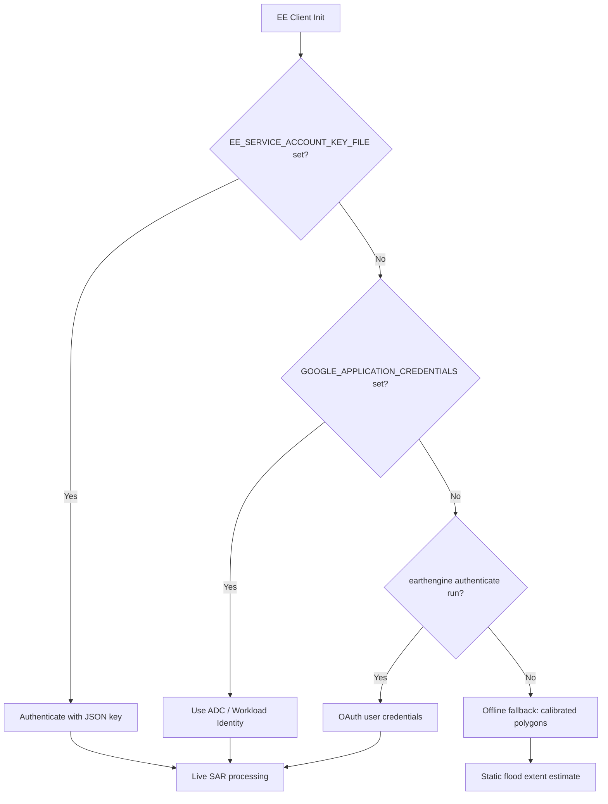

# Environment Configuration Reference

> **Status:** VERIFIED — matches [`/.env.example`](/.env.example)  
> **Cross-reference:** [`/docs/13_DEPLOYMENT_AND_INFRASTRUCTURE/`](/docs/13_DEPLOYMENT_AND_INFRASTRUCTURE/)

This document is the canonical reference for every environment variable understood by the SURAKSHA Flood Intelligence Platform. All configuration is loaded from environment variables; a `.env` file (via `python-dotenv`) may be used for local development only.

> [!CAUTION]
> Never commit secrets to source control. The `secrets/` directory is git-ignored. Service account JSON files must never be committed. See [Security Notes](#security-notes) below.

---

## Table of Contents

1. [Quick Start](#quick-start)
2. [TypeSafe Jev System One](#1-typesafe-jev-system-one)
3. [Google Earth Engine](#2-google-earth-engine)
4. [Application Runtime & API Gateway](#3-application-runtime--api-gateway)
5. [Hydrological Corridor & Station Defaults](#4-hydrological-corridor--station-defaults)
6. [Civil Defense Alerting (OASIS CAP v1.2)](#5-civil-defense-alerting-oasis-cap-v12)
7. [CWC/NWDP & IMD Observation Ingestion](#6-cwcnwdp--imd-observation-ingestion)
8. [Open-Meteo Global Flood API](#7-open-meteo-global-flood-api)
9. [Production Hardening Checklist](#production-hardening-checklist)
10. [Security Notes](#security-notes)
11. [Configuration Validation](#configuration-validation)

---

## Quick Start

```bash
# 1. Copy the template
cp .env.example .env

# 2. Edit the variables relevant to your setup
# (Minimum required for the demo: no variables needed — offline mocks run automatically)

# 3. Start the API
uvicorn suraksha.disasters.flood.api.app:app --reload
```

For a full local run with live CWC data, at minimum configure **Section 6** (NWDP CSV paths and datum).

---

## 1. TypeSafe Jev System One

Governs whether the Jev supervisory AI runs in cloud (live) or offline (deterministic mock) mode.

| Variable | Type | Default | Required |
|----------|------|---------|----------|
| `TYPESAFE_API_KEY` | `str` | — | No (offline fallback active if unset) |
| `TYPESAFE_BASE_URL` | `str` | `https://api.typesafe.ai` | No |

```bash
# .env
TYPESAFE_API_KEY=your_typesafe_api_key_here
TYPESAFE_BASE_URL=https://api.typesafe.ai
```

**Behaviour when unset:**  
If `TYPESAFE_API_KEY` is not set, the `JevIntelligenceEngine` automatically activates high-fidelity **deterministic offline heuristic mocks** for all five gate functions:
- `_mock_data_gate` — Pre-run telemetry validation
- `_mock_committee_adjudication` — Mid-run ensemble spread adjudication
- `_mock_claim_verification` — Mid-run individual claim verification
- `_mock_cross_agent` — Post-run triangulation
- `_mock_sensor_audit` — Sensor anomaly audit

This means the full pipeline runs correctly in offline/air-gapped environments with no Jev API access.

> [!NOTE]
> The TypeSafe API endpoints are `POST /v1/systemone` (inference) and `GET /v1/models` (model listing). The deprecated `/v1/evaluate` endpoint is forbidden.

---

## 2. Google Earth Engine

Controls Sentinel-1 SAR satellite processing via the Google Earth Engine Python API.

| Variable | Type | Default | Required |
|----------|------|---------|----------|
| `EE_PROJECT_ID` | `str` | — | For live SAR processing |
| `EE_SERVICE_ACCOUNT_KEY_FILE` | `path` | — | For service account auth |
| `GOOGLE_APPLICATION_CREDENTIALS` | `path` | — | ADC alternative |

```bash
# .env
EE_PROJECT_ID=your_gcp_project_id
EE_SERVICE_ACCOUNT_KEY_FILE=secrets/suraksha-gee-key.json
# OR use ADC (Application Default Credentials):
GOOGLE_APPLICATION_CREDENTIALS=secrets/suraksha-gee-key.json
```

**Authentication Hierarchy:**



**Offline Behaviour:**  
When EE credentials are absent or unreachable, `Sentinel1SARProcessor` returns a calibrated offline fallback polygon for the Patna-Bihar corridor, ensuring the pipeline always produces an inundation estimate.

> [!CAUTION]
> The service account JSON key file (`EE_SERVICE_ACCOUNT_KEY_FILE`) must NEVER be committed to git. The `secrets/` directory is listed in `.gitignore`. Verify before every commit.

---

## 3. Application Runtime & API Gateway

Controls server binding, environment mode, logging, and security.

| Variable | Type | Default | Required |
|----------|------|---------|----------|
| `ENVIRONMENT` | `str` | `development` | No |
| `API_HOST` | `str` | `0.0.0.0` | No |
| `API_PORT` | `int` | `8000` | No |
| `LOG_LEVEL` | `str` | `INFO` | No |
| `CORS_ALLOWED_ORIGINS` | `str` | `http://localhost:3000,http://127.0.0.1:3000` | Yes in production |
| `SURAKSHA_OPERATOR_API_KEY` | `str` | — | Yes in production |
| `SURAKSHA_ENV` | `str` | — | Used for `demo` endpoint guard |

```bash
# .env
ENVIRONMENT=development          # or "production"
API_HOST=0.0.0.0
API_PORT=8000
LOG_LEVEL=INFO                   # DEBUG, INFO, WARNING, ERROR
CORS_ALLOWED_ORIGINS=http://localhost:3000,http://127.0.0.1:3000
SURAKSHA_OPERATOR_API_KEY=       # Leave empty for local dev (no auth required)
```

### ENVIRONMENT values

| Value | Behaviour |
|-------|-----------|
| `development` | CORS defaults, operator key optional, demo dashboard enabled |
| `production` | Strict CORS required, operator key ≥ 32 chars required, demo dashboard disabled, synthetic fallbacks disabled |

### SURAKSHA_OPERATOR_API_KEY

This key protects all `POST/PUT/PATCH/DELETE` routes under `/api/v1/flood/`. Supply it in requests as:

```
Authorization: Bearer <SURAKSHA_OPERATOR_API_KEY>
```

**Generate a secure key:**
```bash
python -c "import secrets; print(secrets.token_urlsafe(32))"
```

> [!WARNING]
> In production, failing to set this key causes the API to return `503 Service Unavailable` on all write operations.

---

## 4. Hydrological Corridor & Station Defaults

Configures the default CWC station and geographic targeting.

| Variable | Type | Default | Required |
|----------|------|---------|----------|
| `DEFAULT_STATION_ID` | `str` | `GANGES_PATNA` | No |
| `DEFAULT_DISTRICT` | `str` | `Patna` | No |
| `SURAKSHA_PROCESSED_DIR` | `path` | `./data/processed` | No |

```bash
# .env
DEFAULT_STATION_ID=GANGES_PATNA
DEFAULT_DISTRICT=Patna
SURAKSHA_PROCESSED_DIR=./data/processed
```

These defaults affect which station is used in the demo dashboard and the citizen SOS triage endpoint.

---

## 5. Civil Defense Alerting (OASIS CAP v1.2)

Configures the identity fields embedded in generated CAP alert XML.

| Variable | Type | Default | Required |
|----------|------|---------|----------|
| `CAP_SENDER` | `str` | — | Yes in production |
| `CAP_CONTACT` | `str` | — | Yes in production |
| `CAP_DEFAULT_LANGUAGE` | `str` | `en-US` | No |
| `CAP_AREA_RADIUS_KM` | `float` | `5` | No |

```bash
# .env
CAP_SENDER=suraksha-operator@authority.gov.in
CAP_CONTACT=flood-control-room@authority.gov.in
CAP_DEFAULT_LANGUAGE=en-US
CAP_AREA_RADIUS_KM=5
```

> [!IMPORTANT]
> In production mode, `CAP_SENDER` and `CAP_CONTACT` must be set to values that do not contain `@example.invalid`. The API factory raises `RuntimeError` at startup if this condition is not met.
>
> These fields are set only after receiving authorization from the issuing civil defense authority. Unauthorized alert distribution is a legal violation.

**Example generated CAP identifier format:**
```xml
<identifier>IN-SURAKSHA-FLOOD-{event_id}</identifier>
<sender>{CAP_SENDER}</sender>
```

---

## 6. CWC/NWDP & IMD Observation Ingestion

The most critical configuration block for operational use. Controls how live river gauge and rainfall data are ingested.

| Variable | Type | Default | Required |
|----------|------|---------|----------|
| `NWDP_LEVEL_CSV` | `path` | — | Yes for live stage data |
| `NWDP_DISCHARGE_CSV` | `path` | — | No |
| `NWDP_RAINFALL_CSV` | `path` | — | Yes for live rainfall data |
| `NWDP_STATION_ALIASES` | `str` | — | No |
| `NWDP_SOURCE_TIMEZONE` | `str` | `Asia/Kolkata` | No |
| `NWDP_LEVEL_DATUM` | `str` | — | Yes (see below) |
| `NWDP_LEVEL_DATUM_OFFSET_M` | `float` | — | Required if datum is `GAUGE_ZERO_RELATIVE` |
| `IMD_STATION_ID` | `str` | — | For live IMD rainfall |
| `IMD_API_TOKEN` | `str` | — | For live IMD rainfall |
| `IMD_API_AUTH_HEADER` | `str` | `Authorization` | No |
| `IMD_API_AUTH_SCHEME` | `str` | `Bearer` | No |
| `TELEMETRY_POLLING_ENABLED` | `bool` | `false` | No |
| `TELEMETRY_POLL_INTERVAL_SECONDS` | `float` | `3600` | No |

```bash
# .env
NWDP_LEVEL_CSV=/data/cwc/gandhi_ghat_stage_2024.csv
NWDP_RAINFALL_CSV=/data/cwc/gandhi_ghat_rainfall_2024.csv
NWDP_LEVEL_DATUM=MSL
# OR for GAUGE_ZERO_RELATIVE datum:
# NWDP_LEVEL_DATUM=GAUGE_ZERO_RELATIVE
# NWDP_LEVEL_DATUM_OFFSET_M=46.312
NWDP_SOURCE_TIMEZONE=Asia/Kolkata

IMD_STATION_ID=PAT
IMD_API_TOKEN=your_imd_api_token

TELEMETRY_POLLING_ENABLED=false
TELEMETRY_POLL_INTERVAL_SECONDS=3600
```

### Datum Configuration

> [!IMPORTANT]
> `NWDP_LEVEL_DATUM` controls how raw gauge readings are interpreted. Setting this incorrectly can produce physically impossible stage heights, which the data quality framework will flag but cannot correct automatically.

| Datum value | Meaning | Additional required variable |
|-------------|---------|------------------------------|
| `MSL` | Readings are already in meters above mean sea level | None |
| `GAUGE_ZERO_RELATIVE` | Readings are relative to local gauge zero — an MSL offset must be added | `NWDP_LEVEL_DATUM_OFFSET_M` |

**Health endpoint indication:**  
The `/health` endpoint reports `nwdp_level_csv: "configured"` only when the CSV file exists AND the datum is verified. Otherwise it shows `"file_missing"` or `"not_configured_or_datum_unverified"`.

### Telemetry Polling

When `TELEMETRY_POLLING_ENABLED=true`, the `TelemetryScheduler` starts a background thread that:
1. Calls `ConfiguredTelemetryFeed()` every `TELEMETRY_POLL_INTERVAL_SECONDS`
2. Stores the latest reading in memory
3. Reports `last_successful_poll_at` in the health endpoint

> [!WARNING]
> Enable polling only after all file paths, station IDs, and credentials have been individually validated with `python scripts/probe_hydro_providers.py`.

---

## 7. Open-Meteo Global Flood API

Supplemental GloFAS modelled discharge estimates. These are **not** gauge observations and do not enter the SURAKSHA pipeline or alert thresholds.

| Variable | Type | Default | Required |
|----------|------|---------|----------|
| `OPEN_METEO_FLOOD_API_BASE_URL` | `str` | `https://flood-api.open-meteo.com/v1/flood` | No |
| `OPEN_METEO_FLOOD_API_KEY` | `str` | — | No (required for commercial use) |
| `OPEN_METEO_FLOOD_TIMEOUT_SECONDS` | `float` | `15` | No |
| `OPEN_METEO_FLOOD_CACHE_SECONDS` | `int` | `21600` | No |
| `OPEN_METEO_FLOOD_CELL_SELECTION` | `str` | `land` | No |

```bash
# .env
OPEN_METEO_FLOOD_API_BASE_URL=https://flood-api.open-meteo.com/v1/flood
OPEN_METEO_FLOOD_TIMEOUT_SECONDS=15
OPEN_METEO_FLOOD_CACHE_SECONDS=21600   # 6 hours
OPEN_METEO_FLOOD_CELL_SELECTION=land
```

**Health endpoint status values:**

| Status string | Meaning |
|---------------|---------|
| `public_endpoint_non_commercial_terms_apply` | Using default public endpoint |
| `custom_https_endpoint_configured` | Custom endpoint set |
| `invalid_configuration` | Base URL does not start with `https://` |

> [!NOTE]
> The public Open-Meteo Flood API is free for non-commercial research. Commercial deployments must purchase an Open-Meteo subscription and configure a customer endpoint.

---

## Production Hardening Checklist

Before setting `ENVIRONMENT=production`, verify all items:

| # | Item | Variable | Minimum |
|---|------|----------|---------|
| 1 | Operator API key set | `SURAKSHA_OPERATOR_API_KEY` | ≥ 32 characters |
| 2 | Explicit CORS origins | `CORS_ALLOWED_ORIGINS` | No wildcards |
| 3 | CAP sender identity | `CAP_SENDER` | Authorized identity |
| 4 | CAP contact email | `CAP_CONTACT` | Operational mailbox |
| 5 | Level CSV file exists | `NWDP_LEVEL_CSV` | Valid file path |
| 6 | Rainfall source configured | `NWDP_RAINFALL_CSV` or `IMD_API_TOKEN` | Either source |
| 7 | Datum verified | `NWDP_LEVEL_DATUM` | `MSL` or `GAUGE_ZERO_RELATIVE` + offset |
| 8 | Service account key NOT in git | `EE_SERVICE_ACCOUNT_KEY_FILE` | Outside repo |
| 9 | Telemetry validated | `TELEMETRY_POLLING_ENABLED` | After probe script |
| 10 | TypeSafe key set (or offline OK) | `TYPESAFE_API_KEY` | Optional |

---

## Security Notes

### Secrets Directory

A `secrets/` directory at the repository root is git-ignored and intended for local JSON key files:

```
.gitignore entries:
  secrets/
  *.json        (service account files)
  .env          (never commit the actual .env, only .env.example)
```

### Variable Handling

- Load from environment variables only — never hardcode in source code
- In containerized deployments, inject via Docker secrets, Kubernetes Secrets, or cloud secret managers (AWS Secrets Manager, GCP Secret Manager)
- Rotate `SURAKSHA_OPERATOR_API_KEY` regularly and treat it as a production secret

### Timing-Safe Comparison

The operator authentication middleware uses `secrets.compare_digest()` to prevent timing attacks when comparing bearer tokens — a constant-time comparison that does not leak key length through response timing.

---

## Configuration Validation

After editing `.env`, validate the configuration using the probe script:

```bash
# Probe all configured providers for reachability and freshness
python scripts/probe_hydro_providers.py

# Check health endpoint (reflects configuration state)
curl http://localhost:8000/api/v1/flood/health | python -m json.tool
```

The health endpoint `provider_configuration` block maps directly to this configuration file — use it as a live configuration audit tool.

```json
{
  "provider_configuration": {
    "nwdp_level_csv": "configured",
    "rainfall_source": "configured",
    "imd_api": "not_configured",
    "open_meteo_flood_api": "public_endpoint_non_commercial_terms_apply",
    "telemetry_polling": "disabled",
    "operator_auth": "not_configured",
    "cors_origins": "development_defaults"
  }
}
```
