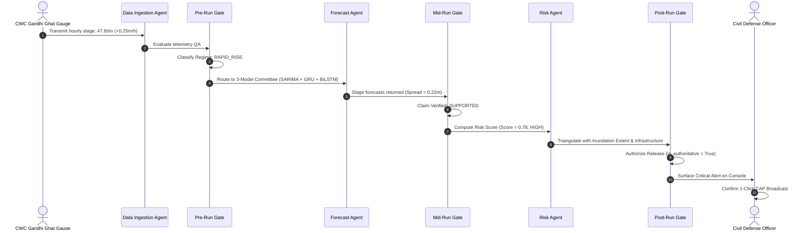

# Operational User Flows & Personas

| Field | Value |
|---|---|
| **Document ID** | UI-10-002 |
| **Version** | 1.0.0 |
| **Status** | VERIFIED |

---

## 1. User Personas

| Persona | Role | Key Goal | Platform Interface |
|---|---|---|---|
| **District Disaster Officer (DDO)** | Civil Defense, Patna DM Office | Authorize evacuations, deploy SDRF/NDRF boats, issue public alerts | Dashboard & CAP Broadcast |
| **Duty Hydrologist** | Central Water Commission (CWC) | Verify model ensemble convergence, audit gauge data anomalies | Technical Console & Hydrograph |
| **Municipal Engineer** | Patna Smart City Drainage Division | Operate sluice gates, manage urban pumping stations along Ganga | Drainage Risk Map |
| **Field Responder / Citizen** | General Public & Volunteers | Receive geo-targeted warnings, report stranded persons | Mobile Web & SOS Intake |

---

## 2. Canonical Operational Workflows

### 2.1 Workflow 1: Pre-Flood Rapid Rise Alerting

### 2.2 Workflow 2: Anomaly Escalation to Human Review
When a faulty gauge sends a sudden jump of $+3.5\text{ m/h}$ without corresponding rainfall ($<2\text{ mm}$), the **Pre-Run Gate** flags a physical impossibility:
1. Gate marks regime as `SENSOR_CONFLICT`.
2. Pipeline suppresses automatic warning release.
3. Post-Run Gate marks `requires_human_escalation = True`.
4. Console alerts the duty hydrologist with raw telemetry diagnostics and activates the calibrated satellite/persistence fallback.
