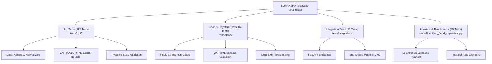

# Comprehensive Testing & Verification Strategy

| Field | Value |
|---|---|
| **Document ID** | TST-12-001 |
| **Version** | 1.0.0 |
| **Status** | VERIFIED |
| **Test Suite Size** | 243 Tests Passing (0 Failures, 0 Regressions) |

---

## 1. Testing Philosophy

SURAKSHA operates in safety-critical civil defense contexts where algorithmic false alarms cause panic and missed detections cost human lives. The test suite enforces:

1. **Zero Regressions Mandate**: All 243 automated tests must pass before any code is merged or deployed.
2. **Deterministic Offline Testing**: Unit and integration tests must run without external network dependencies by using high-fidelity offline mocks.
3. **Supervisor Invariant Protection**: Specialized invariant tests verify that supervisory layers cannot violate physical laws or modify numerical forecasts.

---

## 2. Test Suite Hierarchy



---

## 3. Running the Test Suite

```powershell
# Run entire test suite
pytest tests/ -q

# Run supervisor invariant verification
pytest tests/flood/test_flood_supervisor.py -v

# Run FastAPI integration tests
pytest tests/integration/test_flood_api.py -v
```
