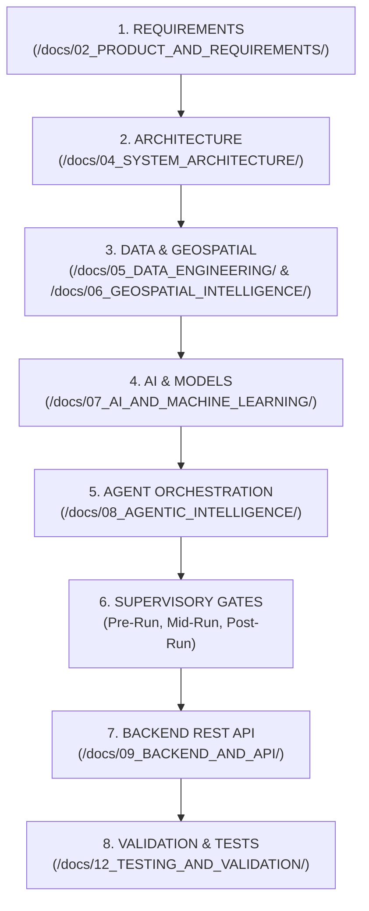

# SURAKSHA Central Knowledge Map

This central knowledge map connects every operational requirement to its architectural component, scientific data pipeline, AI model, supervisory policy, REST API endpoint, and automated validation test.

---

## Complete End-to-End Traceability Matrix

| Operational Requirement | Architecture Component | Source Code Path | Data Source & Lineage | Specialist Model / Agent | Jev Supervisory Gate | REST API Endpoint | Automated Test Evidence |
| :--- | :--- | :--- | :--- | :--- | :--- | :--- | :--- |
| **FR-001: River Telemetry Ingestion** | Platform Core & Hydrology Ingestion | [`src/suraksha/disasters/flood/ingestion/`](https://github.com/shouri123/SURAKSHA/tree/main/src/suraksha/disasters/flood/ingestion/) | CWC Gandhi Ghat Gauge (`023-MDGANG`), IMD Rainfall | `DataQAAgent` | **Pre-Run Gate**: Bounds Check ($[0, 120\text{ m}]$), Jump Rate ($<2.0\text{ m/h}$) | `GET /api/v1/flood/health` | [`tests/flood/test_observation_lifecycle.py`](https://github.com/shouri123/SURAKSHA/tree/main/tests/flood/test_observation_lifecycle.py) |
| **FR-002: Cloud-Penetrating Inundation** | Geospatial SAR Engine | [`src/suraksha/disasters/flood/geospatial/s1_sar_processor.py`](https://github.com/shouri123/SURAKSHA/tree/main/src/suraksha/disasters/flood/geospatial/s1_sar_processor.py) | Google Earth Engine `COPERNICUS/S1_GRD` | `SatelliteAgent` (Otsu Threshold, JRC Masking) | **Pre-Run Gate**: Telemetry Completeness QA | `POST /api/v1/flood/pipeline/run` | [`tests/flood/test_observation_lifecycle.py`](https://github.com/shouri123/SURAKSHA/tree/main/tests/flood/test_observation_lifecycle.py) |
| **FR-003: Headwater Glacial Melt Tracking** | Cryosphere SAR/Optical Engine | [`src/suraksha/disasters/flood/geospatial/s1_cryosphere_processor.py`](https://github.com/shouri123/SURAKSHA/tree/main/src/suraksha/disasters/flood/geospatial/s1_cryosphere_processor.py) | GEE S1/S2 Headwater Tiles (Gangotri, Kedarnath, Kosi) | `CryosphereEngine` (Nagler Wet-Snow Algorithm) | **Pre-Run Gate**: Regime Classification (`RAPID_RISE`) | `POST /api/v1/flood/pipeline/run` | [`tests/unit/test_cryosphere_engine.py`](https://github.com/shouri123/SURAKSHA/tree/main/tests/unit/test_cryosphere_engine.py) |
| **FR-004: Multi-Horizon Stage Forecasting** | Champion-Challenger Engine | [`src/suraksha/disasters/flood/models/forecasting/`](https://github.com/shouri123/SURAKSHA/tree/main/src/suraksha/disasters/flood/models/forecasting/) | Hourly Time Series (`real_hourly_hydrological_timeseries.csv`) | `ForecastAgent` (`SARIMA`, `GRU`, `Hybrid BiLSTM`) | **Mid-Run Gate**: Spread Adjudication ($\Delta \le 0.40\text{ m}$) | `POST /api/v1/flood/simulate` | [`tests/flood/test_production_inference.py`](https://github.com/shouri123/SURAKSHA/tree/main/tests/flood/test_production_inference.py) |
| **FR-005: Calibrated Flood Risk Scoring** | Inundation & Risk Engine | [`src/suraksha/disasters/flood/models/risk/`](https://github.com/shouri123/SURAKSHA/tree/main/src/suraksha/disasters/flood/models/risk/) | Digital Elevation Model (DEM), Stage Height | `RiskAgent` (Calibrated Gradient Boosting) | **Mid-Run Gate**: Risk Calibration Check | `POST /api/v1/flood/simulate` | [`tests/unit/test_flood_pipeline.py`](https://github.com/shouri123/SURAKSHA/tree/main/tests/unit/test_flood_pipeline.py) |
| **FR-006: Infrastructure Exposure Assessment**| Consequence & Spatial Engine | [`src/suraksha/disasters/flood/agents/impact_agent.py`](https://github.com/shouri123/SURAKSHA/tree/main/src/suraksha/disasters/flood/agents/impact_agent.py) | OpenStreetMap Infrastructure Layers, Patna Population | `ImpactAgent` (HAND Inundation Depth, Facility Breaches) | **Post-Run Gate**: 4-Way Cross-Agent Triangulation | `POST /api/v1/flood/pipeline/run` | [`tests/integration/test_verified_flood_pipeline.py`](https://github.com/shouri123/SURAKSHA/tree/main/tests/integration/test_verified_flood_pipeline.py) |
| **FR-007: Authoritative Civil Defense Alerts** | Civil Defense Alert Engine | [`src/suraksha/core/alerting/`](https://github.com/shouri123/SURAKSHA/tree/main/src/suraksha/core/alerting/) | Triangulated Forecast & Impact Outputs | `VerificationAgent` (Commander SITREP, Citizen SOS) | **Post-Run Gate**: Authoritative Release Certification | `GET /api/v1/flood/alerts` | [`tests/flood/test_flood_supervisor.py`](https://github.com/shouri123/SURAKSHA/tree/main/tests/flood/test_flood_supervisor.py) |

---

## Documentation Categories Directory Map

* **[01_PROJECT_FOUNDATION](/docs/01_PROJECT_FOUNDATION/)**: Identity, charter, mission, problem statement, scope, glossary.
* **[02_PRODUCT_AND_REQUIREMENTS](/docs/02_PRODUCT_AND_REQUIREMENTS/)**: Functional and non-functional requirements, personas, user journeys.
* **[03_DOMAIN_AND_FLOOD_KNOWLEDGE](/docs/03_DOMAIN_AND_FLOOD_KNOWLEDGE/)**: Hydrological science, rating curves, flood behavior, cryosphere dynamics.
* **[04_SYSTEM_ARCHITECTURE](/docs/04_SYSTEM_ARCHITECTURE/)**: C4 architecture diagrams, execution DAG, state immutability, ADRs.
* **[05_DATA_ENGINEERING](/docs/05_DATA_ENGINEERING/)**: Data source registry, provenance taxonomy, 14-point audit framework.
* **[06_GEOSPATIAL_INTELLIGENCE](/docs/06_GEOSPATIAL_INTELLIGENCE/)**: Google Earth Engine, Sentinel-1 SAR, HAND, permanent water masking.
* **[07_AI_AND_MACHINE_LEARNING](/docs/07_AI_AND_MACHINE_LEARNING/)**: Forecasting methodology, model cards (SARIMA, BiLSTM), uncertainty estimation.
* **[08_AGENTIC_INTELLIGENCE](/docs/08_AGENTIC_INTELLIGENCE/)**: Multi-agent orchestration, agent specifications, TypeSafe Jev System One.
* **[09_BACKEND_AND_API](/docs/09_BACKEND_AND_API/)**: FastAPI asynchronous backend, REST routes, OpenAPI 3.1 specification.
* **[10_APPLICATION_AND_USER_EXPERIENCE](/docs/10_APPLICATION_AND_USER_EXPERIENCE/)**: Dashboard specifications, Leaflet map controls, user flows.
* **[11_RISK_SAFETY_AND_SECURITY](/docs/11_RISK_SAFETY_AND_SECURITY/)**: Scientific Value Governance Invariant, threat models, secret management.
* **[12_TESTING_AND_VALIDATION](/docs/12_TESTING_AND_VALIDATION/)**: 243-test suite structure, historical flood replay scenarios, invariant testing.
* **[13_DEPLOYMENT_AND_INFRASTRUCTURE](/docs/13_DEPLOYMENT_AND_INFRASTRUCTURE/)**: Python 3.14+ runtime, environment variables, offline execution.
* **[14_MONITORING_AND_OPERATIONS](/docs/14_MONITORING_AND_OPERATIONS/)**: Health readiness endpoints, operational runbooks, failure recovery.
* **[15_RESEARCH_AND_EXPERIMENTATION](/docs/15_RESEARCH_AND_EXPERIMENTATION/)**: 9-metric comparative benchmarks, research papers, experimental protocols.
* **[16_PROJECT_MANAGEMENT](/docs/16_PROJECT_MANAGEMENT/)**: Coding standards, decision logs, technical debt registers, roadmap.

