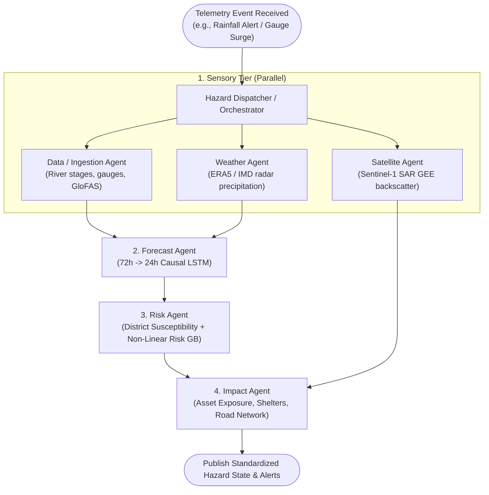

# SURAKSHA Backend & Agent Execution Flow

## 1. Multi-Agent Disaster Pipeline Flow

SURAKSHA pipelines are modeled as explicit Directed Acyclic Graphs (DAGs) compiled with **LangGraph**. The workflow enforces sensory parallelism followed by predictive aggregation:

## 2. Deterministic State Progression
All agents interact by reading and augmenting a typed state contract (`FloodState` inheriting from `BaseHazardState`). No hidden side-effects occur outside the shared state transitions.
