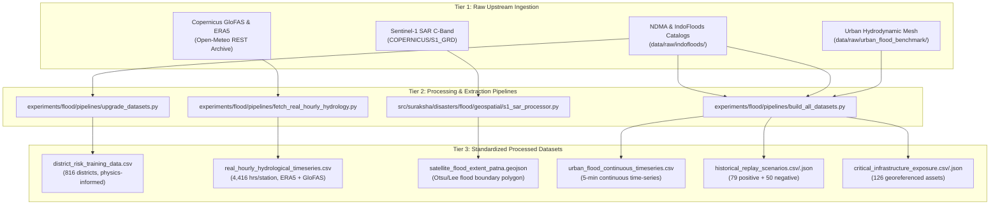

# SURAKSHA Data Architecture & Lineage Specification

## 1. Overview & Data Tier Hierarchy

The SURAKSHA platform enforces strict tier isolation across its datasets to ensure immutability of raw records, reproducible feature pipelines, and zero git repository bloat.

```text
data/
├── raw/                      # Immutable raw upstream archives & inventories
│   ├── indofloods/           # National susceptibility & historical flood catalogs
│   │   ├── DFSI.csv
│   │   ├── District_FloodedArea.csv
│   │   ├── District_FloodImpact.csv
│   │   ├── India_Flood_Inventory_v3.csv
│   │   └── variables_description_indofloods.pdf
│   └── urban_flood_benchmark/ # Hydrodynamic 1D pipe + 2D overland mesh data
│       ├── 1d_nodes_dynamic_all.csv
│       ├── 2d_nodes_dynamic_all.csv
│       ├── timesteps.csv
│       └── urban-flood-modelling.zip
├── processed/                # Standardized arrays, ML matrices & GeoJSON polygons
│   ├── real_hourly_hydrological_timeseries.csv
│   ├── district_risk_training_data.csv
│   ├── critical_infrastructure_exposure.csv/.json
│   ├── historical_replay_scenarios.csv/.json
│   ├── satellite_flood_extent_patna.geojson
│   ├── synthetic_design_storms.csv
│   └── urban_flood_continuous_timeseries.csv
└── fixtures/                 # Micro test datasets for CI/CD unit & integration tests
```

---

## 2. Lineage & Transformation Pipelines



---

## 3. Storage Governance & Git Hygiene

1. **Large Binary Management**:
   - Files exceeding 50MB (such as `urban-flood-modelling.zip` at 153MB and `sample_submission.csv` at 1.08GB) are strictly excluded from source control via `.gitignore`.
2. **Processed Dataset Versioning**:
   - Processed CSV and GeoJSON files used by core benchmarks are maintained in `data/processed/`.
3. **Reproducibility**:
   - All processed files are fully deterministically reproducible by executing `experiments/flood/pipelines/build_all_datasets.py` and `upgrade_datasets.py`.
