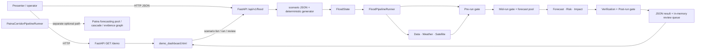

# SURAKSHA Flood Lab: System Architecture, Data Lineage, and Runtime Workflow

**Prepared:** 5 November 2026  
**Scope:** The repository’s Ganga–Patna flood subsystem, with emphasis on the private synthetic Flood Lab and its current Python API.  
**Evidence basis:** Local working tree at the preparation date. Several flood modules and demo files are modified or untracked relative to Git `HEAD` (`300bbb6043975d297139f87c6be34d0e44bca19f`). This report describes the inspected working tree; it does not claim those changes are in that commit. The user-supplied dataset report was treated as a lead list and checked against readers and call sites.

> **Presentation framing:** SURAKSHA Flood Lab is a demonstrable software pipeline for scenario replay, model routing, evidence logging, and human escalation. Its synthetic outputs demonstrate execution and control flow; they do not establish real-world forecast skill or constitute an official warning.

## 1. Executive explanation

The current demo is a single FastAPI application. A browser loads the locally served `demo_dashboard.html`; it asks the API for scenario definitions, submits editable scenario input, and displays the resulting `FloodState`, model execution metadata, gate decisions, logs, and human-review record. The API builds deterministic synthetic hydrology and runs the FloodPipelineRunner in offline demo mode.

Within the primary supervised path, three input agents prepare and log data, then a pre-run gate classifies data quality and hydrologic regime. The mid-run controller chooses an ensemble, one forecast model, or a fallback. Risk and impact modules then estimate severity and exposure. Verification and the post-run gate compare outputs and may escalate. The returned state records provenance, degraded paths, model execution, gate actions, and review status.

“AI agent” in this implementation means an explicitly called Python specialist module. Model inference occurs in forecast and risk components. Several other outputs are deterministic rules, formulas, catalogs, or simulation. In the demo, Jev is forced offline and deterministic; it is not a live cloud model call.

## 2. System architecture diagram

Open the interactive [architecture diagram](.archify/architecture-suraksha-flood-lab-20261105/suraksha-flood-lab-architecture.html). It shows the browser/API boundary, primary runner, specialist modules, stores/checkpoints, the synthetic/offline path, and the separate corridor pipeline.

## 3. Runtime entry points and how it starts

### Local start sequence

1. The ASGI entry point imports `src/suraksha/disasters/flood/api/app.py` and creates the FastAPI application.
2. Importing `routes.py` creates a default `pipeline_runner` for ordinary `/pipeline/run` requests. This is not the same object used by the synthetic case runner.
3. FastAPI lifespan loads forecast/risk checkpoints and the station registry. Provider polling starts only when `TELEMETRY_POLLING_ENABLED` is enabled and configuration is present.
4. The browser requests `GET /demo`; FastAPI returns `demo_dashboard.html` from the same Python process. There is no separate Node frontend server in this demo path.
5. The page requests `GET /api/v1/flood/demo/scenarios`; the route reads `experiments/flood/scenarios/suraksha_demo_scenarios.json` and generates each 72-hour history deterministically.
6. Selecting Run submits the scenario input to `POST /api/v1/flood/demo/scenarios/{scenario_id}/run`. That route validates a `FloodState`, stamps synthetic provenance and seed, creates `build_flood_graph(offline_demo=True)`, executes it, saves any review request in a process-local dictionary, and returns the output and separate evaluation reference.

### API surface relevant to this explanation

| Route | Role |
|---|---|
| `GET /` | API identity and links |
| `GET /api/v1/flood/health` | Registry, configured provider status, readiness blockers |
| `GET /api/v1/flood/stations` and `/stations/{station_id}` | Station metadata from registry |
| `POST /api/v1/flood/pipeline/run` | Regular caller-supplied run; supports supervised/static mode |
| `GET /api/v1/flood/demo/scenarios` | Synthetic case catalog and generated inputs |
| `POST /api/v1/flood/demo/scenarios/{id}/run` | Offline synthetic case execution |
| `GET /api/v1/flood/demo/reviews` | Process-local pending review records |
| `POST /api/v1/flood/demo/reviews/{event_id}/decision` | Accept/reject/defer demo review and note |
| `POST /api/v1/flood/alerts/cap-recommendation` | CAP message generation/recommendation; not evidence of connected dissemination |
| `/intelligence/sitrep`, `/intelligence/triage-sos`, `/intelligence/advisory` | Additional decision-support endpoints |

The demo review dictionary is in memory, so reviews do not survive process restart and are not a durable notification system. Human review is represented in the dashboard/API response and is a workflow gate, not an email/SMS delivery integration.

## 4. Primary runtime workflow, step by step

### A. Input and state creation

The scenario JSON supplies a case ID, phase, current stage, warning/danger levels, rainfall, discharge, soil saturation, metadata, synthetic history configuration, expected regime/strategy, and evaluation reference. `build_scenario_input` deep-copies input; its generator reads only scenario inputs/history configuration. It does **not** inject the evaluation reference into the model input. It uses a fixed seed, exactly 72 hourly records, seven daily rainfall totals distributed into hourly rainfall, and explicit `SYNTHETIC_SCENARIO` provenance. Each sample can include stage, 24-hour rain, discharge, soil saturation, timestamp, confidence, source, and missing values according to configured ratio.

`FloodState` is the typed carrier. It groups station/event identity; current hydrology; observation snapshots; forecast; risk and impact assessments; phase-specific pre/active/post assessments; upstream glacier telemetry; geojson; metadata; evidence store; supervisor decision; provenance/degraded paths; and agent logs.

### B. Sensory agents

| Agent/module | Reads | Produces / logs | Current interpretation |
|---|---|---|---|
| `DataAgent` | `FloodState.current_condition`, metadata, station registry; optional stage/rain/discharge/soil arguments | Completed condition, telemetry snapshot, sensor plausibility audit, evidence chunk, optional glacier telemetry context | Validates and annotates observations. Demo synthetic values are not gauge observations. If an input is missing outside provider mode, it may apply documented fallback thresholds/values; provenance must remain visible. |
| `WeatherAgent` | Rainfall 24h and optional seven-day daily rain series; optional freezing level and high-altitude temperature/DDF metadata | API3d/API7d, rainfall evidence, optional simple degree-day melt rate metadata | It computes indices only when a seven-day sequence exists. Melt is only a metadata estimate when both temperature and calibrated DDF are passed. The default workflow passes these from scenario metadata; this does not itself route glacier melt downstream. |
| `SatelliteAgent` | Event phase, AOI bounding box, SAR processor and offline flag | GeoJSON, optional SAR observation snapshot, baseline/change metadata | In the demo it calls an offline SAR processor/simulator. New Sentinel CSVs are query/processing specifications, not the imagery stack. Presence of a GeoJSON catalog does not prove this run reads that artifact. |

### C. Pre-run gate

`PreRunGate` receives stage, danger level, 24-hour rainfall, one-hour jump, missing-data ratio, upstream melt (if supplied), cloud cover, GLOF precursor flag, event phase, station/section, and evidence store. Deterministic policy logic evaluates missing/conflicting inputs and regime signals, then returns a regime, selected strategy, action, sufficiency, and possibly an execution plan. It can identify `GLOF_PRECURSOR` or `COMPOUND_SURGE`; in the current main path this is a context/regime and review signal, not a validated glacier-to-Bihar travel-time forecast.

### D. Forecasting and model selection

For `PRE_EVENT` and `ACTIVE_EVENT`, the mid-run gate assembles a feature lookback from evidence/snapshots and calls candidates according to the strategy selected by the pre-run gate. The context assembler’s feature sequence is used as a numeric model input; missingness/interpolation/completeness and provenance are carried into execution metadata.

| Strategy/model family | Role in current code |
|---|---|
| SARIMA / ARIMA | Statistical forecasting candidates; a fitted model state must be available at runtime to count as executed |
| GRU | Neural forecast candidate; requires a loaded model/checkpoint |
| Hybrid BiLSTM | Neural/sequence forecast candidate used by ensemble strategy |
| Persistence | Explicit simple baseline and fallback when the selected candidate is unavailable/fails |
| Causal LSTM | Present in model/checkpoint area and registry support; not a claim that every demo run executes it |
| PatnaForecastingPool | Separate corridor/digital-twin alternative, not the standard `/demo` runner |

The default forecast registry may nominate a model, but `ForecastAgent` verifies readiness: statistical model fitted state or neural model plus loaded checkpoint. If not ready or prediction throws, it executes Persistence and records the candidate, actual executed model, fallback reason, input provenance, completeness, and predictions. The supervised gate can run an ensemble and aggregate mean/spread; model unavailability/disagreement can request human review. For `POST_EVENT`, the main pipeline bypasses forward surge models and computes a deterministic recession baseline from the current stage, peak stage, and recession rate.

The forecast output is a stage estimate at `t+6`, `t+12`, and `t+24`, with a code-constructed interval and peak timing. These intervals are currently formula outputs, not demonstrated calibrated uncertainty intervals.

### E. Risk and impact

`RiskAgent` builds the feature mapping expected by `CalibratedFloodRiskModel`: flood susceptibility, flooded area percent, permanent-water share, population, historical fatalities, duration, vulnerability prior, forecast stage anomaly, 24-hour rainfall, and soil saturation. In the current inference function, several vulnerability/district attributes are hard-coded constants; forecast anomaly/rain/soil are taken from current `FloodState`. The presence of `district_risk_training_data.csv` does not mean that the inference agent reads it on each run. A checkpoint is loaded through the model registry; its exact calibration/production suitability must be established separately.

`ImpactAgent` chooses the scenario `flooded_area_km2` or its default 42.6 km², computes population as area × 420 persons/km², estimates facility counts with spacing/density formulas, and uses `PatnaAssetCatalog` to check forecast/observed stage against asset elevations. It calls `SpatialExposureEngine`, which can load the WorldPop target-AOI catalog and OSM target-infrastructure catalog from `data/new datasets/`. Those files describe AOI bounds/population targets and infrastructure categories/query bounds, not 100 m population rasters or a live polygon overlay. Bounding-box/catalog logic can attach zones/assets; without a precise flood polygon raster intersection the output remains an estimate. The module also has fixed shelter records.

Outputs are phase-labelled:

* **PRE_EVENT:** potential/forecast exposure and threshold status.
* **ACTIVE_EVENT:** observed-labelled estimate, trend from snapshots, exposed assets, and satellite-pass count. In offline mode, an observation may be synthetic; “observed” in the field name does not change its provenance.
* **POST_EVENT:** estimated damage proxies and recovery intelligence, with before/after imagery metadata only when supplied.

### F. Verification, post-run decision, and human review

`VerificationAgent` checks available snapshots/provenance and may use configured search/Jev integrations outside offline mode. The post-run gate compares available satellite extent, t+24 stage, danger level, risk severity, and impact population, and can attach external corroboration. Missing corroboration is not positive confirmation. A final safety policy additionally escalates if evidence is insufficient, fallback was used, committee requests review, forecast/current stage reaches danger, or the regime is GLOF/compound.

The final `SupervisorState` records pre-run verdict, committee, forecast execution, post-run verdict, action history, model count, mode, and review flag. If review is required the result becomes `ESCALATED_HUMAN_REVIEW` and `is_authoritative` is set false. The API records a review object for the dashboard. Accept/reject/defer records an operator decision in process memory; it does not make an unverified forecast scientifically authoritative or dispatch an official alert.

### G. Static baseline versus supervised mode

`FloodPipelineRunner.run()` dispatches on `execution_mode`:

* `supervised`: pre/mid/post supervision, regime-based routing, committee/fallback metadata, claim checks and escalation.
* `static`: fixed sequence Data → Weather → Satellite → Forecast → Risk → Impact → Verification, then one static supervisor record. This is intended as a research comparison baseline and is less adaptive.

The demo endpoint explicitly uses offline mode and scenario synthetic provenance. The regular API `/pipeline/run` uses its own normal runner; a request selecting `static` is not the same as the supervised demo.

## 5. Separate corridor/digital-twin path

`PatnaCorridorPipelineRunner` is another implementation in `workflow.py`. It accepts a lookback matrix (or builds a fallback matrix from telemetry), calls `PatnaForecastingPool` for probabilistic stage forecasts, evaluates corridor/cascade consequences, builds evidence/audit output, and generates a SITREP. `build_patna_corridor_graph()` exposes that runner. The inspected `/demo` and `/pipeline/run` routes use `build_flood_graph()` / `FloodPipelineRunner`; therefore this corridor runner must be presented as a separate optional subsystem unless another caller is shown. Do not draw it as a live stage in the dashboard path.

Other available modules include hydraulic conveyance/cross-section helpers, catchment catalog ingestion, glacier degree-day model and basin-routing helper, cascade/section graph, post-event recovery, CAP alert construction, SITREP/advisory/SOS triage. An exported module or helper is not proof that the primary demo invokes it. `route_glacier_melt_to_basins` and `DegreeDayMeltModel` are not demonstrated as a connected end-to-end upper-Ganga glacier → Bihar stage route in the inspected scenario route.

## 6. Dataset and provenance register

“Present” below means a local file exists in the inspected workspace. “Runtime” states whether an inspected active code path reads it. A dataset’s metadata/catalog file is not the underlying data asset.

### A. Files directly or conditionally read by runtime modules

| File / fields or attributes | Role and actual use | Status |
|---|---|---|
| `src/suraksha/disasters/flood/basins/data/cwc_stations.json` — station ID/name, basin/state, coordinates, warning/danger marks and station metadata | `StationRegistry` loads station catalog for API and threshold lookups. It is metadata, not a live CWC gauge series. | Runtime registry |
| `data/processed/critical_infrastructure_exposure.csv` — asset ID/name/category, coordinates/elevation and exposure-related columns | `PatnaAssetCatalog` loads static asset records and compares stage with configured elevations for forecast/observed exposure. | Runtime consumer; static catalog |
| `data/new datasets/worldpop_patna_bihar_target_aoi.csv` — catchment domain/AOI/district, bounding box, estimated population, vulnerable groups, use case | `SpatialExposureEngine` loads target zones. Used in area/bbox zone logic; not actual WorldPop population raster cells. | Conditional runtime consumer |
| `data/new datasets/osm_patna_target_aoi_infrastructure.csv` — asset category/subcategory, OSM key, AOI and geographic bounds/use case | `SpatialExposureEngine` loads target infrastructure categories/areas; values can support catalog-level estimates, not a fresh OSM query. | Conditional runtime consumer |
| Configured NWDP/IMD provider files | `ingestion/providers.py` can read configured CSV columns in chunks; telemetry polling is gated by environment/config and is not the offline demo’s source. | Conditional provider integration; verify env and polling status |
| `data/processed/real_hourly_hydrological_timeseries.csv` — repository documentation describes timestamp, station, precipitation, soil moisture, pressure, temperature, discharge, stage, danger level | Patna loader can read the CSV for training/replay utilities. This is documented as ERA5/GloFAS-derived context, not automatically a CWC observed gauge series and not a direct default demo input. | Loader/utility path; not demo route |

### B. Processed, raw, and synthetic assets in the repository

| Dataset/file family | Attributes / content | Current role and boundary |
|---|---|---|
| `data/processed/district_risk_training_data.csv` | Training features for district vulnerability/risk (documented columns include DFSI, flooded extent/area, impact/vulnerability priors and related hydrologic features) | Model-training/experiment asset. Runtime RiskAgent currently supplies several hard-coded priors; do not claim direct per-run CSV ingestion. Local observed row count is 4,896; documentation’s 816 “districts” should not be repeated as a row count without a unique-district audit. |
| `data/processed/historical_replay_scenarios.csv/.json` | Event/replay scenarios and labels/values | Replay/benchmark utility, not default live feed. |
| `data/raw/indofloods/India_Flood_Inventory_v3.csv` | Historical flood records and event attributes; repository provenance says 6,876 records | Historical event context/label asset. Not evidence that a forecast model was trained from it on each API start. |
| `data/raw/indofloods/DFSI.csv` | District flood susceptibility scores | Source/feature asset for risk data preparation; runtime agent uses a fixed DFSI feature value unless changed. |
| `data/raw/indofloods/District_FloodedArea.csv` | District flooded-area/exposure attributes | Training/feature preparation. |
| `data/raw/indofloods/District_FloodImpact.csv` | District human impact/vulnerability attributes | Training/feature preparation. |
| `data/processed/critical_infrastructure_exposure.json` | Static infrastructure asset records | Companion asset catalog. Runtime CSV path is explicit in `PatnaAssetCatalog`. |
| `data/processed/satellite_flood_extent_patna.geojson` | One packaged GeoJSON feature in the local inventory | Artifact exists, but the default demo’s satellite agent calls the configured processor/simulator; no claim that this single file is its observation feed. |
| `data/processed/urban_flood_continuous_timeseries.csv` | Synthetic/benchmark urban time sequence | Experiment asset, not Ganga/Patna river observation. |
| `data/processed/synthetic_design_storms.csv` | Synthetic design rainfall/hyetographs | Stress-test/design input. The demo cases instead generate rain from scenario seeds. |
| `data/processed/macro_river_timeseries_hotspots.csv` | Macro river time-series/context asset | Research/derived asset; not shown as active default demo input. |
| `data/raw/nwdp/bihar/*.csv` (hourly telemetry spans, manual daily levels/discharge; README) | Stage/rain/discharge station/time fields in provider exports | Local-only, gitignored provider downloads; can be configured via env in provider adapter. Workspace README says downloaded 2026-11-03; file presence alone does not verify live freshness or correct Gandhi Ghat mapping. The stated level-file latest time was 2026-11-02 23:00 and rainfall latest 2026-10-31 17:00 in the inspected notes. |
| `data/raw/urban_flood_benchmark/*` | 1D/2D nodes/edges, static/dynamic values, edge indices, timesteps and benchmark targets; includes large Parquet/ZIP assets | Separate urban drainage/surface benchmark, not the Ganga flood route. Local-only/gitignored. |

### C. New `data/new datasets/` inventory and whether it is real input

| File | What its columns describe | Runtime use status |
|---|---|---|
| `bihar_patna_historical_flood_event_reports.csv` | Event catalog / date, place, event summaries | Catalog; not continuous hydrographs |
| `bihar_patna_historical_flood_extents.csv` | Event extent source/catalog | Catalog; not itself extent raster/polygon collection |
| `buxar_patna_hathidah_cross_sections.csv` | Cross-section IDs and hydraulic geometry summary fields | Candidate hydraulic input; not a dense bathymetric survey; hydraulic helper has a CSV reader, but not the default demo route |
| `cwc_bihar_river_stations.csv` | Station registry/search target fields | Catchment ingestion helper can parse it; default API station registry loads JSON instead |
| `dem_patna_upstream_catchment_catalog.csv` | DEM asset/query/AOI specification | Catalog; not a DEM raster |
| `era5_patna_himalayan_catchments.csv` | Catchment/time-series data request/spec fields | Catalog/spec; not an ERA5 gridded dataset |
| `imd_rainfall_basin_stations.csv` | Rainfall station catalog/target fields | Catalog; not rainfall observations |
| `osm_patna_target_aoi_infrastructure.csv` | OSM target AOI/category/bounds/use-case attributes | Conditional runtime catalog read by SpatialExposureEngine |
| `patna_upstream_catchment_lulc_dataset.csv` | LULC source/AOI/processing specification | Catalog; not classified land-cover raster |
| `sentinel1_patna_floodplain_cryosphere.csv` | Sentinel-1 scene/search/processing requirements | Catalog; not SAR scene stack |
| `sentinel2_patna_uttarakhand_cryosphere.csv` | Sentinel-2 scene/search/processing requirements | Catalog; not optical scene stack |
| `uttarakhand_glacial_lakes_dataset.csv` | Lake inventory/catchment attributes | Context catalog; no active lake-breakout simulation proven in default demo |
| `uttarakhand_upper_ganga_glacier_dataset.csv` | Glacier inventory/geometry/source attributes | Context catalog; not glacier mass-balance or melt observations |
| `worldpop_patna_bihar_target_aoi.csv` | Target AOI bounding boxes, estimated population, vulnerable groups, use-case | Conditional zone catalog loaded by SpatialExposureEngine; not 100 m gridded population cells |
| `RF25_ind2025_rfp25.nc` and `Rainfall_ind2025_rfp25.grd` | Gridded rainfall products | Binary raster/grid assets. No active default API read path was found for these files; catalog presence is not ingestion. |

The repository’s data inventory also includes `data_audit` reports, benchmark outputs, model checkpoints, and scenario reference outputs. Those are useful evidence for reproducibility, but are not all prediction inputs. Some raw datasets are gitignored/local-only. The actual API deployment may therefore not contain the same data as this workstation.

### D. Attributes used in each decision area

| Decision area | Input attributes actually referenced in code | Output |
|---|---|---|
| Sensor/data QA | stage, warning/danger, rainfall, discharge, soil saturation, jump/rate metadata, missing ratio, provenance | Plausibility/anomaly classification, snapshot, evidence chunk |
| Antecedent weather | last seven daily rain values; optional high-altitude temperature + calibrated degree-day factor; source/time metadata | API3d/API7d, optional estimated melt-rate metadata |
| Forecast | 72-hour feature matrix assembled from stage, rainfall, discharge/soil, rate-of-rise and observation/evidence sequence; selected model/checkpoint | stage at +6/+12/+24, model/fallback/provenance/completeness logs |
| Risk | forecast-stage anomaly, 24-hour rain, soil saturation, flooded-area percent; fixed defaults for DFSI, permanent-water %, population, fatalities, duration and vulnerability | risk score, severity, driver list and engine label |
| Impact | area metadata/default, current/forecast/peak stage, asset elevation/category catalog; density constants; optional AOI catalog bounds | phase-labelled potential/current/post-event population/assets/area estimates |
| Supervision | stage vs danger, rain, jump, missing ratio, melt context/GLOF flag, model strategy/prediction spread, satellite extent/provenance, risk/impact values, search snippets | regime, strategy, proceed/fallback/escalate, final review flag and reason history |

## 7. Models, checkpoint assets, and what they do

| Model/algorithm | Subsystem | How it is used / caveat |
|---|---|---|
| SARIMA, ARIMA | Stage forecast candidates | Statistical model state required; otherwise Persistence fallback is explicitly reported |
| GRU, Hybrid BiLSTM, Causal LSTM | Neural stage forecast module/checkpoints | Only a model with loaded weights counts as executed. Listing a checkpoint is not proof it was selected in a particular run. |
| Persistence | Forecast baseline/fallback | Holds/extends current sequence using simple baseline prediction; useful as comparison and safe fallback, not a sophisticated AI forecast |
| Calibrated risk classifier/model | Risk score | Receives feature dict and returns score/severity/drivers; training data relevance and calibration must be demonstrated separately |
| Deterministic policy engine | Gates/committee | Encodes threshold, regime, strategy, and escalation logic; policy decisions are not learned neural output |
| Offline Jev simulator | Demo adjudication/consistency checks | Used because offline demo forces the Jev client offline; deterministic simulator supports controlled replay |
| Degree-day melt formula | Weather context | Conditional simple calculation; not an integrated snow/glacier hydrology model in the main demo path |

Model files are under `src/suraksha/disasters/flood/models/` with checkpoints under `models/checkpoints/`. API health reports readiness information; each scenario output’s own `model_execution` and `fallback_reason` fields are the evidence for what executed in that run.

## 8. What is implemented, partial, and not demonstrated

### Demonstrable today

* Select/run deterministic synthetic cases and alter complete JSON input.
* Preserve synthetic provenance, generated history, input snapshots, agent logs, and model execution metadata.
* Route among regimes/strategies and show model fallback behavior.
* Compare supervised and static pipeline behavior through API/benchmark tooling.
* Generate phase-specific forecast/risk/impact output, supervisor actions, and human review decision record.
* Serve a local interactive dashboard and API from one Python service.

### Present as helper, catalog, or optional path

* Several satellite, glacier, cross-section, DEM, ERA5, IMD, LULC, OSM and WorldPop catalogs/specifications.
* Hydraulic conveyance and catchment ingestion helpers.
* Degree-day glacier model and melt routing helper.
* CAP message construction, corridor cascade, evidence graph and recovery logic.
* NWDP/IMD adapters and telemetry scheduler when explicitly configured.

### Not proven by current demo execution

* Live, correctly datum-adjusted CWC/NWDP gauge ingestion or provider freshness.
* A connected Upper Ganga glacier/lake release hydrograph routed through travel time to Buxar/Patna/Gandhi Ghat and downstream Bihar stations.
* Production Sentinel-1/2 image ingestion, live Earth Engine query, or operational polygon-to-population raster intersection.
* Fully dynamic Saint-Venant 1D/2D hydraulics or a GNN execution in `/demo`.
* Risk inference reading the processed district CSV on every request.
* Real forecast skill/calibration demonstrated by synthetic scenario suite.
* Durable human-review persistence, notification, official alert authorization, or alert delivery receipts.

These are accurate scope boundaries, not a reason to hide working demo behavior. They tell the evaluator what the next engineering stages are.

## 9. Reproducibility and benchmark interpretation

The scenario suite contains 13 deterministic synthetic scenarios spanning phases, ordinary/rapid-rise/high-stage conditions, sensor conflict/missingness, and cryosphere-context cases. A fixed seed makes inputs reproducible. The target/evaluation reference is returned separately from the generator/model input to reduce leakage.

The repository has prior reports comparing synthetic outputs to their mock references and to Persistence. Any result such as an MAE from that suite is a **synthetic replay metric**. It measures whether code behaves consistently against its authored mock targets; it does not establish generalization to observed Ganga events. A scientifically meaningful score needs held-out observed hydrographs, station/datum alignment, temporal split, baselines, and uncertainty/calibration evaluation.

For a live demo, open `/demo`, pick cases from normal/average/worst/precursor/post-event groups, then show: (1) input and provenance, (2) model actually executed/fallback, (3) forecast horizons, (4) risk/impact drivers and estimation caveat, (5) gate action and review reason, and (6) accept/defer record. Use the health endpoint to show provider state separately from synthetic run mode.

## 10. Repository map for a code walkthrough

| Path | Responsibility |
|---|---|
| `src/suraksha/disasters/flood/api/app.py` | FastAPI app factory, lifespan, middleware, `/demo` page |
| `src/suraksha/disasters/flood/api/routes.py` | API schemas, scenario routes, run/review endpoints, station and intelligence routes |
| `src/suraksha/disasters/flood/api/demo_dashboard.html` | Local interactive Flood Lab UI |
| `src/suraksha/disasters/flood/workflow.py` | Main FloodPipelineRunner and separate PatnaCorridorPipelineRunner |
| `src/suraksha/disasters/flood/contracts/flood_state.py` | Typed workflow input/output contract |
| `src/suraksha/disasters/flood/agents/` | Data, weather, satellite, forecast, risk, impact and verification specialists |
| `src/suraksha/disasters/flood/supervisor/` | Pre-run, mid-run, post-run gates and deterministic policy contracts |
| `src/suraksha/disasters/flood/models/` | Forecast/risk model implementations, registry, checkpoint artifacts |
| `src/suraksha/core/intelligence/` | Context assembly, evidence store, Jev abstraction, search corroboration |
| `src/suraksha/disasters/flood/testing/synthetic_hydrograph.py` | Deterministic synthetic observation history builder |
| `experiments/flood/scenarios/suraksha_demo_scenarios.json` | Scenario input, seeds, expected regimes/strategies and evaluation reference |
| `src/suraksha/disasters/flood/geospatial/` | Exposure, SAR, catchment and hydraulic helpers |
| `src/suraksha/disasters/flood/ingestion/` | Provider adapters, local loaders, scheduler |
| `src/suraksha/disasters/flood/alerting/` | CAP alert document construction |
| `src/suraksha/disasters/flood/intelligence/` | SITREP, advisory and citizen SOS triage helpers |
| `data/` | Raw/processed/spec data; inspect provenance and gitignore before treating as runtime source |

## 11. Short verbal explanation for the evaluator

> “This is SURAKSHA Flood Lab, a private experiment interface. The browser submits deterministic synthetic river scenarios to one FastAPI backend. The backend packages stage, rainfall, discharge, soil, snapshots, and provenance into FloodState. Data, weather, and satellite modules prepare evidence. A pre-run gate classifies the situation and chooses a forecasting strategy. The forecast pool reports the model that actually ran or the Persistence fallback. Risk and impact modules produce estimates. Verification and a final gate either release a non-authoritative result or request a human decision. The dashboard shows the complete trace. This demonstrates the application workflow; the demo uses synthetic data and offline Jev, so its scores are software-evaluation results, not operational forecast validation.”

## 12. Evidence pointers

Core inspected implementation locations: `api/app.py` (application and `/demo`), `api/routes.py` (API routes and synthetic runner), `workflow.py` (execution order and phase branches), `testing/synthetic_hydrograph.py` (generator), `agents/` (specialist logic), `supervisor/` (gates), `models/` (inference), `geospatial/exposure.py` (catalog load and exposure estimation), `consequences/asset_catalog.py` (asset CSV reader), and `basins/station_registry.py` (station JSON reader). The diagram candidates keep repository identity and working-tree caveat with their source references.

Archify schema, source-evidence, layout, delivery, and strict checks passed for all three interactive diagrams. Its separate Chrome browser check could not complete: the bundled Chrome GPU process crashed during startup and the DevTools pipe timed out/closed. The HTML files were generated, but that automated browser inspection is not claimed as passed. The diagrams cite files at the pinned repository revision; where active demo helper files are untracked, the figure uses the tracked route as the evidence anchor, and this report remains the description of the current working tree.
