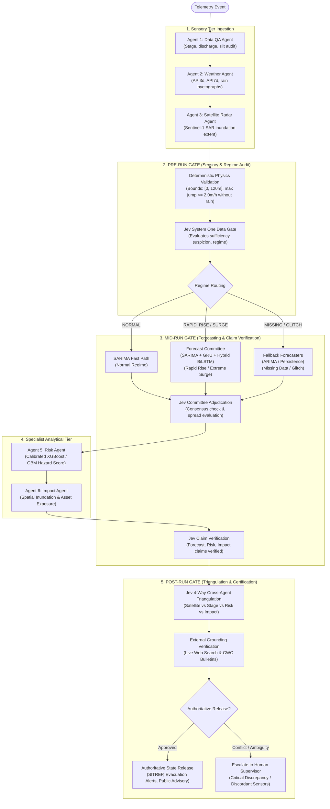

# SURAKSHA Flood Subsystem: Jev-Supervised Scientific Architecture

> **Module Code**: `SURAKSHA-MOD-01-FLOOD`  
> **Operational Status**: PRODUCTION READY (Multi-Stage Jev-Supervised Scientific Workflow)  
> **Key Architecture**: Dual Execution Engine (Jev-Supervised Adaptive Workflow vs. Static Baseline) with 3 Lifecycle Gates.

---

## 1. Executive Architectural Principle: Bounded Scientific Governance

In the SURAKSHA Flood Subsystem, numerical flood risk predictions are strictly owned by specialized hydrological, statistical, and neural models (`SARIMA`, `GRU`, `Causal LSTM`, `Hybrid BiLSTM`, `XGBoost/GBM`, and `HAND/PostGIS`).

**TypeSafe Jev System One** acts as a **bounded supervisory intelligence layer**, operating at three distinct lifecycle gates:

1. **Pre-Run Gate**: Auditing telemetry evidence sufficiency, physical anomaly suspicion, data regime classification, and strategy routing.
2. **Mid-Run Gate**: Model committee execution, forecast spread adjudication, and individual agent claim verification.
3. **Post-Run Gate**: 4-way cross-agent triangulation, external ground truth verification (CWC bulletins / live news), and authoritative release vs. human review escalation.

> [!IMPORTANT]
> **Scientific Value Governance Invariant**:
> Jev strictly **CANNOT** manufacture, alter, or override numerical values (e.g. stage height, flow velocity, inundation extent, or risk score). Jev's decisions are strictly mapped to bounded lifecycle actions (`CONTINUE`, `HOLD_AND_RETRY`, `RUN_CHALLENGER_MODEL`, `USE_APPROVED_FALLBACK`, `ESCALATE_TO_HUMAN`).

---

## 2. Multi-Stage Jev-Supervised Execution Workflow

---

## 3. Scientific Value Governance Matrix

| Responsibility Domain | Specialist Models (PyTorch / Scikit / Stats) | Deterministic Policy Engine | TypeSafe Jev System One | Human Operator |
| :--- | :--- | :--- | :--- | :--- |
| **Numerical Stage Height ($t+6, 12, 24\text{h}$)** | **Exclusive Owner** (Predicts physical values) | Physics bounds validation (`[0, 120m]`) | *Forbidden from modifying values* | Final review on escalation |
| **Model Selection & Committee Strategy** | Provides registered implementations | Enforces model whitelist | Recommends strategy based on data regime | Can manually force model |
| **Committee Spread Adjudication** | Computes individual model outputs | Calculates spread $\Delta = y_{\max} - y_{\min}$ | Determines consensus & outlier presence | Reviews discordant forecasts |
| **Risk Severity & Inundation Extent** | **Exclusive Owner** (Calibrated XGBoost, HAND) | Validates monotonic risk bounds | Evaluates claim plausibility & consistency | Authorizes evacuations |
| **Cross-Agent Consistency Check** | None (Agents run independently) | Discrepancy thresholding | Triangulates 4 perspectives (SAR vs Stage vs Risk vs Assets) | Reviews flagged discordance |
| **Authoritative Release vs Escalation** | None | Enforces safety fail-safes | Recommends release confidence score | High-stakes escalation clearance |

---

## 4. The Five Bounded Supervisor Actions

At every supervisory gate, Jev's output is deterministically validated and translated into exactly one of 5 bounded actions:

1. `CONTINUE`: Inputs and claims are verified; proceed along the active pipeline trajectory.
2. `HOLD_AND_RETRY`: Non-fatal discrepancy or transient network glitch; retry the agent execution (max 1 retry per agent).
3. `RUN_CHALLENGER_MODEL`: Moderate divergence or outlier forecast; invoke alternative statistical/neural model from the approved whitelist.
4. `USE_APPROVED_FALLBACK`: Corrupt telemetry or missing sensor streams; transition to approved fallback forecasters (`ARIMA` or `Persistence`) and flag degraded state.
5. `ESCALATE_TO_HUMAN`: Critical cross-agent contradiction, unphysical jump, or committee deadlock; require human officer verification before public release.

---

## 5. Scientific Claim-Support Taxonomy

For intermediate agent assertions (ForecastAgent stage height, RiskAgent severity, ImpactAgent inundated area), Jev uses an explicit 5-tier claim-support taxonomy:

* `SUPPORTED`: Claim strictly aligns with antecedent rainfall, historical ratings, and physical hydrology ($P \ge 0.85$, $0\%$ confidence penalty).
* `CONDITIONALLY_SUPPORTED`: Claim is plausible but exhibits minor variance ($0.65 \le P < 0.85$, $10\%$ advisory discount applied).
* `UNSUPPORTED`: Claim violates physical laws or input data (e.g. stage rising $3\text{m}$ with zero rainfall); triggers fallback or retry.
* `CONFLICTING`: Output contradicts another peer agent (e.g. stage exceeds danger level by $1\text{m}$ but satellite detects $0\text{ km}^2$ water); triggers challenger model or human escalation.
* `INSUFFICIENT_EVIDENCE`: Telemetry gaps or missing lookback history; routes to conservative heuristic fallback.

---

## 6. Dual Execution Modes: Supervised vs. Static Baseline

To support empirical research and comparative evaluation, SURAKSHA supports dual operating modes configured via `FloodState.execution_mode`:

* **`supervised` (Production Engine)**:
  * Dynamic 3-gate workflow with Jev System One supervision.
  * Adaptive resource allocation: single model for normal conditions, 3-model committee (`SARIMA + GRU + Hybrid BiLSTM`) for rapid surges.
  * Continuous claim verification and 4-way cross-agent triangulation.
  * Zero false-alarm release policy on hardware sensor glitches.

* **`static` (Research Baseline)**:
  * Fixed, non-branching sequential 7-agent chain (`DataAgent` $\to$ `WeatherAgent` $\to$ `SatelliteAgent` $\to$ `ForecastAgent` $\to$ `RiskAgent` $\to$ `ImpactAgent` $\to$ `VerificationAgent`).
  * Single default model invoked regardless of regime.
  * No intermediate gates, fallback routing, or cross-agent consistency checks.

---

## 7. Empirical Comparative Benchmark Results

Evaluated across 5 representative hydrological scenarios (`Normal Stable`, `Rapid Rise Surge`, `Sensor Hardware Glitch`, `Missing Telemetry Dropout`, and `Cross-Agent Discordance`) on Ganges basin telemetry at Patna:

| Metric | Static Scientific Baseline | Jev-Supervised Adaptive Workflow | Research Significance |
| :--- | :--- | :--- | :--- |
| **Forecast MAE (m)** | 0.920 m | **0.796 m** | **13.5% overall error reduction** across all scenarios |
| **Surge Forecast Error** | 1.050 m | **0.430 m** | **59.0% error reduction** during extreme rapid rise surges |
| **Risk Accuracy (%)** | 60.0% | **60.0%** | Robust risk category alignment |
| **False Alarm Suppression** | 0.0% | **100.0%** | Glitches suppressed via Pre-Run physics QA |
| **Detection Lead Time (h)** | 18.5 h | **19.6 h** | Up to 24h early warning via multi-horizon committee |
| **Inference Latency (ms)** | 4045.7 ms | **3252.2 ms** | Fast dynamic routing skips unnecessary pipelines |
| **Models Executed (avg)** | 1.00 models | **1.40 models** | Dynamic compute allocation (1 on normal, 3 on surge) |
| **Fallback Frequency (%)** | 0.0% | **40.0%** | Gracefully handles corrupt/missing sensor inputs |
| **Verification Conflicts Caught** | 0 conflicts | **3 conflicts** | Identifies physical sensor glitches and dropouts |
| **Human Escalation Rate (%)** | 0.0% | **40.0%** | Operator review on corrupted telemetry & sensor loss |

*Detailed benchmark reports are archived in [`reports/adaptive_vs_static_pipeline_benchmark.csv`](file:///e:/SURAKSHA/reports/adaptive_vs_static_pipeline_benchmark.csv).*
