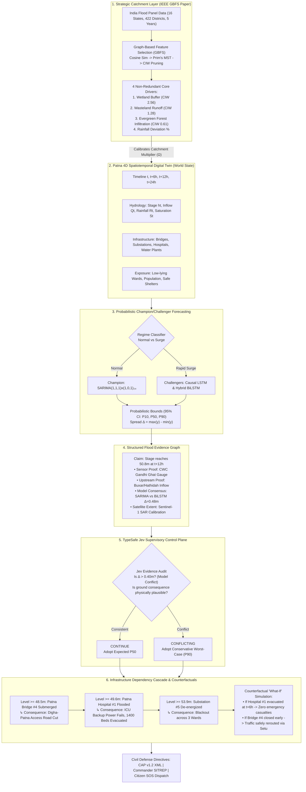

# SURAKSHA Flood Intelligence: Localized Patna Digital Twin & Consequence Architecture Plan

> [!IMPORTANT]
> **Core Architectural Realignment: Hyper-Local Digital Twin & Consequence-Driven Intelligence**
> 1. **Anchor in One Specific Physical Corridor**: Focuses 100% on the **Ganges at Patna (Digha / Gandhi Ghat / Danapur corridor, Bihar)** as the operational laboratory for SURAKSHA 2.0's Spatiotemporal World State.
> 2. **Strategic Catchment Baseline (IEEE GBFS Paper)**: Leverages the 4 non-redundant flood drivers (`% Wetland`, `% Wasteland`, `% Evergreen Forest`, and `Rainfall Deviation`) to mathematically calibrate the **Catchment Runoff Multiplier ($\Omega$)**, eliminating multi-collinear and redundant data feeds.
> 3. **Minimal Local Telemetry**: Ingests strictly the 4 necessary local time-series feeds: water level ($h_t$), rainfall ($R_t$), upstream inflow ($Q_t$), and modulated effective soil saturation ($S_t^{\text{eff}}$).
> 4. **Probabilistic Forecasting (No Fake Precision)**: Evaluates a **Champion / Challenger** pool (`SARIMA`, `Causal LSTM`, `Hybrid BiLSTM`) producing **95% Confidence Intervals (P10 Best, P50 Expected, P90 Worst)** across $t+6\text{h}$, $t+12\text{h}$, and $t+24\text{h}$ horizons.
> 5. **Ground After-Effects & Infrastructure Failure Cascade**: Evaluates physical asset breach thresholds (Hospital #1, Bridge #4, Power Substation #5, Drinking Water Plant #6) and models cascading consequences (road severance $\rightarrow$ ambulance blockage $\rightarrow$ ICU power failure $\rightarrow$ shelter triage).
> 6. **Structured Evidence Graph & Jev Supervisory Control Plane**: Jev acts as an evidence-aware scientific referee over an explicit Evidence Graph. If model spread $\Delta = \max(y) - \min(y) > 0.40\text{ m}$, Jev tags the claim as `CONFLICTING` and automatically shifts civil defense operations to the **conservative P90 Worst-Case bound**.

---

## 1. System Architecture: Strategic Vulnerability to Tactical Response



---

## 2. Mathematical Formulations & Catchment Scaling

### A. Catchment Runoff Multiplier ($\Omega_{\text{catchment}}$)
From the IEEE GBFS empirical results, 4 non-redundant features govern catchment behavior:
- Wetland retention ratio $w \in [0, 1]$
- Evergreen forest infiltration ratio $f \in [0, 1]$
- Degraded wasteland ratio $l \in [0, 1]$
- Rainfall deviation $\delta_R = \frac{R_{\text{actual}} - R_{\text{normal}}}{R_{\text{normal}}}$

The catchment runoff multiplier $\Omega$ scales dynamic soil moisture saturation:
$$\Omega = (1 + 0.45 \cdot l) \cdot (1 - 0.35 \cdot w) \cdot (1 - 0.20 \cdot f)$$
Effective catchment saturation fed into deep neural models is:
$$S_t^{\text{eff}} = \min\left(1.0, \, S_t \cdot \Omega \cdot \max(1.0, 1.0 + \delta_R)\right)$$

### B. Probabilistic Champion/Challenger Ensemble
- **Station**: `GANGES_PATNA` (Warning Level: $49.52\text{ m}$, Danger Level: $50.52\text{ m}$, High Flood Level: $52.52\text{ m}$).
- **Regime-Aware Routing**:
  - `STABLE`: Champion is `SARIMA(1, 1, 1)x(1, 0, 1)₂₄`.
  - `RAPID_SURGE`: Summon Challengers `Causal LSTM` (72h lag) and `Hybrid BiLSTM` (Residual CNN + BiLSTM).
  - `SENSOR_DEGRADED`: Fallback to `ARIMA(2, 1, 1)` or `Persistence`.
- **95% Confidence Bounds**:
  $$\hat{y}_{\text{best}, h} = \mu_h - 1.96 \cdot \sigma_h, \quad \hat{y}_{\text{expected}, h} = \mu_h, \quad \hat{y}_{\text{worst}, h} = \mu_h + 1.96 \cdot \sigma_h$$
  $$\Delta_h = \max_k(\hat{y}_{k, h}) - \min_k(\hat{y}_{k, h})$$

---

## 3. Physical Asset Catalog & Inundation Failure Cascade

From [`data/processed/critical_infrastructure_exposure.csv`](file:///e:/SURAKSHA/data/processed/critical_infrastructure_exposure.csv):

| Asset ID | Asset Name | Category | Ground Elev. | Inundation Threshold | Failure Cascade & Operational Consequence |
| :--- | :--- | :--- | :--- | :--- | :--- |
| **INFRA-PAT-0004** | Patna Bridge Arterial #4 | Transport Bridge | $47.60\text{ m}$ | **$48.50\text{ m}$** | Approach submerged; traffic cut off between Digha & Central Patna; ambulance delay +35 min |
| **INFRA-PAT-0001** | Patna Hospital #1 (1,400 beds) | Healthcare | $48.00\text{ m}$ | **$49.60\text{ m}$** | Ground floor flooded; ICU backup power at risk; patient transfer to safe zones |
| **INFRA-PAT-0007** | Patna Hospital #7 (750 beds) | Healthcare | $48.60\text{ m}$ | **$50.40\text{ m}$** | Emergency ward flooded; arterial road access blocked |
| **INFRA-PAT-0006** | Patna Drinking Water Plant #6 | Public Utility | $52.50\text{ m}$ | **$53.60\text{ m}$** | Silt contamination; clean water supplies cut for 120,000 residents |
| **INFRA-PAT-0005** | Patna Power Substation #5 | Energy Grid | $51.70\text{ m}$ | **$53.90\text{ m}$** | Grid failure & electrocution hazard; mandatory pre-emptive manual shutdown |

### Safe-Zone Shelters in Patna
- **Patna High School Relief Camp** ($25.612^\circ\text{N}, 85.138^\circ\text{E}$): Capacity 1,200 persons (Status: `ACTIVE_OPEN`).
- **Digha Community Centre Shelter** ($25.635^\circ\text{N}, 85.092^\circ\text{E}$): Capacity 850 persons (Status: `ACTIVE_OPEN`).
- **Gulzarbagh Stadium Safe Zone** ($25.598^\circ\text{N}, 85.201^\circ\text{E}$): Capacity 2,500 persons (Status: `RESERVE`).

---

## 4. Concrete Pydantic Data Contracts

```python
from pydantic import BaseModel, Field
from typing import Literal, Any

class CatchmentProfile(BaseModel):
    """Static/seasonal catchment profile derived from IEEE GBFS panel analysis."""
    wetland_ratio: float = Field(0.08, ge=0.0, le=1.0)
    wasteland_ratio: float = Field(0.12, ge=0.0, le=1.0)
    forest_ratio: float = Field(0.15, ge=0.0, le=1.0)
    rainfall_deviation_pct: float = Field(0.0)
    runoff_multiplier_omega: float = Field(1.34, ge=0.5, le=3.0)

class PatnaSpatiotemporalNode(BaseModel):
    """Hourly sensory feed for the Ganges at Patna corridor."""
    timestamp: str
    station_id: str = "GANGES_PATNA"
    stage_m: float = Field(..., ge=0.0, le=65.0)
    rainfall_mm: float = Field(..., ge=0.0)
    discharge_cumec: float = Field(..., ge=0.0)
    soil_moisture_effective: float = Field(..., ge=0.0, le=1.0)
    catchment: CatchmentProfile = Field(default_factory=CatchmentProfile)

class ProbabilisticPrediction(BaseModel):
    """Probabilistic prediction bounds for a specific time horizon."""
    horizon_hours: int  # 6, 12, or 24
    p10_best_m: float
    p50_expected_m: float
    p90_worst_m: float
    spread_delta_m: float
    active_regime: Literal["STABLE", "RAPID_SURGE", "SENSOR_DEGRADED"]
    champion_model: str
    challengers_executed: list[str]

class AssetCascadeNode(BaseModel):
    """Physical infrastructure facility breach event and cascading dependencies."""
    asset_id: str
    asset_name: str
    category: Literal["hospital", "bridge", "substation", "water_plant", "shelter"]
    threshold_m: float
    predicted_stage_m: float
    is_breached: bool
    breach_lead_time_hours: int
    cascading_dependencies: list[str]
    actionable_intervention: str

class EvidenceChain(BaseModel):
    """Structured claim verification node for Jev supervisory audit."""
    claim_id: str
    statement: str
    telemetry_source: str
    model_provenance: str
    spread_delta_m: float
    uncertainty_score: float
    verification_status: Literal["SUPPORTED", "CONDITIONALLY_SUPPORTED", "UNSUPPORTED", "CONFLICTING", "INSUFFICIENT_EVIDENCE"]

class PatnaCorridorWorldState(BaseModel):
    """Actionable civil defense report containing consequences and directives."""
    timestamp: str
    station_node: PatnaSpatiotemporalNode
    forecasts: dict[int, ProbabilisticPrediction]
    evidence_graph: list[EvidenceChain]
    jev_verdict: Literal["CONTINUE", "HOLD_AND_RETRY", "RUN_CHALLENGER_MODEL", "USE_APPROVED_FALLBACK", "ESCALATE_TO_HUMAN"]
    adopted_scenario: Literal["EXPECTED_P50", "WORST_CASE_P90"]
    cascades: list[AssetCascadeNode]
    displaced_population_estimate: int
    available_shelter_capacity: int
    counterfactual_interventions: list[str]
    cap_alert_xml: str | None = None
    commander_sitrep: str
```

---

## 5. Implementation Roadmap & Execution Order

```text
Phase 1: Codebase Hygiene & Contract Scaffolding
├── Remove redundant root duplicates: models/causal_lstm.py, models/bilstm_hybrid.py
├── Create contracts/patna_contracts.py with Pydantic v2 schemas
└── Implement CatchmentProfile (GBFS Ω runoff multiplier calculation)

Phase 2: Ingestion & Digital Twin Asset Indexing
├── Implement ingestion/patna_loader.py (Streaming real_hourly_hydrological_timeseries.csv)
└── Implement consequences/asset_catalog.py (Indexing 18 Patna assets from critical_infrastructure_exposure.csv)

Phase 3: Probabilistic Champion-Challenger Pool
├── Implement models/forecasting/patna_pool.py
│   ├── Regime detection (Stable vs Surge vs Degraded)
│   ├── Champion: SARIMA(1,1,1)x(1,0,1)₂₄
│   ├── Challengers: Causal LSTM & Hybrid BiLSTM
│   └── Computes P10, P50, P90 bounds and spread Δ
└── Unit tests for probabilistic engine

Phase 4: Infrastructure Dependency Cascade Engine
├── Implement consequences/cascade_engine.py
│   ├── Evaluates P90 flood stage against asset inundation thresholds
│   ├── Evaluates dependency chains (Bridge failure -> Road closure -> Hospital evacuation)
│   └── Matches displaced ward population with safe-zone shelters
└── Counterfactual simulator for Incident Commander

Phase 5: Evidence Graph & TypeSafe Jev Supervisory Control Plane
├── Implement supervisor/evidence_graph.py (Constructs structured claim DAG)
├── Update supervisor/mid_run_gate.py (Audits spread Δ > 0.40m, triggers P90 conservative shift)
├── Update supervisor/post_run_gate.py (Plausibility checks, CAP v1.2 generation, Commander SitRep)
└── Update workflow.py to support dual modes: supervised (3-gate) and static (benchmark baseline)

Phase 6: Replay Validation & Empirical Benchmarking
├── Replay Patna August 2021 historical flood event
├── Verify 100% pytest pass rate (Zero regressions on all 149 tests)
└── Synchronize knowledge graph via graphify update .
```
