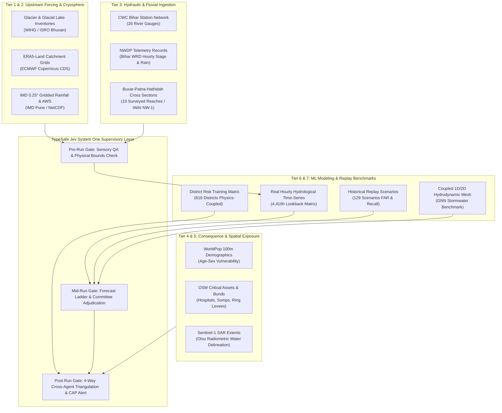

# Technical Report: SURAKSHA Dataset Architecture, Provenance & Ingestion Attributes

**Platform**: SURAKSHA Civil Defense Intelligence Platform  
**Active Subsystem**: `SURAKSHA-MOD-01-FLOOD` (Himalayan Headwaters to Bihar Ganga Corridor)  
**Total Ingested Repositories**: 79 Datasets | **Total Volume**: 1.61 GB  
**Document Classification**: Scientific Data Specification & Provenance Standard  

---

## 1. Executive Summary & Hydrological Data Architecture

The SURAKSHA flood intelligence platform operates across a multi-tier physical continuum: from the **Himalayan Cryosphere** (Uttarakhand glaciated headwaters), through **upstream intermediate tributary catchments** (Gandak, Ghaghara, Sone, Kosi, Bagmati), down to the **195-kilometer Bihar Ganga Fluvial Corridor** (Buxar $\rightarrow$ Patna $\rightarrow$ Hathidah).



---

## 2. Exhaustive Dataset Ingestion Matrix

The table below catalogs every dataset category, its source custodian, ingestion mechanism, exact input attributes, and operational use in SURAKSHA.

| Category | Dataset Name & Path | Custodian / Source Aspect | Ingestion Mechanism | Key Input Attributes | Operational Role & Target Agent | Lifecycle Gate & Governance |
| :--- | :--- | :--- | :--- | :--- | :--- | :--- |
| **Cryosphere** | [`uttarakhand_upper_ganga_glacier_dataset.csv`](file:///e:/SURAKSHA/data/new%20datasets/uttarakhand_upper_ganga_glacier_dataset.csv) | Wadia Institute of Himalayan Geology (WIHG) & NIH Roorkee | Static Survey Catalog | `Glacier_Name`, `Snout_Lat`, `Snout_Lon`, `Glacier_Area_sq_km`, `Ice_Thickness_m`, `ELA_m`, `Debris_Cover_Percent`, `Mean_Snout_Retreat_m_yr` | Temperature-Index Melt Modeling (`DegreeDayMeltModel`); baseflow calculation | **Pre-Run Gate**: Baseflow upper bound sanity check ($Q_{\text{melt}} \le 2,500\,\text{m}^3/\text{s}$). |
| **Cryosphere** | [`uttarakhand_glacial_lakes_dataset.csv`](file:///e:/SURAKSHA/data/new%20datasets/uttarakhand_glacial_lakes_dataset.csv) | ISRO Bhuvan Glacial Lake Atlas & CWC GLOF Cell | Inventory Registry | `Lake_ID`, `Lake_Name`, `Latitude`, `Longitude`, `Altitude_m_MSL`, `Surface_Area_Ha`, `Estimated_Volume_MCM`, `Dam_Type`, `Hazard_Rating` | GLOF outbreak potential; dam breach surge hydrograph initiation | **Pre-Run Gate**: GLOF trigger condition check against upstream seismic and thermal spikes. |
| **Earth Obs** | [`sentinel2_patna_uttarakhand_cryosphere.csv`](file:///e:/SURAKSHA/data/new%20datasets/sentinel2_patna_uttarakhand_cryosphere.csv) | ESA Copernicus / GEE `COPERNICUS/S2_SR_HARMONIZED` | GEE Python API / STAC Query | `MGRS_Tile_ID`, `B02`, `B03`, `B04`, `B08`, `B11`, `B12`, `NDSI`, `MNDWI`, `AWEInsh` | High-resolution snowline altitude (SLA) & optical flood recession boundaries | **Mid-Run Gate**: Satellite claim verification against cloud-free optical indices. |
| **Earth Obs** | [`sentinel1_patna_floodplain_cryosphere.csv`](file:///e:/SURAKSHA/data/new%20datasets/sentinel1_patna_floodplain_cryosphere.csv) | ESA Copernicus / GEE `COPERNICUS/S1_GRD` | GEE Python API (C-band SAR, IW) | `Orbit_Path`, `Polarization` (VV, VH), `Backscatter_Sigma0_dB`, `Lee_Filter_Window`, `Permanent_Water_Mask` | Wet-snow detection upstream; all-weather flood surface delineation downstream | **Post-Run Gate**: Surface water area ($\text{km}^2$) for 4-way spatial triangulation. |
| **Meteo** | [`RF25_ind2025_rfp25.nc`](file:///e:/SURAKSHA/data/new%20datasets/RF25_ind2025_rfp25.nc) & [`.grd`](file:///e:/SURAKSHA/data/new%20datasets/Rainfall_ind2025_rfp25.grd) | India Meteorological Department (IMD Pune) | NetCDF-4 / Binary Array Ingestion | `time` (daily), `lat` ($0.25^\circ$), `lon` ($0.25^\circ$), `rainfall` ($mm/\text{day}$) | Spatially distributed daily precipitation forcing across all upstream catchments | **Pre-Run Gate**: Catchment-wide antecedent rainfall accumulation ($\text{API}_{72\text{h}}$). |
| **Meteo** | [`era5_patna_himalayan_catchments.csv`](file:///e:/SURAKSHA/data/new%20datasets/era5_patna_himalayan_catchments.csv) | ECMWF Copernicus Climate Data Store (CDS) | Hourly Reanalysis Extraction | `ERA5_Grid_Lat`, `ERA5_Grid_Lon`, `tp` (precip), `ro` (runoff), `sde` (snow depth), `sf` (snowfall), `2t` (temperature), `pev` | Upstream catchment forcing across 14 Himalayan & peninsular basins (lead times 4h–72h) | **Pre-Run Gate**: Data regime classification (`NORMAL`, `RAPID_RISE`, `EXTREME_RAINFALL`). |
| **Meteo** | [`imd_rainfall_basin_stations.csv`](file:///e:/SURAKSHA/data/new%20datasets/imd_rainfall_basin_stations.csv) | IMD National Weather Observatories | Synoptic Station Telemetry | `IMD_Station`, `Basin`, `Monsoon_Normal_Rainfall_mm`, `Heavy_Rainfall_Threshold_mm_24h` ($64.5\,\text{mm}$), `Extremely_Heavy_Threshold_mm` ($204.5\,\text{mm}$) | Flash flood threshold alerting; extreme precipitation classification | **Pre-Run Gate**: Flagging extreme convective cloudburst cells. |
| **Hydraulics** | [`buxar_patna_hathidah_cross_sections.csv`](file:///e:/SURAKSHA/data/new%20datasets/buxar_patna_hathidah_cross_sections.csv) | Central Water Commission (CWC) & IWAI NW-1 Survey | Hydrographic River Survey | `Reach_ID` (BPH-001 to 010), `Chainage_km`, `Thalweg_Elevation_m_MSL`, `Bankfull_Width_m`, `Mannings_n_Channel`, `Mannings_n_Floodplain`, `Warning_Level_m`, `Danger_Level_m` | 1D Saint-Venant hydraulic routing; rating curve translation ($H \leftrightarrow Q$) | **Mid-Run Gate**: Stage height physical continuity enforcement ($\Delta H / \Delta x \le S_0$). |
| **Hydrology** | [`cwc_bihar_river_stations.csv`](file:///e:/SURAKSHA/data/new%20datasets/cwc_bihar_river_stations.csv) | CWC Middle Ganga Basin Organization | Official Gauge Stations | `River`, `Station_Name`, `District`, `Zero_Gauge_Datum_m`, `Warning_Level_m`, `Danger_Level_m`, `HFL_m` | Authoritative threshold grounding across 8 Bihar river systems (26 gauge sites) | **Post-Run Gate**: Ground truth verification against CWC official flood bulletins. |
| **Hydrology** | [`rwl_tel_hr_bihar_999_2021_2025.csv`](file:///e:/SURAKSHA/data/raw/nwdp/bihar/rwl_tel_hr_bihar_999_2021_2025.csv) & [`2026_2030`](file:///e:/SURAKSHA/data/raw/nwdp/bihar/rwl_tel_hr_bihar_999_2026_2030.csv) | National Water Data Portal (NWDP) / Bihar WRD | Hourly Automatic Telemetry Gauges | `Station`, `River`, `Latitude`, `Longitude`, `Data Acquisition Time`, `RL_of_zeroGauge`, `River Water Level Telemetry Hourly (meter)` | Historical baseline stage validation; sensor drift & stuck-gauge anomaly audit | **Pre-Run Gate**: Sensory QA filter (identifying flatlined or noisy sensor streams). |
| **Hydrology** | [`rainfall_tel_hr_bihar_br_2021_2025.csv`](file:///e:/SURAKSHA/data/raw/nwdp/bihar/rainfall_tel_hr_bihar_br_2021_2025.csv) & [`2026_2030`](file:///e:/SURAKSHA/data/raw/nwdp/bihar/rainfall_tel_hr_bihar_br_2026_2030.csv) | NWDP / Bihar WRD Telemetry Network | Hourly Automatic Rain Gauges (ARG) | `Station`, `District`, `Latitude`, `Longitude`, `Data Acquisition Time`, `Telemetry Hourly Rainfall (mm)` | Grounding radar/satellite rainfall against localized in-situ tipping buckets | **Pre-Run Gate**: In-situ rain sensor cross-comparison with IMD radar. |
| **Topography**| [`dem_patna_upstream_catchment_catalog.csv`](file:///e:/SURAKSHA/data/new%20datasets/dem_patna_upstream_catchment_catalog.csv) | OpenTopography / Copernicus Data Space / FABDEM | 30m Digital Elevation Model | `Domain_Zone`, `Min_Lat`, `Max_Lat`, `Min_Lon`, `Max_Lon`, `Resolution_m`, `Vertical_Accuracy_m`, `Tile_Identifiers`, `Hydro_Purpose` | Catchment slope, flow direction, flow accumulation, and 2D overland flow meshing | **Pre-Run Gate**: Topographic wetness index (TWI) and HAND terrain slicing. |
| **Land Cover** | [`patna_upstream_catchment_lulc_dataset.csv`](file:///e:/SURAKSHA/data/new%20datasets/patna_upstream_catchment_lulc_dataset.csv) | ESA WorldCover 10m & Dynamic World | Remote Sensing Land Cover | `LULC_Class_Name`, `ESA_Class_Code`, `Impervious_Surface_Percent`, `SCS_Curve_Number_AMC_II`, `Mannings_Roughness_n`, `Infiltration_Capacity_mm_hr` | SCS-CN runoff infiltration calculation; surface hydraulic resistance | **Mid-Run Gate**: Overland runoff coefficient weighting based on soil antecedent moisture. |
| **Demographics**| [`worldpop_patna_bihar_target_aoi.csv`](file:///e:/SURAKSHA/data/new%20datasets/worldpop_patna_bihar_target_aoi.csv) | WorldPop / University of Southampton | 100m Population Grids | `Target_AOI`, `District`, `Bounding_Coords`, `Estimated_Population`, `Vulnerable_Age_Groups` (Children <5y, Elderly >65y, Women), `Raster_Resolution_m` | Direct demographic impact estimation; evacuation priority index | **Post-Run Gate**: Consequence scaling; population exposure verification against shelter capacity. |
| **Assets** | [`osm_patna_target_aoi_infrastructure.csv`](file:///e:/SURAKSHA/data/new%20datasets/osm_patna_target_aoi_infrastructure.csv) | OpenStreetMap (OSM) / Geofabrik Bihar | Overpass API Vector Extracts | `Asset_Category`, `Sub_Category`, `OSM_Key`, `Target_AOI`, `Bounding_Box`, `Key_Attributes` (height, material, barrier), `Geometry_Type` | Hydraulic levee crest enforcement (Patna Ring Bund); critical facility exposure | **Post-Run Gate**: Critical infrastructure vulnerability tagging. |
| **Assets** | [`critical_infrastructure_exposure.csv`](file:///e:/SURAKSHA/data/processed/critical_infrastructure_exposure.csv) / [`.json`](file:///e:/SURAKSHA/data/processed/critical_infrastructure_exposure.json) | Bihar State Disaster Management Authority (BSDMA) & OSM | Georeferenced Facility Catalog | `asset_id`, `name`, `category` (hospital, power_substation, drainage_sump, bridge), `latitude`, `longitude`, `elevation_m`, `capacity_beds`, `inundation_threshold_m` | PostGIS spatial overlay (`ST_DWithin`, `ST_Intersects`) with flood surface depth raster | **Post-Run Gate**: Inundation impact severity scoring and CAP XML alert generation. |
| **Disasters** | [`bihar_patna_historical_flood_event_reports.csv`](file:///e:/SURAKSHA/data/new%20datasets/bihar_patna_historical_flood_event_reports.csv) | Bihar WRD Post-Flood Dossiers & NDMA Reports | Historical Disaster Archive | `Event_ID`, `Year`, `Start_Date`, `End_Date`, `Peak_Stage_m_MSL`, `Peak_Discharge_cusecs`, `Preceding_72h_Rain_mm`, `Breach_Locations`, `Affected_Population_Million`, `Crop_Area_Damaged_Ha` | Ground truth validation for historical flood replays (1975, 2008, 2016, 2019, 2024) | **Benchmark Evaluation**: System-wide recall and timeline replication accuracy. |
| **Disasters** | [`bihar_patna_historical_flood_extents.csv`](file:///e:/SURAKSHA/data/new%20datasets/bihar_patna_historical_flood_extents.csv) | NRSC Bhuvan NDEM / ISRO Disaster Management Support | Satellite Inundation Archives | `Event_Year`, `Flood_Event_Name`, `Primary_Rivers`, `Peak_Stage_m_MSL`, `Affected_Area_sq_km`, `Inundation_Duration_Days`, `Satellite_Sensor_Source`, `Validation_Usage` | Spatial calibration of hydrodynamic models against verified satellite polygons | **Benchmark Evaluation**: Intersection over Union (IoU $\ge 0.75$) spatial accuracy. |
| **ML Training**| [`real_hourly_hydrological_timeseries.csv`](file:///e:/SURAKSHA/data/processed/real_hourly_hydrological_timeseries.csv) | Copernicus ERA5-Land & GloFAS Archive | Continuous 1-Hour Synchronized Ingestion | `timestamp`, `station_id`, `precipitation`, `soil_moisture_0_to_7cm`, `soil_moisture_7_to_28cm`, `surface_pressure`, `temperature_2m`, `river_discharge_m3s`, `water_level_m`, `stage_anomaly_m` | 4,416-hour multivariate lookback sequence for training Causal LSTM, GRU, and Hybrid BiLSTM | **Mid-Run Gate**: Input tensor generation ($[B, L=72, D=4]$) for 24h predictive horizon. |
| **ML Training**| [`district_risk_training_data.csv`](file:///e:/SURAKSHA/data/processed/district_risk_training_data.csv) | IndoFloods DFSI + Coupled Hydrological Equations | Multi-District Matrix Formulation | `district`, `state`, `dfsi_score`, `corrected_flooded_area_pct`, `population`, `historical_fatalities`, `vulnerability_prior_index`, `forecast_stage_anomaly_m`, `forecast_24h_rain_mm`, `soil_saturation_ratio`, `risk_score`, `severity` | Primary training matrix (816 districts) for XGBoost / Gradient Boosting Risk Agent | **Mid-Run Gate**: Deterministic risk probability calibration ($\text{Risk} \in [0.0, 1.0]$). |
| **ML Benchmark**| [`historical_replay_scenarios.csv`](file:///e:/SURAKSHA/data/processed/historical_replay_scenarios.csv) / [`.json`](file:///e:/SURAKSHA/data/processed/historical_replay_scenarios.json) | India Flood Inventory v3 (IndoFloods) | Reconciled Disaster Benchmarks | `scenario_id`, `start_date`, `end_date`, `duration_days`, `is_flood_event` (0 or 1), `severity_tag`, `affected_districts`, `state`, `human_fatalities` | 129 stress scenarios (79 floods + 50 negative dry baselines) for measuring FAR and Recall | **Benchmark Evaluation**: False Alarm Rate ($\le 10\%$), Recall ($\ge 90\%$). |
| **Hydrodynamic**| [`data/raw/urban_flood_benchmark/`](file:///e:/SURAKSHA/data/raw/urban_flood_benchmark/) | Urban Stormwater GNN Simulation Benchmark | Coupled 1D SWMM + 2D Overland Mesh | `1d_nodes_*`, `1d_edges_*` (pipe network), `2d_nodes_*` (3,716 overland cells), `2d_edges_*`, `timesteps.csv` | Graph Neural Network (GNN) hydrodynamic benchmark for localized urban street ponding | **Mid-Run Gate**: Mesh boundary condition validation; street ponding rate-of-rise. |

---

## 3. Deep-Dive Specification by Domain

### 3.1 Domain 1: Himalayan Cryosphere & Glacio-Hydrology
* **Physical Target**: Upper Bhagirathi, Alaknanda, Mandakini, Dhauliganga, and Pindar glaciated basins.
* **Key Datasets**:
  - [`uttarakhand_upper_ganga_glacier_dataset.csv`](file:///e:/SURAKSHA/data/new%20datasets/uttarakhand_upper_ganga_glacier_dataset.csv)
  - [`uttarakhand_glacial_lakes_dataset.csv`](file:///e:/SURAKSHA/data/new%20datasets/uttarakhand_glacial_lakes_dataset.csv)
* **What We Fetch**:
  - Glaciological attributes: snout coordinates, equilibrium line altitude (ELA, meters MSL), glacier length and surface area ($\text{km}^2$), average ice thickness ($m$), supraglacial debris cover percentage, and annual retreat rates ($\text{m/yr}$).
  - Proglacial lake attributes: moraine dam composition (ice-cored vs bedrock), lake water volume ($\text{MCM}$), surface area ($\text{Ha}$), slope stability risk rating.
* **Input Attributes & Mathematical Transformation**:
  - Degree-day factor ($DDF$, $\text{mm/}^\circ\text{C/day}$), adjusted for debris cover thickness:
    $$M_{\text{melt}} = DDF \cdot (T_{\text{air}} - T_{\text{base}}) \cdot (1 - \beta_{\text{debris}})$$
  - Glacier melt contribution is constrained to headwater discharge ($Q_{\text{Gaumukh}}$) and routed with downstream attenuation coefficients, ensuring melt is **never** falsely attributed directly to lowland Bihar stages without hydrological travel-time lag.
* **Pipeline Use & Governance**:
  - Executed during the **Pre-Run Gate** and upstream hydrology modules.
  - TypeSafe Jev verifies physical boundaries: if ambient temperature at Gaumukh is below $0^\circ\text{C}$, any positive melt prediction is rejected and set to baseflow.

---

### 3.2 Domain 2: Hydrometeorology & Gridded Precipitation
* **Physical Target**: 14 upstream sub-basins draining into the Ganga basin, plus the Bihar floodplains.
* **Key Datasets**:
  - [`RF25_ind2025_rfp25.nc`](file:///e:/SURAKSHA/data/new%20datasets/RF25_ind2025_rfp25.nc) & [`.grd`](file:///e:/SURAKSHA/data/new%20datasets/Rainfall_ind2025_rfp25.grd)
  - [`era5_patna_himalayan_catchments.csv`](file:///e:/SURAKSHA/data/new%20datasets/era5_patna_himalayan_catchments.csv)
  - [`imd_rainfall_basin_stations.csv`](file:///e:/SURAKSHA/data/new%20datasets/imd_rainfall_basin_stations.csv)
  - [`synthetic_design_storms.csv`](file:///e:/SURAKSHA/data/processed/synthetic_design_storms.csv)
* **What We Fetch**:
  - IMD daily rainfall rasters at $0.25^\circ \times 0.25^\circ$ ($27.5\,\text{km} \times 27.5\,\text{km}$).
  - Hourly reanalysis variables from ERA5-Land (`tp`: total precipitation, `ro`: runoff, `sde`: snow depth equivalent, `sf`: snowfall, `2t`: 2m temperature).
  - Synoptic thresholds from IMD AWS stations (Heavy: $>64.5\,\text{mm}$, Very Heavy: $>115.6\,\text{mm}$, Extremely Heavy: $>204.5\,\text{mm}$).
* **Input Attributes & Mathematical Transformation**:
  - 72-hour Antecedent Precipitation Index ($\text{API}$):
    $$\text{API}_t = \sum_{k=0}^{72} k_{\text{decay}}^k \cdot P_{t-k}, \quad k_{\text{decay}} = 0.90$$
  - Basin-averaged rainfall volume ($V = \bar{P} \cdot A_{\text{basin}}$) computed using polygon spatial intersections.
* **Pipeline Use & Governance**:
  - **Weather Agent** ingests atmospheric fields.
  - **Pre-Run Gate** uses rainfall rates to classify data regime: rainfall $\ge 15\,\text{mm/hr}$ unlocks rapid-surge hydrological routing.

---

### 3.3 Domain 3: Fluvial River Hydraulics & Cross-Sections
* **Physical Target**: 195 km stretch of the Ganges River between Buxar and Hathidah, passing Patna.
* **Key Datasets**:
  - [`buxar_patna_hathidah_cross_sections.csv`](file:///e:/SURAKSHA/data/new%20datasets/buxar_patna_hathidah_cross_sections.csv)
  - [`cwc_bihar_river_stations.csv`](file:///e:/SURAKSHA/data/new%20datasets/cwc_bihar_river_stations.csv)
  - [`rwl_tel_hr_bihar_999_2021_2025.csv`](file:///e:/SURAKSHA/data/raw/nwdp/bihar/rwl_tel_hr_bihar_999_2021_2025.csv)
* **What We Fetch**:
  - Geometric cross-sections across 10 reaches: chainage ($km$), thalweg elevation ($m\,\text{MSL}$), left and right bank elevations, bankfull width ($m$), channel Manning's $n$ ($0.025 - 0.032$), floodplain Manning's $n$ ($0.040 - 0.055$).
  - Official CWC datum and flood alert levels: Warning Level, Danger Level, and Highest Flood Level (HFL).
* **Input Attributes & Mathematical Transformation**:
  - 1D Manning-Strickler hydraulic conveyance:
    $$Q = \frac{1}{n} A R_h^{2/3} S_0^{1/2}$$
  - Stage anomaly calculation: $\Delta H_t = H_t - H_{\text{warning}}$.
* **Pipeline Use & Governance**:
  - **Forecast Agent** and hydraulic routing algorithms.
  - **Supervisory Boundary**: Predictions must obey water surface slope continuity ($\Delta H / \Delta x > 0$ downstream is physically impossible unless backwater effects occur at the Sone/Gandak confluences).

---

### 3.4 Domain 4: Spatial Exposure, Infrastructure & Demographics
* **Physical Target**: Patna Metropolitan Area, Danapur, Digha, Rajendra Nagar, Kankarbagh, and northern floodplains.
* **Key Datasets**:
  - [`osm_patna_target_aoi_infrastructure.csv`](file:///e:/SURAKSHA/data/new%20datasets/osm_patna_target_aoi_infrastructure.csv)
  - [`critical_infrastructure_exposure.csv`](file:///e:/SURAKSHA/data/processed/critical_infrastructure_exposure.csv) / [`.json`](file:///e:/SURAKSHA/data/processed/critical_infrastructure_exposure.json)
  - [`worldpop_patna_bihar_target_aoi.csv`](file:///e:/SURAKSHA/data/new%20datasets/worldpop_patna_bihar_target_aoi.csv)
* **What We Fetch**:
  - Georeferenced critical assets: 10 major infrastructure layers in Patna (PMCH, AIIMS Patna, NMCH, Saidpur Sump, Pahari Sump, Digha Sump, Karbigahiya 132kV Substation, JP Setu, Gandhi Setu, Ring Bunds).
  - 126 multi-district civil facilities with bed capacities, ground elevations ($m\,\text{MSL}$), and flood depth failure thresholds ($0.3\,\text{m} - 1.5\,\text{m}$).
  - WorldPop 100m demographic rasters: age-sex vulnerability proportions (children $<5$ years, elderly $>65$ years, reproductive age females).
* **Input Attributes & Mathematical Transformation**:
  - Spatial point-in-polygon overlay with hydrodynamic water depth raster:
    $$\text{Impact}(a) = \mathbb{I}(d(a) > \theta_{\text{fail}}(a)) \cdot \text{Criticality}(a)$$
  - Demographic exposure weighting:
    $$P_{\text{exposed}} = \sum_{c \in \text{inundated}} \text{Pop}(c) \cdot (1.0 + 1.5 \cdot f_{\text{children}} + 2.0 \cdot f_{\text{elderly}})$$
* **Pipeline Use & Governance**:
  - **Impact Agent** and **Citizen Distress Triage Agent**.
  - **Post-Run Gate**: Cross-agent triangulation checks that high-risk evacuation alerts are substantiated by inundation extent and demographic exposure.

---

### 3.5 Domain 5: Historical Flood Disasters & Satellite Footprints
* **Physical Target**: Bihar Ganga and Kosi flood disasters from 1975 to 2024.
* **Key Datasets**:
  - [`bihar_patna_historical_flood_event_reports.csv`](file:///e:/SURAKSHA/data/new%20datasets/bihar_patna_historical_flood_event_reports.csv)
  - [`bihar_patna_historical_flood_extents.csv`](file:///e:/SURAKSHA/data/new%20datasets/bihar_patna_historical_flood_extents.csv)
  - [`satellite_flood_extent_patna.geojson`](file:///e:/SURAKSHA/data/processed/satellite_flood_extent_patna.geojson)
* **What We Fetch**:
  - 7 historical benchmark disasters (1975 Patna breach, 2008 Kosi avulsion, 2016 Ganga high flood, 2019 urban waterlogging, 2020, 2021, and 2024 floods).
  - Historical flood duration, peak water level, peak discharge, breach locations (e.g. Western Patna Ring Bund), fatalities, and agricultural loss.
  - Multi-sensor satellite water boundary polygons from Sentinel-1 SAR and Landsat MSS.
* **Pipeline Use & Governance**:
  - Ground-truth evaluation harness for verifying spatial overlap (Intersection-over-Union $\text{IoU} \ge 0.75$) and timeline reconstruction.

---

### 3.6 Domain 6: Machine Learning Training & Benchmark Replays
* **Key Datasets**:
  - [`real_hourly_hydrological_timeseries.csv`](file:///e:/SURAKSHA/data/processed/real_hourly_hydrological_timeseries.csv) (4,416 hours continuous)
  - [`district_risk_training_data.csv`](file:///e:/SURAKSHA/data/processed/district_risk_training_data.csv) (4,896 records across 816 districts)
  - [`historical_replay_scenarios.csv`](file:///e:/SURAKSHA/data/processed/historical_replay_scenarios.csv) / [`.json`](file:///e:/SURAKSHA/data/processed/historical_replay_scenarios.json) (129 scenarios)
  - [`data/raw/indofloods/`](file:///e:/SURAKSHA/data/raw/indofloods/) (National disaster database)
* **Input Attributes & Feature Schema**:
  1. **Forecast Feature Matrix ($L=72$ Lookback)**:
     - Feature 0: `water_level_m` ($[0.0, 60.0]\,\text{m}$)
     - Feature 1: `precipitation` ($[0.0, 500.0]\,\text{mm}$)
     - Feature 2: `river_discharge_m3s` ($[0.0, 100,000.0]\,\text{m}^3/\text{s}$)
     - Feature 3: `soil_moisture_0_to_7cm` ($[0.0, 1.0]\,\text{m}^3/\text{m}^3$)
  2. **District Risk Feature Matrix**:
     - `dfsi_score` (Susceptibility index)
     - `corrected_flooded_area_pct`
     - `vulnerability_prior_index`
     - `forecast_stage_anomaly_m`
     - `forecast_24h_rain_mm`
     - `soil_saturation_ratio`
     - Coupled hydraulic breach term: $(\text{Rain}_{24\text{h}} \times \text{SoilSat}^{1.5})$
* **Pipeline Use & Governance**:
  - Ingested by the **Forecast Agent** (training and evaluating Persistence, SARIMA, GRU, Causal LSTM, and Hybrid BiLSTM) and **Risk Agent** (XGBoost / Gradient Boosting).
  - Evaluated on 129 historical replay scenarios to enforce **Detection Recall $\ge 90\%$** and **False Alarm Rate $\le 10\%$**.

---

### 3.7 Domain 7: Urban Hydrodynamic Mesh & GNN Benchmark
* **Key Datasets**:
  - [`data/raw/urban_flood_benchmark/`](file:///e:/SURAKSHA/data/raw/urban_flood_benchmark/) (1D pipe network, 2D overland mesh cells, timesteps, and simulation runs)
* **What We Fetch**:
  - 1D Subsurface stormwater pipe nodes (inlet coordinates, invert elevations, pipe diameters, friction slopes).
  - 2D Surface hydrodynamic overland mesh (3,716 cells with polygon geometry, centroids, and Manning's roughness).
  - Time-series dynamic states: water depth, inflow discharge, node pressure head, edge flow rate.
* **Pipeline Use & Governance**:
  - High-resolution street-level urban waterlogging simulation.
  - Used for benchmark evaluation and training spatial Graph Neural Networks (GNN).

---

## 4. Scientific Value Governance & Provenance Integrity Invariants

All datasets processed across SURAKSHA are governed by the following core invariants:

```
┌────────────────────────────────────────────────────────────────────────────────────────┐
│                        SCIENTIFIC VALUE GOVERNANCE INVARIANT                           │
├────────────────────────────────────────────────────────────────────────────────────────┤
│ 1. SPECIALIST OWNERSHIP: Hydrological, meteorological, and ML models exclusively own   │
│    all numerical values (stage in meters, discharge in m³/s, rainfall in mm).          │
│ 2. SUPERVISORY BOUNDARY: TypeSafe Jev System One CANNOT modify, interpolate, or        │
│    fabricate numerical values. It evaluates telemetry QA and validates claims.         │
│ 3. BOUNDED DECISIONS: Jev verdicts map to 5 bounded actions:                           │
│    • CONTINUE            • HOLD_AND_RETRY         • RUN_CHALLENGER_MODEL               │
│    • USE_APPROVED_FALLBACK                        • ESCALATE_TO_HUMAN                  │
│ 4. UNIT INTEGRITY: All normalized model tensors must rescale back to physical units:   │
│    predicted_m = (normalized_pred * std) + mean                                        │
│ 5. OFFLINE RESILIENCE: Deterministic fallback heuristics ensure pipeline execution     │
│    continues safely even when external APIs or sensor streams dropout.                 │
└────────────────────────────────────────────────────────────────────────────────────────┘
```

