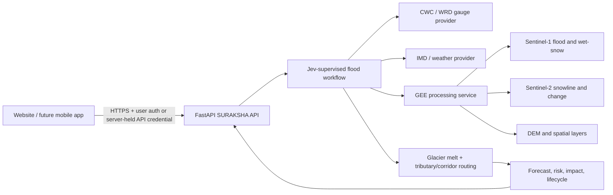

# GEE, Backend API, and Application Integration Plan

## Objective

Connect SURAKSHA's existing flood science into one evidence-aware runtime, use Google Earth Engine (GEE) for real satellite and geospatial observations, expose the result through a stable authenticated backend API, and let the separate SURAKSHA website and future mobile app consume that API. The application layer must not reimplement scientific models or connect directly to GEE.

This plan is based on repository commit `d34347f`, the supplied review notes, and the linked conversation excerpt in the pasted text. The conversation identified `shouri123/SURAKSHA-Website` as an empty private repository at the time of review and said the mobile app repository had not yet been created; verify current repository status before beginning that phase.

## Architecture and trust boundaries

- GEE service-account credentials or ADC remain on the SURAKSHA server. Never ship them to browser/mobile code.
- The application authenticates to SURAKSHA. For browser traffic, prefer the app's server-side proxy or user authentication; a static secret embedded in JavaScript is public.
- GEE supplies Earth-observation/geospatial processing; it does not replace CWC/WRD gauge telemetry or IMD rainfall.
- Forecasts and modeled estimates must remain distinguishable from observed data and offline/synthetic fallback values in storage, logs, API responses, and UI.
- Expensive imagery jobs run asynchronously or through cached products; API requests should not hold open while large GEE reductions/vectorization run.

## Current repository evidence

- `src/suraksha/core/geospatial/earth_engine_client.py` initializes the Earth Engine SDK using service-account credentials or user/default credentials and reports status.
- `s1_sar_processor.py` has an authenticated Sentinel-1 path, but exceptions or missing authentication return a simulated polygon. Consumers must not treat that response as an observation.
- `s2_snowline_processor.py` has an Earth Engine Sentinel-2/DEM path; cloud, scene coverage, and observation provenance need validation.
- `s1_cryosphere_processor.py` enters its authenticated branch but explicitly returns calibrated offline values; real wet-snow extraction is not implemented.
- `change_detection.py` supports explicit offline degradation, and `satellite_agent.py` constructs its detector with `offline_mode=True`.
- `api/routes.py` has health, station, pipeline, and alert/intelligence endpoints. `/pipeline/run` can accept a caller-supplied level and otherwise derives one from a warning threshold; it is not yet a live-data-backed forecast interface.
- `workflow.py` is the main orchestration path. The review notes identify gaps connecting catchment ingestion, glacier routing, corridor routing, exposure geometry, and Jev's planned runtime route to this path.
- The separate website/app repositories are not part of this workspace, so frontend contracts can be specified here but cannot yet be wired or verified against their code.

## Delivery sequence

### Phase 0 — Freeze contracts and provenance rules

1. Define a versioned API contract for health/provider status, station catalog, forecast submission/status/result, satellite products, impact products, alerts, and post-event reconstruction.
2. Standardize an observation envelope: `source`, `observed_at`, `ingested_at`, `spatial_coverage`, `units`, `quality`, `is_fallback`, `provenance`, and `degradation_reasons`. Preserve model estimates separately with `valid_time`, `lead_time`, and model/version metadata.
3. Define explicit provider states (`available`, `degraded`, `unavailable`, `not_configured`) and ensure top-level health is not reported as healthy solely because model checkpoints loaded.
4. Record schemas/OpenAPI as the source of truth for the website and mobile client. Version breaking changes under `/api/v1` to `/api/v2` or compatible additive changes only.

**Exit criteria:** API examples and Pydantic schemas cover observed, modeled, missing, and fallback values; OpenAPI is reproducibly generated and contains no secrets.

### Phase 1 — Make GEE processing real and honest

1. Harden `EarthEngineClient`: one application-scoped initialization, explicit project/config diagnostics, bounded retries/timeouts, and no credential material in status or logs. Keep local/offline mode explicit.
2. Complete Sentinel-1 flood extent processing: filter by AOI, acquisition window, orbit/pass and polarization; reject empty collections; use a documented baseline/change method and permanent-water mask; return acquisition metadata, valid-pixel coverage, algorithm/version, geometry, area, and quality flags. A failed query must be `unavailable`/`degraded`, not a synthetic observation.
3. Implement Sentinel-1 wet-snow extraction in `s1_cryosphere_processor.py` using a dated frozen reference and current scene, with orbit/polarization matching, backscatter change, mask/area statistics, scene coverage, and fallback provenance. Do not present a seasonal climatology as a current observation.
4. Finish Sentinel-2 snowline/snow-cover QA: cloud and shadow masking, scene-date and coverage reporting, tile/AOI consistency, and independent validation. Feed observed snow state into melt inputs only with an explicit time and basin mapping.
5. Implement online pre/post imagery change detection in `change_detection.py`, including Sentinel-1 and Sentinel-2 scene selection, comparable acquisition windows, cloud/valid-pixel masking, change products, and calibrated confidence. Remove the forced offline setting from the production post-event path, while retaining an explicit offline/test mode.
6. Add task-based GEE processing for heavy reductions/exports. Persist task IDs and status; cache immutable results by product, AOI, dates, and processor version.

**Exit criteria:** each satellite output identifies actual collection IDs and dates, coverage, algorithm/version, quality, and fallback status; empty scenes/auth failures cannot yield an apparently observed product.

### Phase 2 — Connect hydrological observations and the scientific chain

1. Add provider adapters for CWC/WRD station histories and IMD rainfall, with a canonical timestamped store at station/catchment resolution. Earth Engine and rainfall/gauge integrations remain separate.
2. Connect `CatchmentIngestionEngine` to the primary workflow/API. Store the actual 72-hour history for `water_level_m`, `rainfall_mm`, `upstream_discharge_cumec`, and `soil_moisture_index`, including gaps and source quality; reject or explicitly downgrade incomplete windows rather than silently reconstructing them.
3. Make glacier/snow inputs spatially and temporally observed: route GEE snow/wet-snow products and real temperature inputs through calibrated sub-basin melt factors; label estimates and propagate uncertainty. Do not use fixed temperature/degree-day constants as if observed.
4. Wire glacier-to-basin discharge and tributary inflows into the primary `FloodPipelineRunner`, then call Buxar–Patna–Hathidah corridor routing and pass resulting station stage trajectories into forecast, risk, and impact calculation.
5. Calibrate routing and melt parameters against observed historical hydrographs. Reanalysis-derived/reconstructed data must be reported separately from gauge-validated performance.

**Exit criteria:** a traceable timestamped observation window flows from provider adapters into inference; every transformed/model value retains source lineage; routing is exercised by observed historical time series, not only hand-authored values.

### Phase 3 — Make orchestration decisions affect runtime

1. Connect Jev's `ExecutionPlan` fields (`required_agents`, primary/challenger routes, fallback) and `ToolRouter` to the actual workflow transitions.
2. Keep Pre-Run, Mid-Run, and Post-Run gates. Their approved decisions must control continue, retry, challenger, fallback, or human escalation transitions under deterministic policy.
3. Require source-backed evidence for claims. Do not allow cross-agent agreement to certify an impact when all agents depend on the same synthetic or modeled input.
4. Make model training fail closed if fitting fails. Reconcile evaluation splits/metrics and tag dataset provenance before promoting checkpoints.

**Exit criteria:** an execution trace shows plan → selected tools/models → executed route → gate decision → resulting transition; injected route failures exercise only approved fallbacks.

### Phase 4 — Ground flood extent, exposure, and lifecycle truth

1. Supply actual flood polygon/depth raster/AOI to `ImpactAgent` and the exposure engine. Overlay WorldPop rasters and individual infrastructure/road geometries rather than area-density approximations.
2. Persist PRE forecast, ACTIVE observations, and POST reconstruction as distinct lifecycle records. Peak time must come from observed evidence when available; otherwise mark it estimated.
3. Require real pre/post imagery and dated ground evidence for post-event certification. Keep confidence and degradation status visible; missing truth data means provisional or human review, not authoritative certification.
4. Replay the named events (1975, 2008, 2016, 2019, 2020, 2021, 2024) only as real datasets become available; event inventories alone are not ground truth.

**Exit criteria:** impact totals are spatial overlays with provenance; each lifecycle verdict links to dated source evidence and records whether it is observed, modeled, or provisional.

### Phase 5 — Stabilize and secure the backend API

1. Use typed request/response contracts and validate AOI, station, date windows, units, and allowed horizons. Replace implicit warning-threshold water-level defaults with explicit `data_mode` and clear behavior for live, user-supplied, and demonstration requests.
2. Add application authentication/authorization, rate limits, request IDs, audit logs, and secrets management. Keep provider credentials server-side. Provide browser clients a server-side proxy/user-auth flow instead of a public embedded API secret.
3. Make long satellite/forecast runs asynchronous: submit job → return job ID → poll status/result; support idempotency and bounded retries. Cache station metadata and stable products.
4. Expose provider health separately for GEE, CWC/WRD, IMD, storage/queue, forecasting, and Jev. Return truthful degraded status if any required provider is unavailable.
5. Publish OpenAPI examples and a client integration guide; configure CORS only for explicit trusted origins.

**Suggested API surface**

| Method and path | Purpose |
|---|---|
| `GET /api/v1/health` | Overall and per-provider readiness/degradation |
| `GET /api/v1/flood/stations` | Station catalog and metadata |
| `POST /api/v1/flood/forecast-jobs` | Submit live or explicitly supplied forecast input |
| `GET /api/v1/jobs/{job_id}` | Job state, stage, errors, and provenance |
| `GET /api/v1/flood/forecasts/{forecast_id}` | Forecast trajectory, lead times, uncertainty, evidence |
| `POST /api/v1/flood/satellite-jobs` | Request flood/snow/change product for AOI and date window |
| `GET /api/v1/flood/impacts/{impact_id}` | Spatially derived population/assets and provenance |
| `GET /api/v1/flood/incidents/{incident_id}` | PRE/ACTIVE/POST incident record and certification status |
| `GET /api/v1/openapi.json` | Machine-readable contract for app clients |

**Exit criteria:** authenticated API clients can submit, track, and retrieve a forecast/product; schemas distinguish observation from estimate/fallback; provider outage and auth failures are visible and do not become false `HEALTHY` responses.

### Phase 6 — Website and mobile application clients

1. Before frontend implementation, check whether the private website repository has gained content. The supplied conversation described it as empty and the app repository as not yet created.
2. Build the website as a presentation/client layer: station/map selection, job status, forecasts, alerts, observed satellite products, confidence/provenance and degraded state. Keep all scientific execution on SURAKSHA.
3. Use a backend-for-frontend or user-authenticated flow for browser traffic. Keep service credentials and privileged API secrets on the server.
4. Define a mobile client against the same API/OpenAPI contract after the web contract stabilizes. Use user-scoped auth, secure device token storage, and push notifications through an authorized notification service.
5. Add contract-level client checks against a staging backend and fixture-based offline UI states.

**Exit criteria:** web and mobile clients use the same versioned contract, show source/valid-time/status labels, handle queued/degraded/error states, and contain no GEE credential or privileged backend secret.

## Validation strategy

- GEE integration: controlled AOIs/date ranges, no-scene cases, cloud-heavy scenes, auth failure, partial coverage, and reproducible metadata checks.
- Data pipeline: timestamp alignment, unit conversion, duplicate/out-of-order samples, missing-variable windows, provider outages, and provenance preservation.
- Hydrology: independent event holdouts with actual observed hydrographs; report MAE/RMSE/NSE and calibration by station and horizon. Clearly separate reanalysis benchmarks from gauge validation.
- Orchestration: deterministic tests of each gate action and approved route; confirm no unapproved model/tool executes.
- API: schema validation, authentication, authorization, rate limiting, idempotency, async job transitions, and provider degradation responses.
- Spatial impacts: polygon/raster alignment, CRS and nodata handling, asset intersection fixtures, and independent map/ground-truth comparisons.
- Frontend: contract compatibility and explicit rendering of observed, estimated, provisional, and unavailable data.

## Recommended implementation order

Prioritize one thin, trustworthy end-to-end slice: **live gauge/rain input + real Sentinel-1 flood observation → authenticated forecast job API → result with source and degradation metadata → website display**. In parallel, implement wet-snow and post-event change detection as separate GEE products, then bring them into melt/ACTIVE/POST only after their QA and validation criteria pass. Add mobile after the API and web contract settle.

## Decisions and information needed before implementation

- Confirm GEE Cloud Project ID, deployment runtime, and whether the backend will use a service account or workload identity/ADC. Store credentials only in deployment secret management.
- Identify the authoritative CWC/WRD and IMD data-access method and licensing/refresh constraints.
- Confirm the website repository and deployment host are still the private repository named in the pasted conversation; the local workspace has no app code to inspect.
- Decide the production user-authentication provider and whether API access is public, partner-only, or operator-only.
- Choose a job queue/database/object store and retention policy for exported imagery products and event evidence.

## Scope boundary

This is an implementation plan, not a claim that GEE, live gauge ingestion, authentication, the app, or the end-to-end workflow have been implemented. The linked conversation preview tool was not available in this environment; the plan uses the supplied pasted conversation text and repository evidence. The specifically named `gtavistas` skill was not present in the available skill catalog or repository skill folders, so repository analysis followed the available `graphify`/`gravitas` guidance and existing graph/code documentation instead.
