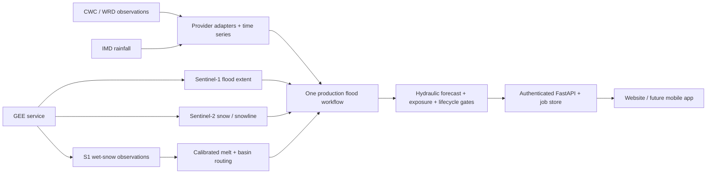

# SURAKSHA Connection Guide: Data → GEE → Flood Pipeline → API → App

This guide explains how to connect the components in this repository into a working service. Implement one narrow path at a time. Keep every input's source and quality attached to its output so a demo, fallback, or model estimate cannot be mistaken for an observation.

Related roadmap: [GEE, API, and application integration plan](/docs?doc=06-geospatial-intelligence--gee-api-application-integration-plan). Repository state used: commit `d34347f`.

## 1. Target architecture



The website/mobile client talks only to SURAKSHA's HTTPS API. The SURAKSHA server talks to GEE and hydrological providers. GEE credentials never go into a browser or mobile bundle. The API credential is a separate credential and should also remain server-side for browser use; use user authentication or a website backend-for-frontend.

## 2. Prepare credentials, providers, and dependencies

1. Create/select and register a Google Cloud project for Earth Engine, enable the Earth Engine API, and confirm your user/service identity has access. Google requires a Cloud project for Python client initialization. See the [authentication guide](https://developers.google.com/earth-engine/guides/auth) and [service account guide](https://developers.google.com/earth-engine/guides/service_account).
2. Install the project with GEE support and configure `EE_PROJECT_ID` in `.env`:

   ```powershell
   python -m pip install -e ".[geo,api]"
   if (-not (Test-Path .env)) { Copy-Item .env.example .env }
   # Edit .env and set EE_PROJECT_ID to the Cloud project ID
   python scripts/setup_earth_engine.py --authenticate
   ```

   The setup command authenticates the local user when requested, initializes the client, and makes a small server round-trip. You can pass `--project YOUR_PROJECT_ID` instead of setting `EE_PROJECT_ID`. Do not replace an existing `.env` file with the example.
3. For an unattended deployment, use Application Default Credentials/workload identity from the hosting platform. A service-account key file is supported for environments that cannot use ADC by setting `EE_SERVICE_ACCOUNT_KEY_FILE`; keep it outside source control and never place it in a browser/mobile bundle. See Google's guidance on [ADC for unattended access](https://developers.google.com/earth-engine/guides/service_account#authenticate-to-earth-engine-using-application-default-credentials).
4. Keep project IDs and credential configuration in deployment configuration/secrets. Never commit service-account JSON. Never return private credential paths or provider error strings that may contain sensitive details in public health responses.
5. Establish access and refresh rules for CWC/WRD stage/discharge and IMD rainfall. Confirm the station IDs, datum, units, timestamp timezone, licensing, and rate limits before writing adapters. Do not assume Earth Engine supplies these hydrology feeds.
6. Define configuration names for provider endpoints, project ID, timeouts, cache/job storage, CORS origins, and auth issuer. Validate required configuration at startup and expose only safe status fields.

Local interactive Earth Engine initialization follows the documented `ee.Authenticate()` then `ee.Initialize(project=...)` flow. Do not use this interactive flow as the hosted service's credential mechanism. See Google's [Python quickstart](https://developers.google.com/earth-engine/guides/quickstart_python) and [unattended auth guidance](https://developers.google.com/earth-engine/guides/service_account).

## 3. Define shared observation and product contracts

Create typed Pydantic contracts in `src/suraksha/disasters/flood/contracts/` before wiring providers. At minimum represent:

```python
class ObservationProvenance(BaseModel):
    source: str
    observed_at: datetime | None
    ingested_at: datetime
    quality: Literal["verified", "provisional", "degraded", "missing"]
    is_fallback: bool = False
    source_record_id: str | None = None
    notes: list[str] = []

class TimedValue(BaseModel):
    value: float | None
    unit: str
    provenance: ObservationProvenance
```

Use immutable, timezone-aware records. Add AOI/CRS and acquisition windows to satellite products; add model/version, valid time, lead time, and uncertainty to forecasts. Use `None` plus a reason for missing measurements. Avoid filling unknown values with physical-looking defaults. Track an explicit `mode` such as `live`, `operator_supplied`, or `demo` on input and output.

Store the canonical four-feature forecast history in the model's required order: `water_level_m`, `rainfall_mm`, `upstream_discharge_cumec`, `soil_moisture_index`. Validate units, order, cadence, gaps, and the full 72-hour history before inference. If it is incomplete, use an explicitly approved fallback or escalate; never silently synthesize the window.

## 4. Build provider adapters first

Keep network I/O outside agents and numerical models. Add provider modules under `src/suraksha/disasters/flood/ingestion/` (or a clearly named providers package), for example:

- `CwcProvider.fetch_observations(station_id, start, end)`
- `ImdProvider.fetch_rainfall(catchment_id, start, end)`
- `GeeProductService.submit(product_request)` and `get_status(task_id)`

Each adapter should return validated contracts, enforce timeouts, handle pagination/rate limits, reject malformed units/timestamps, and map outages to a typed degraded/unavailable result. Keep retry behavior bounded and idempotent. Cache stable results by provider, product, AOI/station, time window, and processor version.

Connect `CatchmentIngestionEngine` to these adapters rather than having each agent make separate ad-hoc requests. The scheduler should accept a provider interface, not `mock_feed` as its only polling path. Keep mock feeds only in tests/demo mode and make their provenance unmistakable.

## 5. Make Earth Engine a reusable processing service

### Initialization

Refactor `EarthEngineClient` to initialize once per process/application lifespan and inject it into processors. It should expose a safe diagnostic result: installed, initialized, project ID, auth mode, and last sanitized error category. Do not mark a provider healthy just because initialization was attempted.

### Implement and validate products

1. **Sentinel-1 flood extent:** query `COPERNICUS/S1_GRD` by AOI, acquisition window, IW mode, polarization, and orbit/pass as required. Confirm the collection is non-empty and enough valid pixels remain. Use a documented and calibrated classification method, permanent-water handling, and optional pre-event reference. Return scene IDs/dates, algorithm version, valid coverage, area, GeoJSON/raster reference, and quality flags. The current fallback polygon must be available only through explicit demo mode.
2. **Sentinel-2 snow cover/snowline:** query the harmonized surface reflectance collection; apply cloud/shadow masks; calculate snow cover/NDSI and elevation-based snowline for valid pixels. Return scene dates, cloud/coverage information, selected tile/AOI, and uncertainty. Do not return tile baseline altitude as an observed snowline.
3. **Sentinel-1 wet snow:** implement matched current/frozen-reference acquisitions with orbit/polarization compatibility and backscatter change thresholds. Return reference/current scene metadata, threshold/method, valid-pixel coverage, wet-snow area, and quality. The current authenticated branch is a stub and should not feed operational melt calculations.
4. **Before/after change detection:** select comparable acquisitions around supplied event dates; calculate flood/damage change only for valid pixels; preserve pre/post scene IDs and masks. Remove forced offline mode only after the real pipeline has honest empty-scene/error behavior.

Start with small, known AOIs and scene windows; compare results with manually reviewed scenes before broadening. Handle no scenes, clouds, partial coverage, permission failure, request timeout, and quota errors explicitly. Earth Engine interactive requests and batch work have different uses; submit large exports as asynchronous tasks and track them. Respect project quotas and limit concurrent work—see Google's [processing environments](https://developers.google.com/earth-engine/guides/processing_environments) and [quota guidance](https://developers.google.com/earth-engine/guides/usage).

Do not turn a failed EE call into an apparently successful feature collection. For interactive products, return a typed unavailable/degraded result. For large products, persist an EE task ID and result location.

## 6. Connect one complete forecast path

Refactor `FloodPipelineRunner` to receive injected services/adapters; avoid global singleton side effects where they hide configuration. The first end-to-end runtime flow should be:

1. Receive station/catchment and forecast time window.
2. Fetch gauge and rainfall histories; validate the 72-hour feature window and provenance.
3. Request or reuse GEE products for the same AOI/time window where needed.
4. Run DataAgent/WeatherAgent with those typed inputs. Agents validate and transform evidence; they must not invent a substitute observation.
5. If cryosphere evidence is available and validated, pass it with real temperature and calibrated sub-basin melt parameters into the melt model. Route only basin-connected runoff.
6. Route tributary and upstream discharge through the hydraulic corridor model. Record calibration/version and boundary conditions.
7. Run forecasting, risk, inundation, exposure, and the lifecycle gates against the same input snapshot.
8. Return forecasts as estimates and satellite/gauge observations as observations, each with provenance, times, quality, and uncertainty.

Make the plan from Jev executable: inspect `required_agents`, primary route, challenger, and approved fallback; dispatch that route; enforce the deterministic policy's returned action. Write an execution trace for selected and actually executed routes. Do not let a gate that says retry/fallback/escalate simply append metadata and continue as normal.

Use a separate explicit demo path for canned values. Replace `value or default` logic with `value if value is not None else ...` when zero is valid; for operational paths, prefer a validation error or degraded state over a default. Do not stamp the current time onto an old or synthetic value and label it as observed now.

## 7. Connect real inundation to impacts and lifecycle

1. Make the satellite/hydraulic output a GeoJSON polygon or depth raster with a known CRS, time, and resolution.
2. Pass that geometry/raster through `ImpactAgent` into `SpatialExposureEngine`.
3. Intersect WorldPop raster cells and real asset/road vectors with the inundation product. Use depth thresholds where assets/population impacts depend on depth. Handle nodata and CRS reprojection deliberately.
4. Keep density-based estimates only as a named provisional fallback, never label them as a spatial overlay.
5. In POST_EVENT, require actual peak/time evidence, dated pre/post imagery, and independent impact evidence for certification. If evidence is missing or all agents share one source, return provisional/human-review status.

## 8. Expose a safe asynchronous API

Keep route functions thin. Define request/response schemas and typed errors first. Suggested flow:

```text
POST /api/v1/flood/forecast-jobs   -> 202 {job_id, status_url}
GET  /api/v1/jobs/{job_id}         -> queued | running | succeeded | degraded | failed
GET  /api/v1/flood/forecasts/{id}  -> forecast + provenance + uncertainty
POST /api/v1/flood/satellite-jobs -> 202 {job_id, status_url}
GET  /api/v1/health                -> per-provider readiness
GET  /api/v1/flood/stations        -> station metadata
```

Use durable job storage and a worker/queue for expensive GEE and flood runs; API process memory is not durable job state. Add request IDs, idempotency keys, auth/authorization, rate limits, timeouts, audit logs, and result retention. Configure CORS to known web origins only; do not combine wildcard origins with credentialed browser requests. Health should show GEE, CWC/WRD, IMD, storage/queue, model registry, and Jev status separately.

Keep the production API credential server-side. For the website, use user sign-in or a server-side route that calls SURAKSHA. For the future mobile app, use user-scoped tokens stored in OS secure storage and the same API contract. Rotate/revoke credentials and do not log bearer tokens.

## 9. Wire the separate website after the contract exists

The current workspace contains no website/mobile client. First confirm the website repo's current state. Then build UI against the OpenAPI schema, not a second copy of model logic. Initial screens should show station selection, forecast job progress, forecast time series, current observation freshness, satellite acquisition dates, impact map, source/quality labels, and degraded/unavailable states. Never show a synthetic/demo result without a visible demo label.

Do not begin the mobile app until the same API contract has stabilized. Web and mobile can share generated API types/client code from OpenAPI, but each must use its own secure user-auth flow.

## 10. Prove each connection before moving on

Use these acceptance checks as implementation milestones (they are instructions, not claims that they already pass):

1. **Provider adapter:** a dated real record returns the expected units/time/source; outage and malformed responses become unavailable/degraded without defaults.
2. **GEE:** a known AOI produces scene IDs, dates, coverage, and a reproducible product; no-scene/auth failure does not emit a synthetic observation.
3. **Window assembly:** exact four-feature 72-hour window, ordered and timezone-aligned; missing feature blocks or explicitly downgrades inference.
4. **Runtime:** trace shows real input record IDs through agents, chosen Jev route, model, hydraulic route, and output provenance.
5. **Spatial impact:** polygon/depth fixture intersects known raster cells/assets and yields expected counts with CRS documented.
6. **API:** unauthenticated calls are rejected where required; valid clients submit a job, poll it, and retrieve a typed result; provider failures remain visible.
7. **Website:** UI renders live, stale, provisional, demo, degraded, and unavailable status correctly against staging API.
8. **Operational replay:** independent held-out observed flood hydrographs and satellite masks support reported metrics. Separate reanalysis benchmarks from gauge-verified results.

Keep these as a growing CI suite and run the relevant checks after each milestone. Add a staging deployment and provider integration checks before production. A green unit suite alone does not establish scientific validity.

## 11. Suggested implementation order

1. Add truthful provenance contracts and an explicit demo/live distinction; remove fake defaults from production paths.
2. Implement provider adapters and the genuine timestamped input window.
3. Complete GEE flood extent first; add wet-snow, snowline, and post-event change products only after each has validated quality metadata.
4. Connect melt and corridor routing to the main runner; validate against gauge hydrographs.
5. Connect polygon/depth products to exposure and make lifecycle certification evidence-gated.
6. Make Jev runtime routing executable and deterministic gate actions effective.
7. Add authenticated API, durable jobs/storage, deployment, monitoring, and provider health.
8. Build the website against OpenAPI, then the mobile app against that same contract.

The first useful milestone is intentionally small: **real CWC/IMD input → validated forecast → authenticated API job/result → website display with timestamps and provenance**. Add GEE flood extent as the next connected product, then bring cryosphere and POST_EVENT products into the science only after their own validation.
