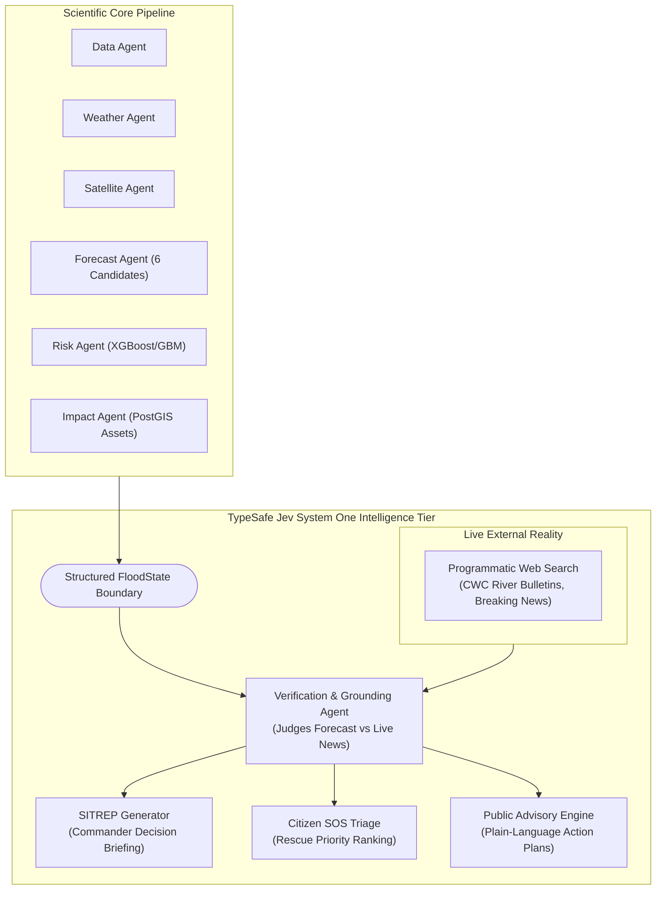

# TypeSafe Jev System One Integration in SURAKSHA Flood Subsystem

## 1. Executive Summary

**TypeSafe Jev** is a **System One** decision model. Rather than generating unconstrained text or replacing physical numerical calculations, Jev provides **fast, typed semantic judgments, probability calibration, and ground-truth verification**.

In the SURAKSHA Flood Subsystem:
- **PyTorch (Causal LSTM, GRU, Hybrid BiLSTM) and statsmodels (ARIMA, SARIMA)** compute the physical hydrological stages.
- **XGBoost and Scikit-Learn** compute vulnerability breach probabilities.
- **Google Earth Engine and PostGIS** calculate flood extents and infrastructure intersections.
- **Jev sits directly above the scientific pipeline**, consuming the structured `FloodState` and external evidence to deliver **verification, grounding, triage, and civil defense situation reporting**.

---

## 2. Architectural Blueprint



---

## 3. The Three System One Primitives in Action

### A. Noul (Calibrated Probability of True/False Condition)
Used for binary verification:
```python
Noul(instructions="Based on external search evidence, is there news or official confirmation of flooding in this district?")
```
*Output*: A calibrated probability in $[0.0, 1.0]$. A score of `0.88` signifies high empirical likelihood of external media confirmation.

### B. Choice (Picking One Defined Categorical Diagnosis)
Used for root cause classification and rescue asset selection:
```python
Choice(
    instructions="Classify the urgency of this citizen distress message during active flooding.",
    criteria={
        "LIFE_THREATENING_TRAPPED": "Water entering living area, rooftop stranding, rapid rise",
        "MEDICAL_EMERGENCY_ISOLATED": "Patient requires oxygen, dialysis, insulin, or acute trauma support",
        "PROPERTY_CONCERN": "Water in basement, street impassable, life safe",
        "RELIEF_REQUEST": "Safe on upper floor, requesting drinking water, food packets"
    }
)
```
*Output*: Chosen category + confidence score.

### C. Score (Rating Degree on an Ordered Descriptive Scale)
Used for corroboration strength and dispatch priority:
```python
Score(
    instructions="Rate the dispatch priority of emergency rescue teams for this call.",
    criteria=[
        "advisory only / no dispatch needed",
        "scheduled relief round (within 6 hours)",
        "urgent evacuation corridor dispatch (within 2 hours)",
        "immediate tactical skiff / SDRF boat dispatch (under 30 minutes)"
    ]
)
```
*Output*: Selected level + probability distribution + continuous score in $[0.0, 1.0]$.

---

## 4. Configuration & API Keys

The SURAKSHA Jev client reads from standard environment variables:
```powershell
$env:TYPESAFE_API_KEY="your-api-key"
# or
$env:JEV_API_KEY="your-api-key"
```

If neither key is present, the engine activates a **deterministic offline mock mode**, guaranteeing that unit tests, local development, and continuous integration pipelines execute without failure.
