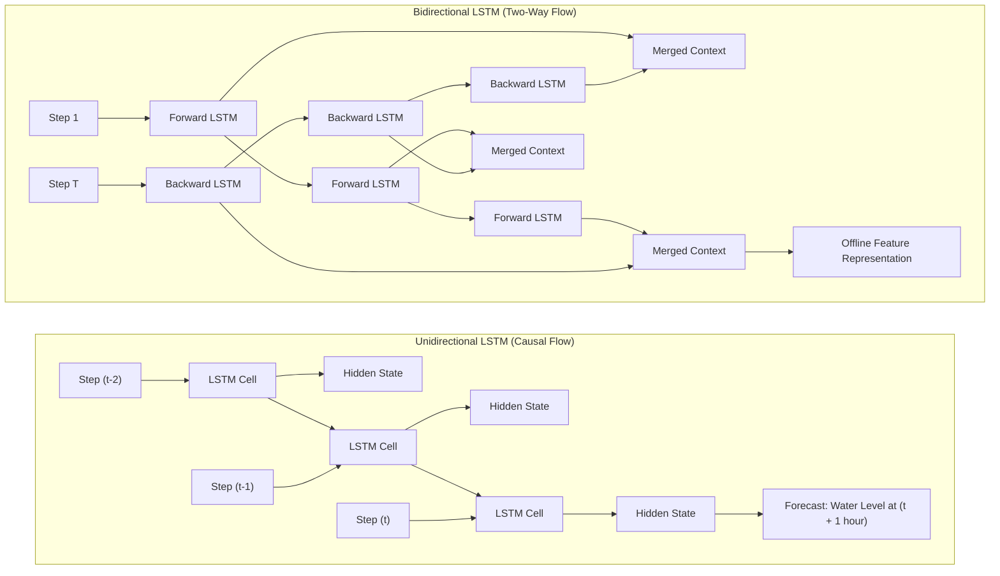
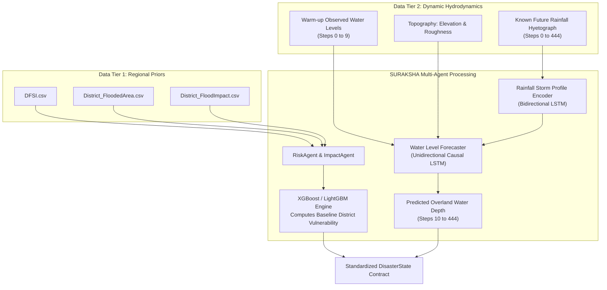

# Technical Evaluation Report: LSTM vs. BiLSTM Architecture Selection for Hydrological Forecasting & Urban Flood Intelligence

**Project**: SURAKSHA (Disaster Intelligence Platform)  
**Author**: Lead AI/ML Systems Engineer  
**Date**: September 2026  
**Scope**: Flood Subsystem — Sequence Modeling, Regional Tabular Priors & 1D-2D Urban Hydrodynamics  

---

## Executive Summary

This report delivers the technical and operational blueprint for model selection in the **SURAKSHA Flood Intelligence Subsystem**. It reconciles deep learning sequence architectures (**Unidirectional LSTM** versus **Bidirectional LSTM**) against the empirical reality of all datasets present in the workspace:

1. **Regional Tabular Priors & Catalog**: Static district susceptibility indices and historical disaster inventories (`DFSI.csv`, `District_FloodedArea.csv`, `District_FloodImpact.csv`, and `India_Flood_Inventory_v3.csv`).
2. **High-Resolution Urban Hydrodynamic Benchmark**: Dynamic 1D pipe and 2D surface terrain sequences at 5-minute sampling intervals (`urban-flood-modelling.zip`).

### Key Decisions & Findings

1. **Water Level Target Forecasting Must Be Causal (Unidirectional LSTM / GRU)**: When predicting future water levels, the model must only process past data moving forward in time. Bidirectional LSTM cannot be used to predict future water levels because future water depth measurements do not exist during live forecasting. Attempting to use a backward pass on future water levels creates an impossible dependency or severe lookahead bias.
2. **Rainfall Exogenous Inputs Can Use BiLSTM**: In the urban flood dataset, future rainfall is 100% known across the entire 445-step forecast horizon (from weather radar, meteorological forecasts, or design storm hyetographs). Therefore, a **Bidirectional LSTM can be effectively used as a Rainfall Storm Profile Encoder**, allowing the system to comprehend upcoming storm peaks before predicting overland water depth.
3. **Regional Datasets Belong in the Risk Prior Engine (XGBoost)**: The 4 CSV tables are cross-sectional district tables without continuous time-series. They must be processed using **Gradient Boosted Decision Trees (XGBoost / LightGBM)** within the `RiskAgent` to output baseline vulnerability scores.

---

## 1. Architecture Comparison: LSTM vs. BiLSTM



### 1.1 Unidirectional LSTM (Standard Causal Network)

A standard LSTM processes data chronologically from past to present: Step 1 → Step 2 → Step t.

At each time step, the network maintains two internal memories:

- **Cell State**: The long-term memory carrying information across many hours.
- **Hidden State**: The working memory representing the immediate situation.

The network controls information flow through three internal gates:

- **Forget Gate**: Decides what past information is no longer relevant (e.g., rainfall that happened 4 days ago that has already drained).
- **Input Gate**: Decides what new sensor readings should be committed to memory (e.g., sudden sharp rise in current rainfall intensity).
- **Output Gate**: Determines the current hidden state and computes the forecast.

**Core Property**: The prediction at time t depends **strictly on observations up to time t**. It never looks into the future, making it 100% compliant with real-time operational forecasting.

### 1.2 Bidirectional LSTM (Two-Way Network)

A BiLSTM processes the input sequence through two separate layers simultaneously:

- **Forward Layer**: Reads from Step 1 to Step T (Past → Future).
- **Backward Layer**: Reads from Step T to Step 1 (Future → Past).

At every step, the forward memory and backward memory are concatenated together into a single vector of double size.

**Core Property**: The output at time step t requires knowledge of **both past steps and future steps**.

### 1.3 Direct Comparison Matrix

| Dimension | Unidirectional LSTM | Bidirectional LSTM (BiLSTM) |
| :--- | :--- | :--- |
| **Information Direction** | One-way: Past → Present | Two-way: Past → Future AND Future → Past |
| **Real-Time Live Forecasting** | **Fully Capable**: Feeds incoming live sensor streams | **Infeasible for Target**: Cannot run backward pass from unmeasured future points |
| **Lookahead Leakage** | Zero risk of lookahead bias | High risk if future targets are fed during training |
| **Memory & Parameter Cost** | Baseline (1x parameters) | Double footprint (2x parameters) |
| **Best Used In SURAKSHA** | Live water-level forecasting (`ForecastAgent`) | Exogenous future rainfall profile encoding & offline satellite gap-filling |

---

## 2. The Lookahead Bias Problem Explained

### 2.1 Why BiLSTM Fails for Direct Water Level Forecasting

Consider an emergency operations center at **2:00 PM**:

- You have river gauge readings from **6:00 AM to 2:00 PM**.
- Your goal is to predict the flood crest height at **6:00 PM**.

To run a Bidirectional LSTM:

1. The forward network reads from 6:00 AM up to 2:00 PM.
2. The backward network must start at **6:00 PM and read backward to 2:00 PM**.
3. But at 2:00 PM today, **the reading at 6:00 PM has not occurred yet**.
4. If an engineer fills future steps with zeros or dummy values, the backward hidden states produce garbage noise.
5. If future values are accidentally included during testing, the model appears to have 99% accuracy on paper, but completely fails in real life because it was cheating by reading the answer in advance.

### 2.2 Where BiLSTM Is Valid and Highly Effective

BiLSTM is scientifically valid in two specific scenarios:

1. **Exogenous Future Rainfall Hyetograph Encoding**:

   When meteorologists issue a storm forecast (or when simulation benchmarks provide the full 36-hour rainfall hyetograph), the rainfall amounts for the entire storm are already known. A BiLSTM can read the entire rainfall curve forwards and backwards, enabling the network to know the exact peak storm intensity and duration before predicting resulting surface water levels.

2. **Offline Retrospective Satellite Gap-Filling**:

   When reviewing a historical monsoon season from Sentinel-2 optical imagery, Day 15 is often obscured by clouds. Because Day 1 through Day 14 and Day 16 through Day 30 are already recorded, a BiLSTM can reconstruct the flooded water extent on Day 15 using context from both before and after the cloud event.

---

## 3. Comprehensive Workspace Dataset Audit

```text
========================================================================================
TIER 1: REGIONAL TABULAR PRIORS & HISTORICAL CATALOG
========================================================================================
1. DFSI.csv

   Rows: 744 | Columns: District Name, State, District Flood Susceptibility Index (DFSI)
   Role: Static district vulnerability baseline (e.g., Patna, Bihar: 19.30)

2. District_FloodedArea.csv

   Rows: 732 | Columns: District Name, Flooded Area %, Permanent Water %, Corrected Area %
   Role: Geographic surface water exposure prior

3. District_FloodImpact.csv

   Rows: 732 | Columns: District Name, Human Fatalities, Injured, Population, Mean Duration
   Role: Historical human impact and vulnerability weighting

4. India_Flood_Inventory_v3.csv

   Rows: 6,876 | Columns: Unique Event ID, Start Date, End Date, Duration, District, State, Damage
   Role: Ground truth catalog for historical incident verification and replay testing

========================================================================================
TIER 2: URBAN HYDRODYNAMIC DYNAMIC BENCHMARK (urban-flood-modelling.zip)
========================================================================================
Structure: Coupled 1D Subsurface Drainage Pipes + 2D Overland Street Mesh
- 1D Network: 17 Subsurface Nodes (Pipes, Manholes, Invert Elevations, Base Areas)
- 2D Network: 3,716 Overland Terrain Cells (Elevation, Roughness, Flow Accumulation, Aspect)
- 1D-2D Links: Hydraulic connections where pipes overflow onto streets
- Timestep Resolution: 5-minute sampling intervals

TRAIN SET (94 Timesteps = ~8 Hours):
- Complete ground truth for: Rainfall, Water Level, Water Volume, Pipe Flow

TEST SET (445 Timesteps = ~37 Hours):
- Warm-up Window (Timesteps 0 to 9 = 50 mins): Both Rainfall and Water Level are observed.
- Forecast Horizon (Timesteps 10 to 444 = ~36 hrs):
  * Rainfall: 100% complete across all 445 steps (Zero missing values).
  * Water Level: Missing / Target to be forecasted.

========================================================================================
```

---

## 4. Master Architectural Mapping for SURAKSHA



### 4.1 Role of Models by Agent

#### RiskAgent & ImpactAgent

- **Input**: Merged district tables (`DFSI.csv`, `District_FloodedArea.csv`, `District_FloodImpact.csv`).
- **Model**: **XGBoost / Gradient Boosted Decision Trees**.
- **Output**: Static vulnerability index score between 0.0 and 1.0 per district.

#### ForecastAgent

- **Input**: 5-minute sequential sensor readings and future storm profile.
- **Model Architecture (Hybrid Encoder-Decoder)**:
  1. **Rainfall Encoder (BiLSTM)**: Processes known future rainfall forward and backward to extract storm peak intensity.
  2. **Water Level Forecaster (Unidirectional Causal LSTM)**: Takes past water levels, static slope/roughness, and the encoded storm profile to forecast water levels forward step-by-step.
- **Output**: Continuous predicted water levels across future hours.

#### Simulation & Replay Harness

- **Input**: Historical disaster records (`India_Flood_Inventory_v3.csv`).
- **Function**: Replays historical storm events through the pipeline to measure detection latency and warning lead times.

---

## 5. Summary Engineering Takeaways

1. **Never use BiLSTM directly on the target water level sequence**; operational forecasting requires strictly causal (unidirectional) progression.
2. **BiLSTM is approved for exogenous rainfall storm profile encoding** because future rainfall sequences are provided across the entire forecast horizon.
3. **Do not force recurrent neural networks on static district tables**; maintain clean separation between tabular priors (XGBoost) and dynamic time-series (LSTM).
