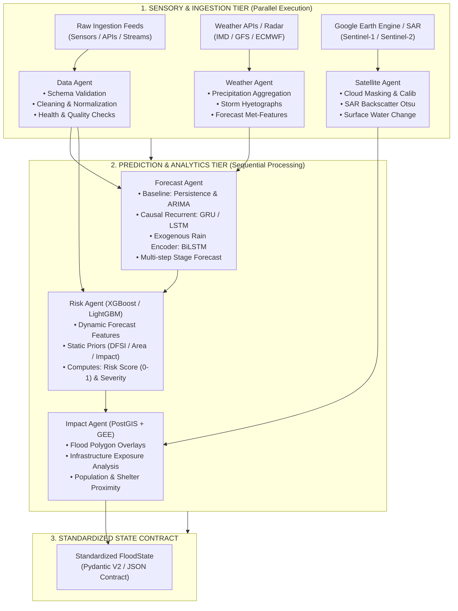
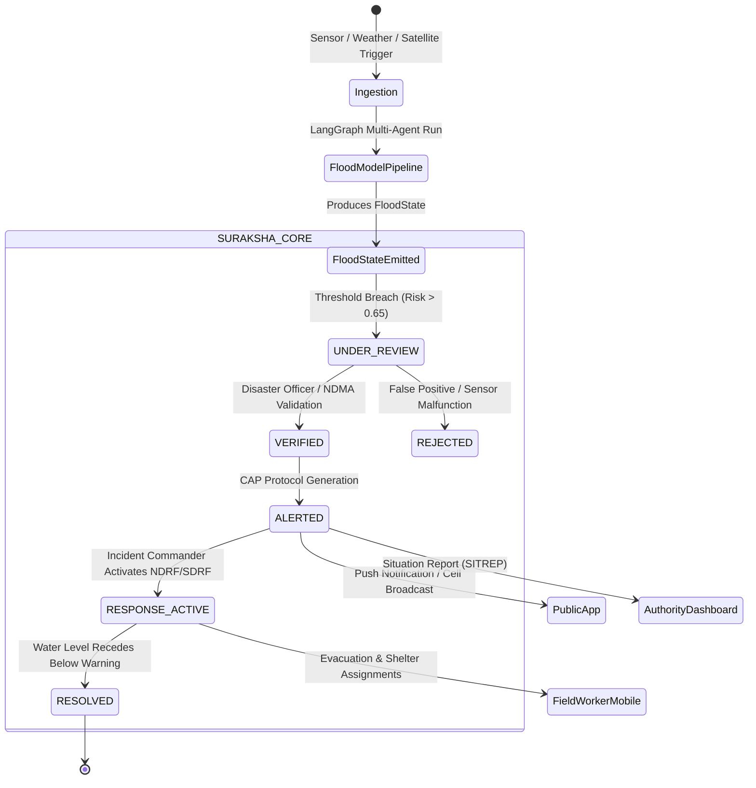
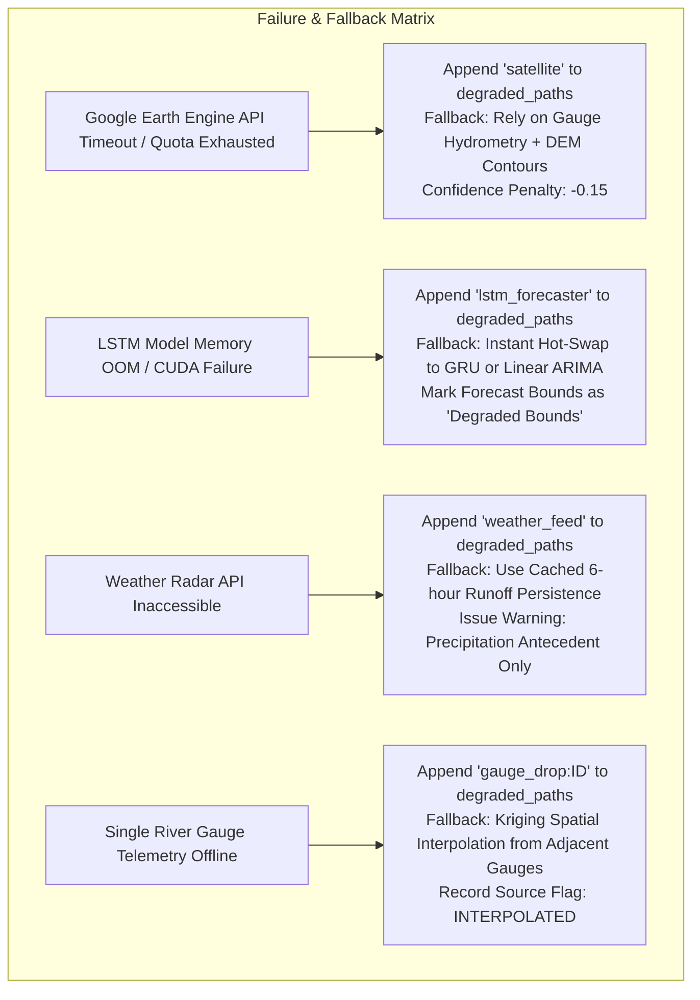

# SURAKSHA Disaster Intelligence Platform
# Technical Specification: Flood Model Subsystem (Module 01)

**Document Version**: 1.0.0  
**Status**: APPROVED BASELINE SPECIFICATION  
**Module Identifier**: `SURAKSHA-MOD-01-FLOOD`  
**Target Delivery**: SURAKSHA Alpha / Phase 1  

---

## Executive Definition

> **The SURAKSHA Flood Model is a LangGraph-orchestrated, multi-agent flood-intelligence pipeline that combines continuous hydrological forecasting, satellite/geospatial analysis, vulnerability modelling, and impact assessment to produce a standardized `FloodState` for the central SURAKSHA backend.**

The **Flood Model is not a single machine learning model**. It is a complete disaster-specific intelligence pipeline. As the first specialized hazard module built for SURAKSHA, it establishes the architectural contract, multi-agent pattern, and state schema that will subsequently be replicated for Earthquakes, Landslides, Cyclones, Wildfires, and Tsunamis.

```
SURAKSHA Multi-Hazard Architecture
   │
   ├── Flood Model          [MODULE 01 — ACTIVE SPECIFICATION]
   ├── Earthquake Model     [MODULE 02 — PLANNED]
   ├── Landslide Model      [MODULE 03 — PLANNED]
   ├── Cyclone Model        [MODULE 04 — PLANNED]
   ├── Wildfire Model       [MODULE 05 — PLANNED]
   └── Tsunami Model        [MODULE 06 — PLANNED]
```

---

## 1. Core Objectives & Intelligence Chain

The Flood Model systematically answers four foundational operational questions in strict chronological order:

```
┌─────────────────────────┐      ┌─────────────────────────┐
│   A. What is happening?  │ ───> │ B. What may happen next?│
│   Detection & Condition │      │       Forecasting       │
└─────────────────────────┘      └─────────────────────────┘
             │                                │
             ▼                                ▼
┌─────────────────────────┐      ┌─────────────────────────┐
│   C. How risky is it?   │ ───> │ D. What is affected?    │
│     Risk Assessment     │      │    Impact Assessment    │
└─────────────────────────┘      └─────────────────────────┘
```

1. **Detection / Current Condition**: What are the current river gauge stages, rainfall accumulation rates, soil moisture levels, and surface water extents?
2. **Forecasting**: How will runoff, discharge rates, and inundation depths propagate over the next 6, 12, 24, and 72 hours?
3. **Risk Assessment**: Given the forecast, local terrain, and historical district vulnerabilities, what is the probability and severity of critical threshold breaches?
4. **Impact Assessment**: What critical infrastructure (roads, bridges, schools, hospitals), population clusters, agricultural zones, and shelters fall within the flood polygon?

---

## 2. End-to-End Pipeline Architecture

The Flood Model executes as an explicit, deterministic directed acyclic graph (DAG) managed via **LangGraph**. The workflow enforces parallel sensory ingest followed by sequential analytical aggregation:



---

## 3. Data Tiering & Taxonomy

Data inputs are segregated into four distinct categories to avoid conflating static vulnerability priors with dynamic continuous time series:

```
                                 FLOOD DATA TAXONOMY
                                          │
       ┌──────────────────┬───────────────┴───────────────┬──────────────────┐
       ▼                  ▼                               ▼                  ▼
Category A:            Category B:                     Category C:        Category D:
Hydrological Series    Historical Prior Catalog        Geospatial / EO    External Weather
(Dynamic 1D/2D)        (Regional Tables)               (Earth Engine)     (Meteo Feeds)
- Stage Heights        - DFSI.csv (744 districts)      - Sentinel-1 SAR   - Radar hyetographs
- Discharge rates      - FloodedArea.csv (732 dist)    - Sentinel-2 Opt   - Precipitation rate
- 5-min urban mesh     - FloodImpact.csv (732 dist)    - NASADEM / SRTM   - IMD/ECMWF forecasts
- Stream gauge feeds   - India_Flood_Inventory_v3.csv  - Dynamic World    - Soil saturation index
```

### Category A: Hydrological Time Series (Dynamic)
* **Purpose**: Direct sequential input for the `ForecastAgent`.
* **Variables**: Continuous timestamp, river water level ($m$), volumetric discharge ($m^3/s$), precipitation intensity ($mm/h$), culvert/pipe flow ($m^3/s$).
* **Primary Sources**:
  * `data/urban_flood/`: High-resolution 1D/2D urban benchmark (3,716 surface mesh cells + 17 subsurface drainage nodes at 5-minute sampling intervals).
  * Central Water Commission (CWC) telemetry APIs and state hydrometric gauge networks.

### Category B: Historical Flood Data & Tabular Priors (Static / Cross-Sectional)
* **Purpose**: District-level baseline exposure weighting and historical incident replay. **Not suitable for continuous LSTM training**.
* **Primary Assets**:
  * `DFSI.csv` (744 districts): District Flood Susceptibility Index ranking regional baseline hazard.
  * `District_FloodedArea.csv` (732 districts): Historical percentage of district inundated vs. permanent water bodies.
  * `District_FloodImpact.csv` (732 districts): Historical human fatalities, casualties, affected population, and mean duration.
  * `India_Flood_Inventory_v3.csv` (6,876 verified events): Longitudinal disaster catalog for verification, model calibration, and retrospective scenario replay.

### Category C: Satellite & Earth Observation Data (Spatial)
* **Purpose**: Inundation surface delineation, ground-truth water boundary mapping, and terrain constraint extraction.
* **Sources**: Google Earth Engine (GEE), Copernicus Open Access Hub, Sentinel-1 Synthetic Aperture Radar (C-band SAR, cloud-penetrating), Sentinel-2 MultiSpectral Instrument (MSI, optical), Copernicus DEM / ALOS PALSAR / NASADEM (30m elevation).

### Category D: External Weather & Hydrometeorological Feeds
* **Purpose**: Antecedent precipitation indexing and exogenous future rainfall profiles.
* **Sources**: India Meteorological Department (IMD) gridded rainfall / radar hyetographs, ECMWF Integrated Forecasting System (IFS), NOAA Global Forecast System (GFS), Open-Meteo High-Resolution APIs.

---

## 4. Multi-Agent Specification & Responsibilities

```
                                 AGENT BOUNDARIES
                                        │
    ┌─────────────────────────┬─────────┴─────────┬─────────────────────────┐
    ▼                         ▼                   ▼                         ▼
Data Agent                Weather Agent       Satellite Agent           Forecast Agent
Ingestion, cleaning,      Rainfall metrics,   GEE SAR backscatter,      ARIMA/GRU/LSTM,
schema validation.        hyetographs.        flood extent mask.        future water level.
[NO RISK PREDICTION]      [WEATHER ONLY]      [SPATIAL ONLY]            [TIME-SERIES ONLY]
    │                         │                   │                         │
    └─────────────────────────┼───────────────────┴─────────────────────────┘
                              ▼
                          Risk Agent
                          XGBoost on dynamic forecast + static tabular priors.
                          Outputs calibrated risk score (0.00-1.00) & severity.
                              │
                              ▼
                          Impact Agent
                          PostGIS intersections: roads, schools, shelters, people.
```

### 4.1 Data Agent
* **Role**: Deterministic gatekeeper of raw sensory telemetry.
* **Explicit Boundary**: **Does NOT predict risk, forecast stages, or classify alerts.**
* **Core Tasks**:
  * Ingest incoming sensor messages (MQTT, Kafka, REST webhooks, CSV drops).
  * Enforce schema compliance via Pydantic models.
  * Detect and log missing readings, anomalous jumps (sensor spike filtering), and clock drifts.
  * Perform min-max / z-score normalization based on historical gauge statistics.
  * Wrap all accepted data points into immutable `Evidence` records with cryptographic hashes and provenance timestamps.

### 4.2 Weather Agent
* **Role**: Meteorologic feature aggregator and storm hyetograph generator.
* **Core Tasks**:
  * Harvest real-time and forecasted cumulative precipitation across target catchments.
  * Compute Antecedent Precipitation Indices ($API_{3d}$, $API_{7d}$) for soil moisture saturation estimates.
  * Construct future rainfall profiles $[r_{t+1}, r_{t+2}, \dots, r_{t+H}]$ across the forecast horizon $H$.

### 4.3 Satellite Agent
* **Role**: Earth Observation feature extractor and surface water change detector.
* **Core Tasks**:
  * Query Google Earth Engine REST API / Python SDK for Sentinel-1 GRD SAR scenes covering the region of interest.
  * Apply speckle filtering (Lee filter, $7 \times 7$ window) and Otsu automatic thresholding on VV/VH backscatter ($\sigma_0 \le -16 \text{ dB}$).
  * Compute Normalized Difference Water Index (NDWI) and Modified NDWI (MNDWI) on cloud-free Sentinel-2 acquisitions.
  * Generate spatial differential masks: $\Delta \text{Extent} = \text{Water}_{\text{current}} - \text{Water}_{\text{permanent\_baseline}}$.
  * Emit standardized GeoJSON polygons containing confidence scores and acquisition timestamps.

### 4.4 Forecast Agent
* **Role**: Causal sequence modeling of downstream stage heights and flood depths.
* **Causality Enforcement**:
  * **Unidirectional (Causal) LSTM / GRU**: Mandatory for target water level prediction ($y_{t+1}, \dots, y_{t+H}$). Under live operations, unmeasured future stages cannot be read in reverse; backward passes over the forecast target induce catastrophic lookahead leakage.
  * **Bidirectional LSTM (BiLSTM)**: Strictly approved as an **Exogenous Rainfall Profile Encoder**. Because forecast storm hyetographs are fully known across the horizon from meteorological radar, a BiLSTM reads the entire storm curve forward and backward to encode peak storm intensity and duration before feeding the causal water depth decoder.
* **Experimental Benchmarking Hierarchy**:
  1. *Baseline 0*: Persistence Model ($y_{t+h} = y_t$).
  2. *Baseline 1*: Autoregressive Integrated Moving Average (ARIMA).
  3. *Baseline 2*: Seasonal ARIMA (SARIMA) for tidal or monsoon cycles.
  4. *Deep Learning Tier*: 2-layer Gated Recurrent Unit (GRU).
  5. *Deep Learning Tier*: 2-layer Causal LSTM ($H=24$ to $435$ steps).
  6. *Hybrid Encoder-Decoder*: BiLSTM Rain Profile Encoder $\rightarrow$ Causal LSTM Water Forecaster.

### 4.5 Risk Agent
* **Role**: Multi-modal fusion of dynamic hydrological forecasts and static socioeconomic priors.
* **Model Engine**: Gradient Boosted Decision Trees (**XGBoost / LightGBM**).
* **Feature Vector ($X_{\text{risk}}$)**:
  * Dynamic Forecast Features: Maximum predicted water depth ($\max \hat{y}_{t+h}$), rate of stage rise ($\frac{\Delta y}{\Delta t}$), predicted duration above warning level.
  * Meteorological Features: 24-hour cumulative rainfall, storm intensity percentile.
  * Static Regional Priors: District Flood Susceptibility Index (`DFSI`), historical flooded area ratio (`Flooded Area %`), permanent water body buffer (`Permanent Water %`), historical casualty index (`District_FloodImpact`).
  * Spatial Evidence: Satellite-observed inundation expansion rate ($\Delta \text{Extent}$).
* **Outputs**: Calibrated continuous risk score $R \in [0.00, 1.00]$, categorical severity (`LOW`, `MEDIUM`, `HIGH`, `CRITICAL`), and model epistemic confidence $C \in [0.00, 1.00]$.

### 4.6 Impact Agent
* **Role**: Geospatial asset exposure, critical infrastructure intersection, and vulnerability mapping.
* **Tech Stack**: PostGIS spatial database + Google Earth Engine + Shapely / GeoPandas.
* **Core Tasks**:
  * Intersect predicted/observed flood polygons with OpenStreetMap (OSM) and Census spatial layers.
  * Quantify inundated geographic area ($\text{km}^2$) and identify breached district administrative boundaries.
  * Enumerate threatened infrastructure: bridges, substations, schools, hospitals, drinking water stations.
  * Calculate nearest unaffected emergency shelters and compute routing accessibility corridors.

---

## 5. Formal Data Contracts & State Schemas

### 5.1 The `Evidence` Object
Every incoming observation, whether from a river gauge, radar station, or satellite pass, is packaged into an immutable `Evidence` record:

```json
{
  "evidence_id": "evi-flood-20260921-00892",
  "source_type": "sensor_gauge | weather_radar | satellite_sar | crowdsource",
  "source_id": "CWC-GAUGE-GANGES-PATNA-04",
  "timestamp": "2026-09-21T21:40:00Z",
  "ingest_timestamp": "2026-09-21T21:42:15Z",
  "location": {
    "latitude": 25.612,
    "longitude": 85.144,
    "district": "Patna",
    "state": "Bihar"
  },
  "metrics": {
    "water_level_m": 48.92,
    "danger_level_m": 48.60,
    "warning_level_m": 47.60,
    "discharge_m3s": 34200.0,
    "rainfall_last_1h_mm": 14.2
  },
  "quality_flag": "VALIDATED",
  "hash_sha256": "8f4a12b...c72e"
}
```

### 5.2 The Standardized `FloodState` Contract
The final artifact produced by the Flood Subsystem that is delivered to SURAKSHA Core:

```json
{
  "$schema": "https://suraksha.gov.in/schemas/v1/flood_state.json",
  "hazard_type": "flood",
  "state_id": "flstate-20260921-patna-001",
  "timestamp": "2026-09-21T21:45:00Z",
  "status": "UNDER_REVIEW",
  "location": {
    "district": "Patna",
    "state": "Bihar",
    "center_lat": 25.612,
    "center_lon": 85.144,
    "bounding_box": [85.01, 25.50, 85.25, 25.70]
  },
  "current_condition": {
    "observed_water_level_m": 48.92,
    "danger_level_threshold_m": 48.60,
    "status": "ABOVE_DANGER_LEVEL"
  },
  "forecast": {
    "model_architecture": "Hybrid_BiLSTM_RainEncoder_Causal_LSTM_Dec",
    "horizon_hours": 24,
    "predictions": [
      {"step_hour": 6, "water_level_m": 49.35, "upper_bound_95": 49.60, "lower_bound_95": 49.10},
      {"step_hour": 12, "water_level_m": 49.82, "upper_bound_95": 50.15, "lower_bound_95": 49.49},
      {"step_hour": 24, "water_level_m": 50.10, "upper_bound_95": 50.55, "lower_bound_95": 49.65}
    ]
  },
  "risk_assessment": {
    "risk_score": 0.88,
    "severity": "CRITICAL",
    "confidence": 0.92,
    "primary_risk_drivers": [
      "Water level exceeding historical danger mark by +0.32m",
      "Catchment rainfall forecast indicates severe incoming convective cell (+65mm/12h)",
      "High baseline regional vulnerability (DFSI: 19.30, 92nd percentile)"
    ]
  },
  "impact_assessment": {
    "affected_area_km2": 42.6,
    "affected_districts": ["Patna", "Vaishali"],
    "exposed_population_estimate": 142000,
    "critical_infrastructure_exposed": {
      "schools": 14,
      "hospitals": 3,
      "primary_health_centers": 8,
      "inundated_road_segments_km": 28.4
    },
    "nearest_operational_shelters": [
      {"shelter_id": "SHELTER-PAT-09", "capacity": 1200, "current_occupancy": 150, "distance_km": 3.2},
      {"shelter_id": "SHELTER-PAT-12", "capacity": 2500, "current_occupancy": 0, "distance_km": 5.8}
    ]
  },
  "degraded_paths": [],
  "evidence_references": [
    "evi-flood-20260921-00892",
    "evi-sat-s1-20260921-gee-034",
    "evi-imd-patna-radar-120"
  ],
  "model_version": "suraksha-flood-v1.2.0"
}
```

---

## 6. SURAKSHA Core Integration & Incident Lifecycle

The Flood Model does not dispatch emergency workers, send public cell broadcasts, or update user interfaces directly. It emits the standardized `FloodState` into the SURAKSHA Core message bus:



### Boundary Matrix: Flood Model vs. SURAKSHA Core

| Capability / Concern | Flood Model Subsystem | SURAKSHA Core Platform |
| :--- | :---: | :---: |
| **Hydrological Time-Series Ingestion & Normalization** | **YES** | NO |
| **Stage & Depth Forecasting (LSTM / GRU / ARIMA)** | **YES** | NO |
| **Satellite Water Surface Delineation (GEE / SAR)** | **YES** | NO |
| **Risk Score & Severity Computation (XGBoost)** | **YES** | NO |
| **Geospatial Infrastructure Overlay (PostGIS)** | **YES** | NO |
| **User Authentication & RBAC (Auth0 / Supabase / Neon Auth)** | NO | **YES** |
| **Incident Lifecycle Management (`UNDER_REVIEW` $\rightarrow$ `ACTIVE`)** | NO | **YES** |
| **Public Multi-lingual Alert Dissemination (SMS / CAP / WhatsApp)** | NO | **YES** |
| **Rescue Worker & Vehicle Fleet Dispatch Logistics** | NO | **YES** |
| **Shelter Bed Allocation & Relief Supply Inventory** | NO | **YES** |
| **Citizen SOS Intake & Mobile App GraphQL / REST APIs** | NO | **YES** |

---

## 7. Role of Large Language Models (LLM Governance)

To maintain scientific integrity and prevent catastrophic hallucinations in high-stakes public safety decisions:

> [!CAUTION]
> **The Large Language Model is strictly prohibited from participating in the quantitative numerical prediction chain.**

```
❌ INCORRECT (UNGOVERNED / DANGEROUS):
Raw Telemetry ───> LLM Prompts ───> "I predict water level will reach 52m, risk is CRITICAL!"

✅ CORRECT (SURAKSHA GOVERNANCE PATTERN):
Raw Telemetry ───> Specialist Models ───> Verified Numbers ───> LLM Agent ───> Natural Language
                    (ARIMA/LSTM/XGB)     (Risk: 0.88, Conf: 0.92)                 SITREP & Briefing
```

* **Prohibited LLM Actions**:
  * Calculating or altering `water_level`, `risk_score`, `severity`, `confidence`, or `affected_area_km2`.
  * Overriding machine learning model outputs based on conversational prompts.
* **Permitted LLM Actions**:
  * **Automated Situation Reports (SITREPs)**: Translating complex multi-agent JSON state contracts into concise, actionable prose for district magistrates.
  * **Multilingual Translation**: Converting verified alert bulletins into 22 scheduled Indian languages.
  * **Public Safety Guidance Narration**: Summarizing nearest shelter corridors for citizen mobile interfaces.

---

## 8. Failure Handling & Graceful Degradation Protocols

In mission-critical disaster management, system components will encounter outages (cloud connectivity loss, satellite orbital revisit delays, sensor telemetry dropouts). The Flood Model enforces explicit fallback degradation without hallucinating missing data:



Every response contains the array `degraded_paths: []`. If any upstream sensory or analytical module fails, the degradation is explicitly listed, the overall `confidence` metric is penalised mathematically, and SURAKSHA Core is notified that the assessment was generated under degraded operational mode.

---

## 9. Machine Learning Experimentation & Validation Framework

Model research must be empirical, reproducible, and benchmarked against standard hydrological baselines.

```
                           EXPERIMENTATION LADDER
                                     │
      Level 0: Baseline ───> Persistence ($y_{t+h} = y_t$)
      Level 1: Linear   ───> ARIMA / SARIMA
      Level 2: Recurrent───> Gated Recurrent Unit (GRU)
      Level 3: Deep LSTM───> 2-Layer Causal LSTM
      Level 4: Hybrid   ───> BiLSTM Storm Encoder + Causal LSTM Decoder
```

### 9.1 Quantitative Evaluation Metrics
All time-series models must be benchmarked across the continuous urban hydrodynamic test sequence (`data/urban_flood/`, 445 time steps) using:

1. **Root Mean Square Error (RMSE)**: Penalizes major peak stage discrepancies:
   $$\text{RMSE} = \sqrt{\frac{1}{N} \sum_{i=1}^N (y_i - \hat{y}_i)^2}$$
2. **Mean Absolute Error (MAE)**: Measures average continuous deviation:
   $$\text{MAE} = \frac{1}{N} \sum_{i=1}^N |y_i - \hat{y}_i|$$
3. **Nash-Sutcliffe Efficiency (NSE)**: The universal standard in hydrological engineering:
   $$\text{NSE} = 1 - \frac{\sum_{i=1}^N (y_i - \hat{y}_i)^2}{\sum_{i=1}^N (y_i - \bar{y})^2}$$
   * $\text{NSE} = 1.0$: Perfect simulation.
   * $\text{NSE} > 0.75$: Excellent hydrological fit.
   * $\text{NSE} < 0.00$: Model is worse than predicting the historical mean $\bar{y}$.
4. **Lead-Time Degradation Curve**: Measuring metric degradation as horizon increases from $t+1\text{h}$ to $t+6\text{h}$, $t+12\text{h}$, and $t+24\text{h}$.
5. **Inference Latency Budget**: Maximum permitted inference latency per agent step: $\le 1,200 \text{ ms}$.

---

## 10. Implementation Codebase Structure

The Flood Subsystem is organized into modular packages under the `flood/` root directory:

```text
flood/
│
├── __init__.py
├── flood_model.py                  # Master LangGraph entrypoint & execution pipeline
├── contracts/
│   ├── __init__.py
│   ├── evidence.py                 # Pydantic schema for validated sensory evidence
│   └── flood_state.py              # Pydantic schema for standardized FloodState contract
│
├── agents/
│   ├── __init__.py
│   ├── data_agent.py               # Ingestion, validation, missing-value imputation
│   ├── weather_agent.py            # Rainfall indexing, storm hyetograph preparation
│   ├── satellite_agent.py          # GEE connection, SAR backscatter, flood masking
│   ├── forecast_agent.py           # Sequence modeling orchestration (ARIMA/GRU/LSTM)
│   ├── risk_agent.py               # XGBoost inference on dynamic forecast + priors
│   └── impact_agent.py             # PostGIS infrastructure & population overlay
│
├── graph/
│   ├── __init__.py
│   ├── flood_graph.py              # LangGraph StateGraph definition, nodes & routing edges
│   └── fallback_router.py         # Dynamic rerouting logic for degraded paths
│
├── models/
│   ├── __init__.py
│   ├── baseline/
│   │   ├── persistence.py          # Persistence baseline model
│   │   └── arima_model.py          # Auto-ARIMA & SARIMA wrappers
│   ├── recurrent/
│   │   ├── gru_forecaster.py       # 2-layer causal GRU implementation
│   │   ├── lstm_forecaster.py      # 2-layer causal LSTM implementation
│   │   └── hybrid_bilstm_lstm.py   # BiLSTM rain encoder + causal LSTM decoder
│   └── risk/
│       ├── xgboost_risk.py         # XGBoost classifier / regressor for hazard scoring
│       └── tabular_features.py     # Feature engineering for DFSI/FloodedArea/Impact
│
├── data/
│   ├── __init__.py
│   ├── loaders/
│   │   ├── urban_flood_loader.py   # Loader for 1D/2D pipe/street mesh dataset
│   │   ├── regional_priors.py      # Loader & parser for DFSI/FloodedArea/Impact CSVs
│   │   └── inventory_catalog.py    # Loader for India_Flood_Inventory_v3.csv
│   └── preprocessing/
│       ├── scalers.py              # Min-Max & Standard scalers for sequence arrays
│       └── spatial_aligner.py      # Coordinate & CRS projection harmonizer (EPSG:4326)
│
├── geospatial/
│   ├── __init__.py
│   ├── earth_engine/
│   │   ├── auth.py                 # GEE service account authentication
│   │   └── s1_sar_processor.py     # Sentinel-1 SAR speckle filter & Otsu thresholding
│   └── postgis/
│       ├── spatial_queries.py      # ST_Intersects, ST_DWithin for infrastructure exposure
│       └── osm_connector.py        # OpenStreetMap school/hospital/shelter parser
│
└── evaluation/
    ├── __init__.py
    ├── metrics.py                  # Implementation of RMSE, MAE, NSE, Peak Error
    ├── benchmark_runner.py         # Automated comparison across all model architectures
    └── replay_harness.py           # Historical event replay using India Flood Inventory
```

---

## 11. Engineering Work Breakdown Structure (Team Task Division)

To facilitate parallel sprint execution across engineering disciplines, work is partitioned into 5 independent tracks:

```
                            ENGINEERING TRACK BREAKDOWN
                                         │
 ┌──────────────┬──────────────┬─────────┴────────┬──────────────┬──────────────┐
 ▼              ▼              ▼                  ▼              ▼              ▼
Track 1        Track 2        Track 3            Track 4        Track 5        Track 6
Data & Prior   Sequence ML    Geospatial & GEE   Risk & ML      LangGraph      Contracts &
Engineers      Researchers    Engineers          Engineers      Architects     Verification
```

### Track 1: Data Ingestion & Prior Engineering
* **Assignee**: Data / Backend Engineers
* **Deliverables**:
  1. High-throughput loaders for `data/urban_flood/` (1D pipes, 2D mesh, 5-minute timesteps).
  2. Ingestion pipeline for `DFSI.csv`, `District_FloodedArea.csv`, `District_FloodImpact.csv`.
  3. Replay loader for `India_Flood_Inventory_v3.csv` to feed simulation scenarios.
  4. Unit tests verifying NaN handling, normalization bounds, and schema integrity.

### Track 2: Hydrological Forecasting & Sequence Modeling
* **Assignee**: AI/ML Deep Learning Researchers
* **Deliverables**:
  1. Train and evaluate Persistence and ARIMA/SARIMA baselines.
  2. Implement PyTorch 2-layer Causal GRU and Causal LSTM.
  3. Implement Hybrid Architecture: BiLSTM future rainfall encoder paired with Causal LSTM stage decoder.
  4. Compute RMSE, MAE, and Nash-Sutcliffe Efficiency (NSE) across all forecast horizons ($t+6, t+12, t+24$).

### Track 3: Satellite Earth Observation & Geospatial Analytics
* **Assignee**: Geospatial / Remote Sensing Engineers
* **Deliverables**:
  1. Google Earth Engine automated query client for Sentinel-1 C-band SAR scenes.
  2. Automatic Otsu thresholding and speckle filtering for water extent segmentation.
  3. PostGIS spatial database schema and geometric intersection scripts for school, hospital, and shelter exposure.

### Track 4: Vulnerability Modeling & Risk Scoring
* **Assignee**: Applied ML Engineers
* **Deliverables**:
  1. Feature store merging dynamic water forecasts with regional tabular priors.
  2. Train and tune XGBoost / LightGBM model to predict risk score ($0.00-1.00$) and severity classes.
  3. Implement model explainability (TreeSHAP) to surface `primary_risk_drivers`.

### Track 5: Orchestration, State Machine & Failure Degeneracy
* **Assignee**: Senior Systems / Platform Engineers
* **Deliverables**:
  1. LangGraph `StateGraph` linking all agents into a deterministic, fault-tolerant DAG.
  2. Fallback router handling degraded paths (GEE failure, sensor telemetry dropouts, LSTM memory errors).
  3. Integration tests verifying end-to-end execution from raw input to `FloodState`.

### Track 6: SURAKSHA Core Handoff & Governance
* **Assignee**: Backend / Security Leads
* **Deliverables**:
  1. Pydantic V2 data contracts (`Evidence`, `FloodState`).
  2. Message bus publisher transmitting validated states to SURAKSHA Core incident lifecycle.
  3. LLM narrative generation wrapper strictly operating on output `FloodState` without altering numerical fields.

---

## 12. Verification & Acceptance Criteria

A build of the Flood Model Subsystem is certified for integration into SURAKSHA Core when it meets the following criteria:

| Metric / Check | Required Acceptance Standard | Verification Method |
| :--- | :--- | :--- |
| **Temporal Causality** | Zero target lookahead leakage across all forecast horizons | Unit test inspecting gradient backpropagation graph |
| **Hydrological Accuracy** | Nash-Sutcliffe Efficiency $\text{NSE} \ge 0.75$ on benchmark test set | Automated run via `evaluation/benchmark_runner.py` |
| **Risk Calibration** | Area Under ROC Curve (AUC-ROC) $\ge 0.88$ on historical inventory replay | `evaluation/replay_harness.py` against 6,876 events |
| **Fault Resilience** | 100% graceful completion under injected GEE or LSTM failures | Chaos integration test verifying `degraded_paths` logging |
| **Inference Latency** | Full LangGraph execution pipeline $\le 3.5 \text{ seconds}$ | Benchmark latency profile under concurrent load |
| **Contract Validity** | Zero schema validation errors against Pydantic `FloodState` | Strict runtime validation gate |

---
**Approved By**: Lead AI/ML Systems Engineer & Technical Architect  
**Distribution**: SURAKSHA Engineering, ML Research, and Geospatial Data Teams
