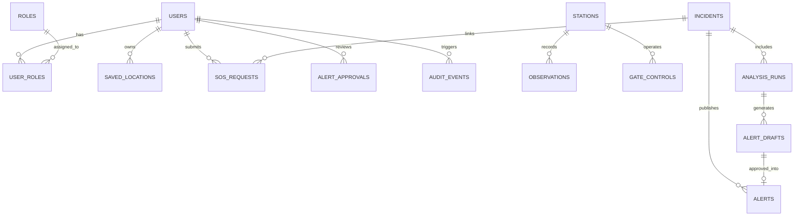

# SURAKSHA Relational Database Schema Specification

## 1. Schema Design Principles
The SURAKSHA database is engineered to third normal form (3NF) to guarantee transactional integrity, prevent redundant telemetry anomalies, and enforce strict referential boundaries across disaster workflows.

* **Primary Keys**: Integer auto-increment (`BIGINT UNSIGNED`) or UUID strings.
* **Timestamps**: All temporal columns use UTC `DATETIME(6)` or `TIMESTAMP` defaults (`CURRENT_TIMESTAMP`).
* **Indexes**: Explicit composite indexes on `(status, created_at)`, `(station_id, observed_at)`, and `(basin, severity)`.
* **Engine**: InnoDB with `utf8mb4` encoding and `utf8mb4_unicode_ci` collation.

---

## 2. Entity-Relationship Diagram

---

## 3. Detailed Table Specifications

### 1. `users`
Core user identity for citizens, researchers, operators, and incident commanders.
| Column | Type | Constraints | Description |
|---|---|---|---|
| `id` | BIGINT UNSIGNED | PK, AUTO_INCREMENT | Unique user identifier |
| `email` | VARCHAR(255) | UNIQUE, NOT NULL | Normalized email address |
| `password_hash`| VARCHAR(255) | NOT NULL | Bcrypt salted hash (12 rounds) |
| `full_name` | VARCHAR(150) | NOT NULL | Citizen or officer display name |
| `phone_number` | VARCHAR(30) | NULL | Emergency SMS dispatch number |
| `district` | VARCHAR(100) | NULL | Primary administrative jurisdiction |
| `is_active` | BOOLEAN | DEFAULT TRUE | Account state |
| `created_at` | DATETIME | DEFAULT CURRENT_TIMESTAMP | Registration timestamp |
| `updated_at` | DATETIME | DEFAULT CURRENT_TIMESTAMP ON UPDATE | Last update timestamp |

### 2. `roles` & `user_roles`
RBAC permission assignments.
* `roles` (`id`, `name`, `description`) — seeded with `admin`, `commander`, `operator`, `citizen`.
* `user_roles` (`user_id`, `role_id`, `assigned_at`) with composite PK `(user_id, role_id)`.

### 3. `saved_locations`
Citizen geofences for personalized warning calculation.
| Column | Type | Constraints | Description |
|---|---|---|---|
| `id` | BIGINT UNSIGNED | PK, AUTO_INCREMENT | Unique location identifier |
| `user_id` | BIGINT UNSIGNED | FK -> users(id) ON DELETE CASCADE | Associated citizen account |
| `label` | VARCHAR(100) | NOT NULL | E.g. "Home", "Farmland", "Mother's House" |
| `latitude` | DECIMAL(10, 7) | NOT NULL | WGS-84 Latitude coordinate |
| `longitude` | DECIMAL(10, 7) | NOT NULL | WGS-84 Longitude coordinate |
| `basin` | VARCHAR(100) | NOT NULL | River basin tag (e.g. "Ganga-Patna", "Kosi") |
| `alert_radius_km`| DECIMAL(5, 2)| DEFAULT 10.00 | Custom proximity alert threshold |
| `created_at` | DATETIME | DEFAULT CURRENT_TIMESTAMP | Creation timestamp |

### 4. `stations`
Telemetry gauge sensor locations across monitored river basins.
| Column | Type | Constraints | Description |
|---|---|---|---|
| `id` | VARCHAR(50) | PK | Canonical Station Code (e.g. "STN-PAT-01") |
| `name` | VARCHAR(150) | NOT NULL | Human-readable name (e.g. "Digha Ghat") |
| `river` | VARCHAR(100) | NOT NULL | River name (e.g. "Ganga", "Son", "Gandak") |
| `basin` | VARCHAR(100) | NOT NULL | Basin name (e.g. "Middle Ganga") |
| `latitude` | DECIMAL(10, 7) | NOT NULL | Sensor latitude coordinate |
| `longitude` | DECIMAL(10, 7) | NOT NULL | Sensor longitude coordinate |
| `warning_level_m`| DECIMAL(6, 2)| NOT NULL | Water level triggering initial Warning (m) |
| `danger_level_m` | DECIMAL(6, 2)| NOT NULL | Water level triggering Emergency Danger (m) |
| `hfl_m` | DECIMAL(6, 2)| NOT NULL | Historical Highest Flood Level recorded (m) |
| `status` | VARCHAR(30) | DEFAULT 'ACTIVE' | `ACTIVE`, `DEGRADED`, `OFFLINE` |
| `last_ping` | DATETIME | NULL | Timestamp of latest heartbeat |

### 5. `observations`
Time-series physical water stage and discharge readings.
| Column | Type | Constraints | Description |
|---|---|---|---|
| `id` | BIGINT UNSIGNED | PK, AUTO_INCREMENT | Observation identifier |
| `station_id` | VARCHAR(50) | FK -> stations(id) ON DELETE CASCADE | Originating telemetry station |
| `water_level_m`| DECIMAL(6, 2)| NOT NULL | Observed surface water level in meters |
| `discharge_m3s`| DECIMAL(10, 2)| NULL | Volumetric water flow in m³/s |
| `rainfall_mm` | DECIMAL(6, 2)| DEFAULT 0.00 | 1-hour accumulated precipitation in mm |
| `quality_flag` | VARCHAR(20) | DEFAULT 'VERIFIED' | `VERIFIED`, `SYNTHETIC`, `ANOMALOUS` |
| `observed_at` | DATETIME | NOT NULL | Telemetry recording timestamp |
| `created_at` | DATETIME | DEFAULT CURRENT_TIMESTAMP | Ingestion timestamp |

### 6. `gate_controls`
Barrage and sluice gate physical configurations and discharge actuation states.
| Column | Type | Constraints | Description |
|---|---|---|---|
| `id` | VARCHAR(50) | PK | Gate identifier (e.g. "GATE-VAL-04") |
| `station_id` | VARCHAR(50) | FK -> stations(id) | Associated barrage facility |
| `name` | VARCHAR(100) | NOT NULL | E.g. "Valmikinagar Barrage Bay 04" |
| `current_opening_pct`| INT | NOT NULL DEFAULT 40 | Aperture percentage (0 = closed, 100 = full) |
| `recommended_opening_pct`| INT | NULL | AI model recommended aperture |
| `discharge_rate_cusecs`| DECIMAL(10,2)| NOT NULL | Estimated discharge volume |
| `mode` | VARCHAR(20) | DEFAULT 'SUPERVISED'| `MANUAL`, `AUTOMATED`, `SUPERVISED` |
| `last_actuated_at`| DATETIME | DEFAULT CURRENT_TIMESTAMP | Timestamp of last motor actuation |

### 7. `incidents`
Master disaster response incidents and emergency management tracking.
| Column | Type | Constraints | Description |
|---|---|---|---|
| `id` | VARCHAR(50) | PK | Incident code (e.g. "INC-2026-FL-001") |
| `title` | VARCHAR(200) | NOT NULL | E.g. "Monsoon Crest Inundation Phase II" |
| `basin` | VARCHAR(100) | NOT NULL | Affected river basin |
| `phase` | VARCHAR(30) | NOT NULL | `WATCH`, `WARNING`, `EVACUATE`, `RECOVERY` |
| `severity` | VARCHAR(20) | NOT NULL | `LOW`, `MODERATE`, `HIGH`, `CRITICAL` |
| `incident_commander`| VARCHAR(150) | NULL | Lead officer in command |
| `created_at` | DATETIME | DEFAULT CURRENT_TIMESTAMP | Incident creation timestamp |
| `closed_at` | DATETIME | NULL | Incident closure timestamp |

### 8. `analysis_runs`
Hydrodynamic simulation models, AI predictions, and supervisory validation results.
| Column | Type | Constraints | Description |
|---|---|---|---|
| `id` | VARCHAR(50) | PK | Run code (e.g. "RUN-98214") |
| `incident_id` | VARCHAR(50) | FK -> incidents(id) NULL | Linked active incident |
| `scenario_name`| VARCHAR(150) | NOT NULL | Synthetic scenario or live boundary run |
| `model_type` | VARCHAR(50) | NOT NULL | E.g. "Saint-Venant 1D-2D Ensemble" |
| `pre_gate_pass`| BOOLEAN | NOT NULL DEFAULT TRUE | Mass balance pre-run check |
| `mid_gate_pass`| BOOLEAN | NOT NULL DEFAULT TRUE | Courant numerical stability check |
| `post_gate_pass`| BOOLEAN | NOT NULL DEFAULT TRUE | Embankment threshold validation |
| `jev_status` | VARCHAR(30) | NOT NULL | `OFFLINE_DETERMINISTIC`, `LIVE_SUPERVISED` |
| `peak_forecast_m`| DECIMAL(6, 2)| NOT NULL | Forecasted maximum water level |
| `executed_at` | DATETIME | DEFAULT CURRENT_TIMESTAMP | Execution timestamp |

### 9. `alert_drafts` & `alerts`
Common Alerting Protocol (CAP) compliant public warning documents.
* `alert_drafts` (`id`, `run_id`, `headline`, `description`, `severity`, `urgency`, `certainty`, `area_desc`, `recommended_actions`, `status`, `created_at`)
* `alerts` (`id`, `draft_id`, `cap_identifier`, `headline`, `description`, `severity`, `urgency`, `area_desc`, `approved_by_id`, `approved_at`, `expires_at`, `status`)

### 10. `sos_requests`
Citizen emergency rescue and medical assistance intake queue.
| Column | Type | Constraints | Description |
|---|---|---|---|
| `id` | VARCHAR(50) | PK | SOS identifier (e.g. "SOS-8472") |
| `user_id` | BIGINT UNSIGNED | FK -> users(id) NULL | Submitting citizen (if authenticated) |
| `citizen_name` | VARCHAR(150) | NOT NULL | Name of person requesting assistance |
| `phone_number` | VARCHAR(30) | NOT NULL | Contact callback phone |
| `emergency_type`| VARCHAR(50) | NOT NULL | `TRAPPED_WATER`, `MEDICAL`, `FOOD_WATER`, `EVACUATION` |
| `severity` | VARCHAR(20) | NOT NULL | `CRITICAL`, `URGENT`, `STANDARD` |
| `people_count` | INT | NOT NULL DEFAULT 1 | Count of stranded persons |
| `latitude` | DECIMAL(10, 7) | NOT NULL | GPS latitude |
| `longitude` | DECIMAL(10, 7) | NOT NULL | GPS longitude |
| `landmark_address`| TEXT | NOT NULL | Physical description (e.g. "Rooftop near temple") |
| `status` | VARCHAR(30) | DEFAULT 'PENDING' | `PENDING`, `DISPATCHED`, `RESCUED`, `RESOLVED` |
| `assigned_team`| VARCHAR(100) | NULL | E.g. "NDRF Boat Squad 04" |
| `notes` | TEXT | NULL | Triage & dispatch notes |
| `created_at` | DATETIME | DEFAULT CURRENT_TIMESTAMP | Submission timestamp |

### 11. `audit_events`
Cryptographically chained, immutable operational audit ledger.
| Column | Type | Constraints | Description |
|---|---|---|---|
| `id` | BIGINT UNSIGNED | PK, AUTO_INCREMENT | Audit sequence ID |
| `user_id` | BIGINT UNSIGNED | FK -> users(id) NULL | Actor performing the operation |
| `actor_email` | VARCHAR(255) | NOT NULL | Cached user email |
| `action_code` | VARCHAR(50) | NOT NULL | E.g. `GATE_OVERRIDE`, `ALERT_PUBLISH`, `SOS_TRIAGE` |
| `resource_id` | VARCHAR(100) | NOT NULL | Impacted entity ID |
| `ip_address` | VARCHAR(45) | NOT NULL | Client IP address |
| `details_json` | TEXT | NOT NULL | Structured JSON change diff |
| `created_at` | DATETIME | DEFAULT CURRENT_TIMESTAMP | Audit log timestamp |

