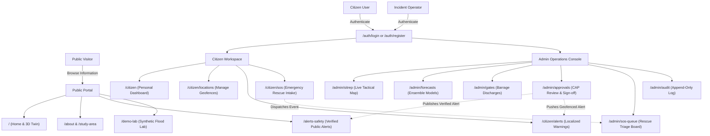

# SURAKSHA Design Analysis & System Blueprint

## 1. Application Overview
**SURAKSHA** (Suraksha AI-Assisted Hydrological Intelligence & Flood Decision Support Platform) is an enterprise-grade, public-interest, dual-workspace platform designed to bridge physical telemetry observations, numerical flood forecasting models, automated sluice gate controls, and supervisory human-verified response workflows.

The system serves three primary audiences:
1. **Public & Research Observers**: Access transparent hydrological methodology, study basin documentation, verified open telemetry catalog, and published CAP-compliant flood advisories without seeing synthetic demonstration data disguised as live observations.
2. **Citizen Users**: Maintain localized geographic profiles, monitor personalized flood risk tiers, receive early evacuation advisories, access offline-first emergency guidelines, and dispatch geotagged SOS rescue assistance requests.
3. **Emergency Operations Personnel & Incident Commanders**: Command a real-time Tactical Situation Report (SITREP), review AI model forecasts, execute gate discharge commands, triage the emergency SOS queue, review and approve CAP alerts, and audit every automated or manual decision in an append-only ledger.

---

## 2. Screen & View Inventory

### A. Public Information Surface
| Route | Screen Name | Key Purpose & Interactive Elements |
|---|---|---|
| `/` | **Landing Page** | Platform vision, 3D digital twin preview, high-level telemetry KPIs, river status map, core architectural pillars, and navigation hubs. |
| `/about` | **About & Project Scope** | Research origins, academic provenance, university/agency disclosures, non-official disclaimer, and institutional partners. |
| `/platform` | **Platform Architecture** | Interactive 4-layer topology (Observation Layer, Modeling Layer, Gate Automation, Supervisory Human Review). |
| `/how-it-works` | **Operational Workflow** | Step-by-step telemetry ingestion, ensemble ML/physics execution, pre/mid/post-run boundary checks, and public dispatch. |
| `/study-area` | **Basin Geography & GIS** | Ganga-Brahmaputra river basins, gauge stations, vulnerable embankments, digital elevation profiles, and flood history. |
| `/methodology` | **Scientific Methodology** | 1D/2D hydraulic equations, neural surrogate benchmarks, uncertainty bounds, and validation metrics. |
| `/research` | **Publications & Validation** | Peer-reviewed papers, ablation studies, synthetic scenario catalog, and verifiable benchmark datasets. |
| `/alerts-safety` | **Public Alerts & Safety** | Filterable feed of verified published CAP alerts, river advisory levels, and downloadable flood preparedness guides. |
| `/demo-lab` | **Interactive Flood Lab** | Real-time scenario simulator: pick synthetic storm hydrographs, trigger model runs, inspect gate recommendations, and review Jev supervisor validation. |
| `/contact` | **Contact & Inquiries** | Academic collaboration requests, researcher access keys, and technical feedback form. |

### B. Citizen Workspace (`/citizen`)
| Route | Screen Name | Key Purpose & Interactive Elements |
|---|---|---|
| `/citizen` | **Citizen Overview** | Personal safety dashboard, summary metric pills (Saved Locations, Active Alerts, SOS Status), localized risk map, and quick actions. |
| `/citizen/alerts` | **Localized Alerts** | Real-time push/in-app alert feed filtered by proximity to citizen's registered geographic pins. |
| `/citizen/locations` | **Saved Locations** | Multi-location management (Home, Workplace, Kin) with lat/long tagging, river basin association, and alert radius toggles. |
| `/citizen/safety` | **Evacuation & Safety Guide** | Step-by-step emergency checklists, flood zone maps, shelter directories, medical emergency hotlines, and offline survival steps. |
| `/citizen/sos` | **SOS Rescue Dispatch** | High-priority intake form: severity level (Trapped, Medical, Evacuation Needed), GPS/address capture, family member count, and live dispatch tracker. |
| `/citizen/profile` | **Account Profile & Consent** | Emergency contact numbers, SMS/push notification preferences, privacy consents, and account settings. |
| `/citizen/notifications` | **Notification History** | Chronological record of delivered warnings, drill notices, and SOS status updates. |

### C. Operations & Admin Console (`/admin`)
| Route | Screen Name | Key Purpose & Interactive Elements |
|---|---|---|
| `/admin` | **Operations Overview** | Real-time SITREP summary, system telemetry health, barrage status gauges, active emergency counts, and quick command buttons. |
| `/admin/sitrep` | **Tactical Situation Report** | Live GIS situation map, river stage meters, rainfall anomaly radar, composite risk index, and operational readiness banner. |
| `/admin/approvals` | **Human Review & Approvals** | Multi-gate approval inbox: inspect automated model outputs, evaluate boundary violations, approve/reject CAP alert drafts, and sign off. |
| `/admin/forecasts` | **Physical & AI Models** | Hydrodynamic simulation controls, ensemble variance envelopes, 12h/24h/48h flood crest predictions, and calibration curves. |
| `/admin/incidents` | **Incident Command** | Master incident lifecycle management, emergency phases (Watch, Warning, Evacuate, Recovery), incident logs, and team task assignments. |
| `/admin/stations` | **Telemetry Gauges** | Sensor network inventory: water level sensors, rain gauges, discharge sensors, battery health, freshness timestamps, and calibration offsets. |
| `/admin/gates` | **Barrage Gate Automation** | Sluice gate control console: manual/automated discharge override, reservoir inflow/outflow balance, and safety interlocks. |
| `/admin/sos-queue` | **Emergency SOS Queue** | Citizen rescue triage board: severity sorting, map clustering, responder team assignment, status progression, and rescue resolution notes. |
| `/admin/audit` | **Immutable Audit Trail** | Cryptographically verifiable log of all manual overrides, gate operations, alert publications, and user authentication events. |
| `/admin/settings` | **System Configuration** | API keys, Jev supervisor endpoints, model threshold bounds, CAP alert distribution channels, and role permissions. |

### D. Authentication Surface (`/auth`)
| Route | Screen Name | Key Purpose & Interactive Elements |
|---|---|---|
| `/auth/login` | **Secure Sign In** | Multi-role authentication (Citizen, Operator, Incident Commander, Admin) with email/password and session cookie issuance. |
| `/auth/register` | **Citizen Registration** | Self-service citizen sign up with phone/email verification and district onboarding. |

---

## 3. User Journeys & Navigation Architecture

---

## 4. UI Component Inventory

1. **Brand & Navigation**:
   * `BrandLogo`: Vector river wave geometry with high-contrast badge.
   * `PublicNavbar`: Sticky glassmorphic navbar with active indicator and responsive drawer.
   * `CitizenNav` & `AdminSidebar`: Collapsible, role-scoped sidebar with badge counters and health indicators.
   * `PublicFooter`: Semantic sitemap, research attribution, disclaimer badge, and system status indicator.
2. **Telemetry & Scientific Displays**:
   * `TacticalMapSvg`: Vector geographic representation of river basins, gauge clusters, and flood inundation polygons.
   * `DigitalTwinScene`: Three.js WebGL river mesh visualization with dynamic water elevation shaders.
   * `MetricCard`: High-contrast numeric pill showing value, units, delta, and semantic caution/critical thresholds.
   * `ProvenanceBadge`: Visual badge explicitly distinguishing between `Verified Observation`, `Catalog Metadata`, and `Synthetic Scenario`.
3. **Operations & Control Primitives**:
   * `GateControlSlider`: Industrial slider with safety lock and confirmation dialog for barrage discharge modification.
   * `ApprovalWorkflowCard`: Structured card showing automated model recommendations, boundary checks, and sign-off buttons.
   * `SOSTriageRow`: Interactive queue row with severity pill (Critical Red, Urgent Amber, Standard), GPS pin, and responder assignment dropdown.
4. **Forms & Data Entry**:
   * `SOSIntakeForm`: Progressive multi-step emergency form with geolocation auto-fill and accessible high-contrast tap targets.
   * `LocationGeofenceForm`: Dynamic coordinate input with river basin selector and radius slider.

---

## 5. Design System Tokens & Visual Language

### A. Color Palette
| Token Name | Hex Value | Semantic Usage |
|---|---|---|
| `canvas` | `#070B0D` | Deep graphite background for maximum dark-mode contrast |
| `surface` | `rgba(15, 23, 27, 0.78)` | Card, modal, and drawer panels with 20px backdrop blur |
| `surface-raised` | `rgba(26, 40, 48, 0.90)` | Hover states, active tabs, and nested callout cards |
| `border-default` | `rgba(46, 73, 82, 0.45)` | Hairline container borders (1px) |
| `border-accent` | `rgba(94, 234, 212, 0.22)`| Highlighted card edges and focus rings |
| `river-teal` | `#5EEAD4` | Primary brand accent, water telemetry values, links |
| `river-teal-dark` | `#14B8A6` | Button gradient endpoints and active toggle states |
| `river-cyan` | `#38BDF8` | Auxiliary telemetry metrics, radar overlays, rainfall |
| `caution-amber` | `#FBBF24` | Stale feeds, synthetic scenario labels, pending approvals |
| `critical-red` | `#F87171` | Exceeded flood crest, emergency SOS, danger alerts |
| `confirmed-green` | `#34D399` | Supervised approval, verified sensor packet, system nominal |

### B. Typography
* **Primary Interface Font**: `Plus Jakarta Sans` / `Inter`, system sans-serif fallback. Clean geometric edges, high legibility under emergency pressure.
* **Technical & Telemetry Font**: `JetBrains Mono` / `ui-monospace`. Exclusively applied to Sensor IDs, timestamps, UTM coordinates, water levels, and JSON payloads.
* **Hierarchy Scale**:
  * Display 1: `text-4xl sm:text-5xl lg:text-[58px]` font-black, leading `1.08`, tracking `-0.02em`
  * Heading 1: `text-2xl sm:text-3xl` font-bold, leading `1.2`
  * Heading 2: `text-xl sm:text-2xl` font-semibold
  * Body: `text-sm sm:text-base` leading `1.6`, color `#9bb2af`
  * Caption / Eyebrow: `text-[10px] sm:text-xs font-mono font-semibold tracking-widest uppercase`

### C. Spacing, Borders & Radius
* **Border Radius**: `rounded-xl` (12px) for inner metric pills; `rounded-2xl` (20px) for standard panels; `rounded-3xl` (28px) for hero containers; `rounded-full` (9999px) for status badges and pill buttons.
* **Box Shadows**: Atmospheric glow `0 20px 60px -15px rgba(0, 0, 0, 0.65), 0 0 1px 1px rgba(94, 234, 212, 0.12)`.
* **Touch Targets**: Minimum `44px × 44px` for all interactive elements on mobile devices.

---

## 6. Technical Implementation Plan
1. **Architecture Blueprint**: Define backend models, API contracts, and MySQL relational schemas.
2. **Backend Engine**: Deploy Python FastAPI service containing REST routes, JWT authentication, simulation engines, and CRUD handlers.
3. **Database Layer**: Generate MySQL relational schema (`database/schema.sql`) and complete seed dataset (`database/seeds.sql`).
4. **Frontend Integration**: Bind Next.js client pages to backend endpoints via authenticated API proxies.
5. **Testing & Verification**: Validate end-to-end user journeys (SOS submission -> Operator Triage -> Resolution; Model Run -> CAP Draft -> Approval -> Public Alert).

